# Bulk Ordering — Functional Guide

**System:** CW store on nopCommerce **5.00**, with the CW Core plugin
**For:** managers, store administrators, Sales Support and clients. You do not need any technical knowledge to read it.

> **About the examples.** Every screen in this guide is a real screenshot from the CW test store, taken while the
> scenarios in §8 were run: real products, real quantities typed into the grid, real carts and a real checkout. The
> products are the nopCommerce sample catalogue (running shoes, T-shirts, a cap, sunglasses, computers); the people
> (*Steve Gates*, a manager, and *Liam Walker*, one of his employees) are test data. Prices are shown exactly as the
> test store shows them.
>
> Bulk ordering works together with packnames (who a garment is for) and subsidies (what a person's employer pays).
> Those parts have their own guides: *PackNames — Functional Guide* and *Subsidies — Functional Guide*. Things that
> work differently from what you might expect are collected in §10.

---

## Contents

1. [The short version](#1-the-short-version)
2. [Key ideas in plain language](#2-key-ideas-in-plain-language)
3. [The whole picture at a glance (diagrams)](#3-the-whole-picture-at-a-glance)
4. [nopCommerce and CW: who does what](#4-nopcommerce-and-cw-who-does-what)
5. [The administrator's journey, screen by screen](#5-the-administrators-journey-screen-by-screen)
6. [The customer's journey, screen by screen](#6-the-customers-journey-screen-by-screen)
7. [Ordering for other people: packnames and subsidies](#7-ordering-for-other-people-packnames-and-subsidies)
8. [Worked scenarios from the test store](#8-worked-scenarios-from-the-test-store)
9. [Configuration](#9-configuration)
10. [Things to know, and open points](#10-things-to-know-and-open-points)
11. [Quick reference](#11-quick-reference)

---

## 1. The short version

**Bulk ordering** is one page where a customer can order many products, in many sizes and colours, without opening
each product one by one.

- Every product is shown as a **card** with its picture, price and a **grid** of quantity boxes: for a shoe, the sizes
  across the top and the colours down the side. The customer types a number in every box they want — "2 × Red 8,
  2 × Blue 9, 1 × Silver 10" — and presses **Add to cart** once.
- **Add everything on this page** adds what was typed on every card of the page in one go.
- Whatever can be added is added. Whatever cannot (not enough stock, a subsidy limit, a missing required product…)
  **stays in its box with the reason written on the card**, so the customer can fix just that line.
- The page can be filtered (**All products**, **Recently ordered**, **Best sellers**), narrowed by **category**,
  sorted, paged, and shown as **tiles** or as a **list**.
- The same grid can also replace the normal size and colour pickers **on a product's own page**.
- A manager ordering for an employee picks the person in **Order for**, as everywhere else in the shop: the page then
  shows only what that person may order, and every line goes to that person's part of the cart. The subsidy pays at
  checkout, as usual.

An **administrator** switches bulk ordering on per store, chooses which customer roles may use it, and decides how
the grids are laid out (which attribute becomes the columns, which the rows).

The central rule:

> **The bulk page is a faster way to fill the cart, not a different way to buy.** Every line goes through the same
> checks as a line added from a product page — stock, minimum quantities, required products, subsidy limits — and
> ends in the same cart and the same checkout.

---

## 2. Key ideas in plain language

### 2.1 The bulk ordering page

The page lives at **/bulkordering** and is reached from the **Bulk ordering** link at the top of every page of the
shop (§6.1). On the left is the category list; across the top are the controls; the rest of the page is the product
cards, 15 to a page by default.

### 2.2 The product card and its grid

Each card shows one product: picture, name, SKU, price, how many of it are **already in the cart** ("5 in cart"),
and its **grid**.

The grid is built from the product's **attributes** — Size, Colour, Fit… — and only from the combinations the
product really sells:

| The product has | The grid looks like |
|---|---|
| No attributes | One quantity box |
| One attribute (Size) | One row, one box per size |
| Two attributes (Size, Colour) | The classic grid: sizes across, colours down |
| Three to five attributes | Sizes across; two to four label columns down the side (for example RAM, HDD, OS) |
| More than five attributes, or a very large grid | The extra attributes move **above** the grid (§2.3) |

A wide grid scrolls sideways inside its card while the row labels stay in place; it never wraps, so a box is always
under its size and beside its colour.

### 2.3 Options above the grid

Some attributes cannot be laid out as columns or rows:

- **Tick boxes** — "Software: Microsoft Office, Acrobat Reader, Total Commander" — because a cell holds one value and
  a tick list holds several;
- attributes left over when a product has **more than five** that could go on the grid, or when its grid would be
  **too big** (more than the store's maximum number of cells, 400 by default);
- attributes that the product's sold combinations never mention.

These are shown **above the grid** as ordinary controls, chosen **once for the whole card**, and they apply to every
line added from that card. Changing one redraws that card only — prices included (ticking Microsoft Office on *Build
your own computer* adds $50 to every box). An option that depends on another one shows "Choose … first" until the
other one is chosen; an option that applies only to part of the grid says "Applies to … only".

### 2.4 What a box shows

Under each quantity box the grid can show:

- the **price** of that combination — only when the combinations do not all cost the same, and only when the store
  shows prices per cell. Otherwise the card shows one price, or a price range;
- its **availability**, in the shop's own words: "In stock", "Out of stock", "Available in 2-4 days",
  "Backordering".

Some places in the grid take no quantity:

- **Out of stock** with no backorders: no box, only the availability ("Out of stock", "Available in 2-4 days").
  A card where no box can take a quantity has no *Add to cart* button either.
- **A dash (–)**: a combination the product does not sell ("Not sold in this combination" when pointed at). Dashes
  appear only on products set in nopCommerce to sell their listed combinations only; otherwise every combination of
  the values can be ordered, as on the product page.
- **Choose above**: a required option above the grid has been emptied; choose it again to enter quantities.

An attribute that is **optional** gets an extra **None** column or row, for ordering the product without it — the
same as leaving it on "---" on the product page.

### 2.5 Adding to the cart

- **Add to cart** on a card adds that card's lines.
- **Add everything on this page** adds every typed line on the page, in one go, across all cards.
- What can be added is added; the box is emptied and the card's "n in cart" goes up. What cannot be added **keeps its
  quantity**, and the card names the box and the reason. A short message says how many units went in: "3 added to
  your cart. The rest are marked with the reason."
- The page does not reload and does not jump to the cart, so the customer carries on where they were.
- Obvious mistakes are caught while typing: a quantity above the stock of that combination ("Size 8, Color Red — Your
  quantity exceeds stock on hand. The maximum quantity that can be added is 2."), or a quantity that is not a whole
  number.

### 2.6 Who can use it

Two things decide it, and both must be true:

1. **Bulk ordering is switched on for the store** (*Enable Bulk Ordering*, §9).
2. The customer's role holds the permission **"Public store. CW Plugin. Access bulk ordering."** — by default
   *Registered* customers and *Administrators*.

Without both, the **Bulk ordering** link is not shown and the page refuses to open.

### 2.7 Packnames and subsidies

When a manager is ordering for someone (**Order for**, in the strip under the header), the bulk page behaves exactly
like the rest of the shop for that person:

- it shows **only what that person may order** — when their subsidy shows only allocated products, the page shows
  only those, and when their ordering period is closed it shows nothing;
- every line goes into **that person's** part of the cart, and "n in cart" counts that person's lines;
- the subsidy's **quantity limit** applies when the line is added ("There are 0 left");
- the **subsidy pays at checkout**, as for any other line. The bulk page itself does not show what the subsidy will
  cover.

---

## 3. The whole picture at a glance

**Colour key:**
🟦 blue = the customer (manager or employee) · ⬜ grey = standard nopCommerce · 🟩 green = CW additions (automatic) ·
🟧 orange = administrator · 🟨 yellow = a decision · 🟥 red = refused / stops · 🟪 purple = finished.

### 3.1 Getting to the page

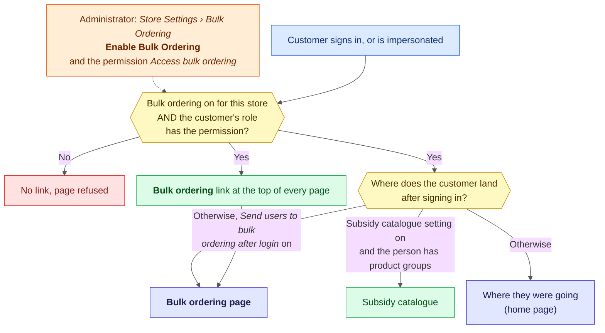

### 3.2 How a product card is laid out

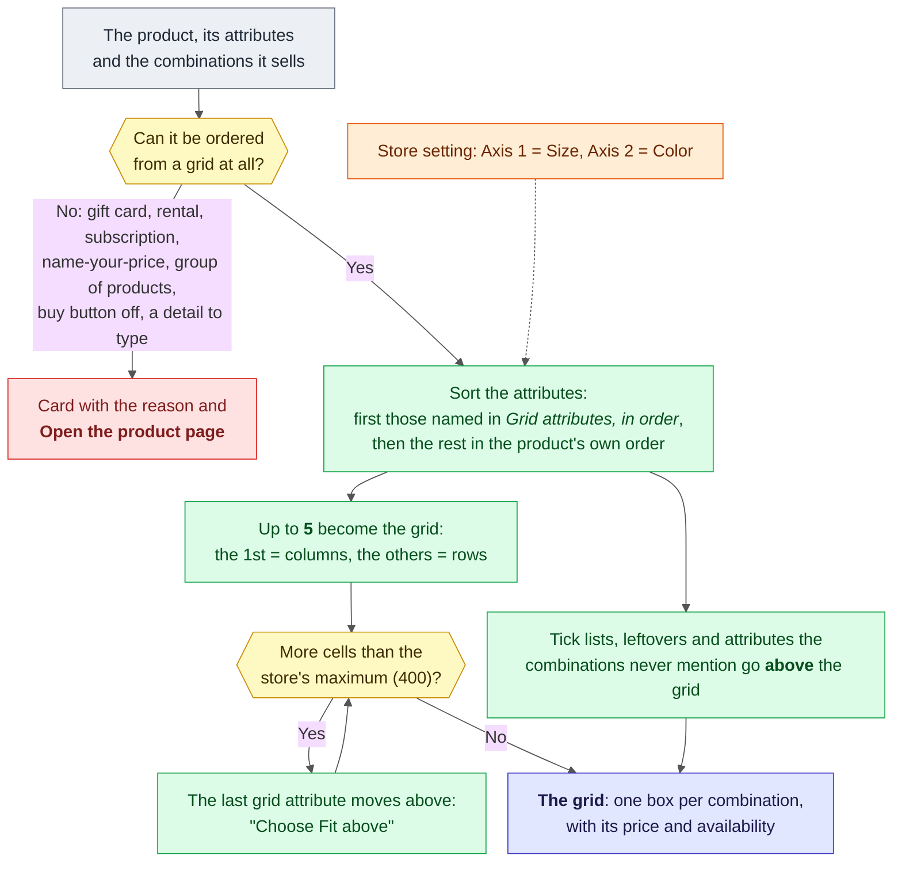

### 3.3 From typed quantities to the cart

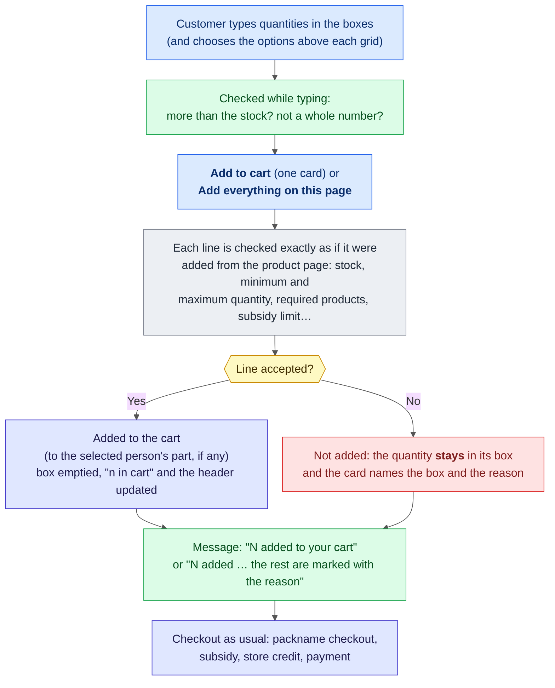

### 3.4 The grid on a product's own page

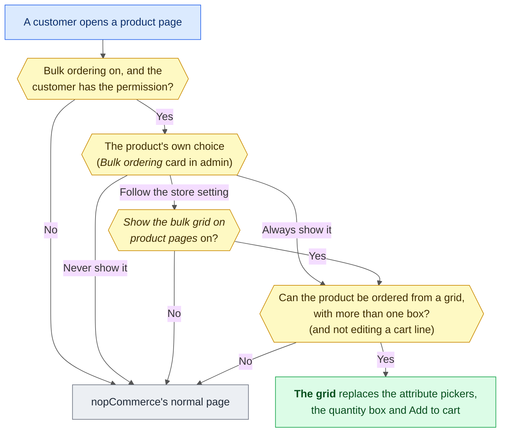

---

## 4. nopCommerce and CW: who does what

nopCommerce sells one product at a time: the customer opens a product, picks a size and a colour, types a quantity
and adds it; for another size they pick again. **The bulk ordering page, its grids and the grid on the product page
are CW.** Everything behind them — the products, attributes, combinations, prices, stock, the cart and the checkout
— is nopCommerce's own, unchanged.

### 4.1 Where they agree (CW uses nopCommerce as it is)

| Feature | nopCommerce | CW |
|---|---|---|
| **Products, attributes, combinations** | *Catalog › Products*, *Product attributes* | The grid is built from them; nothing to set up twice |
| **Prices** | Price, attribute price adjustments, combination prices, discounts | The same price as the product page would show for that combination |
| **Stock and availability** | Per product or per combination, with nop's own wording | Shown under each box in the same words, and enforced the same way |
| **Who sees which product** | Store mapping and customer-role access | The bulk page shows exactly what the rest of the shop shows |
| **Checks when adding** | Stock, minimum / maximum quantity, required products, recurring, gift cards… | Every bulk line goes through the same checks |
| **Cart and checkout** | Standard | The same cart; lines from the bulk page are ordinary cart lines |

### 4.2 Where CW adds to nopCommerce

| | nopCommerce alone | With CW (Bulk Ordering switched on) |
|---|---|---|
| **Ordering many variants** | One size and colour at a time | A grid of every combination, one quantity box each |
| **Ordering many products** | One product page at a time | A page of product cards, and **Add everything on this page** |
| **Finding products** | Catalogue pages, search | Filters (All products / Recently ordered / Best sellers), the order picker, categories, sorting |
| **When a line cannot be added** | The page shows the warning; nothing else is added | The other lines are added; the failed one keeps its quantity and its reason |
| **Product page** | Attribute pickers and one quantity box | Optionally the same grid, per store and per product |
| **Admin** | — | A *Bulk Ordering* section in the store settings, a permission, and a *Bulk ordering* card on each product |

### 4.3 Where they differ

| | nopCommerce | CW bulk page |
|---|---|---|
| **After adding** | Optionally opens the cart (*Display cart after adding product*) | Always stays on the page, so the rest of the page can still be ordered |
| **Category** | Each category is its own page | The category is a filter on the same page: sort, page size and view are kept |
| **Quantity prices (tier prices)** | Shown as a table on the product page | Not shown on the card; the cart applies them (§10) |
| **Wishlist** | Button on the product page | Not offered from the grid (also hidden on a product page that shows the grid) |
| **Details to type** (a name to print, a date, a file) | Typed on the product page | Not possible from the grid: the card sends the customer to the product page |

---

## 5. The administrator's journey, screen by screen

### 5.1 Switching it on

Bulk ordering is switched on per store in *CW Admin › MultiStores › Manage Store › Store Settings*, section **Bulk
Ordering**, with **Enable Bulk Ordering**. The default for all stores is in *CW Admin › Default Settings*. A new store
starts with bulk ordering **off**.

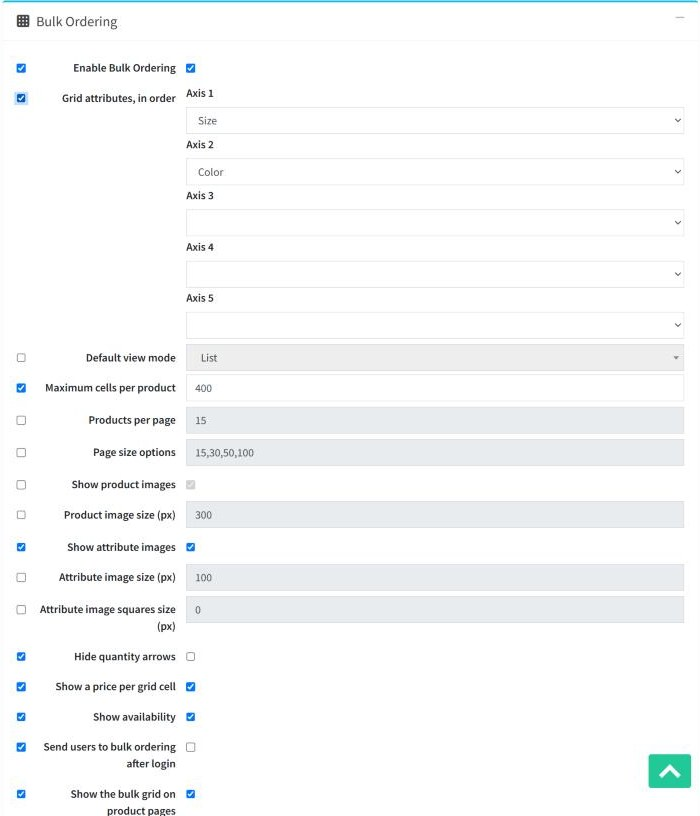

*The test store: bulk ordering on, Size as the first grid attribute and Color as the second. A ticked box on the left
gives the store its own value; an unticked one uses the default for all stores.*

### 5.2 Who may use it

The permission is in *Configuration › Access control list*, category **Public Store**: **"Public store. CW Plugin.
Access bulk ordering."** It is given to *Registered* customers and *Administrators* when the plugin is installed.
Remove a role to keep its customers off the bulk page while the rest of the shop works normally.

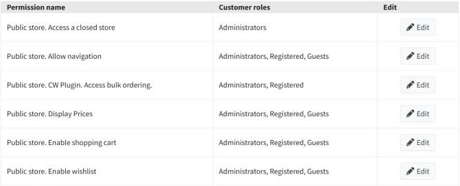

### 5.3 How the grids are laid out

**Grid attributes, in order** (*Axis 1* to *Axis 5*) is a **preference list**:

- the first attribute in the list that a product has becomes its **columns**, the next its **rows**, and so on;
- an attribute the product does not have is simply skipped;
- an attribute that is not in the list can still take a free place, after the listed ones.

With *Axis 1 = Size, Axis 2 = Color*, the running shoes show sizes across and colours down; a cap with only a Size
attribute shows one row of sizes; a computer whose attributes are not in the list shows them in the product's own
order (Processor across; RAM, HDD and OS down). Put first the attributes customers mix in one order — sizes and
colours — because anything moved above the grid is chosen **once per card**.

**Maximum cells per product** (400) stops a product with many attributes from drawing an enormous grid: when the grid
would be bigger, its last attribute moves above it.

The other settings — view, page size, pictures, prices, availability, landing after sign-in, the grid on product
pages — are listed in §9.

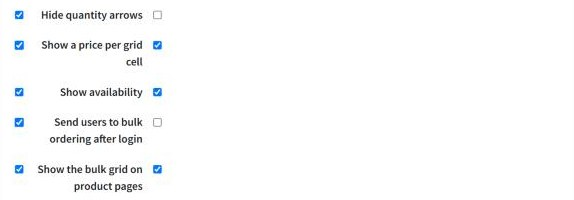

### 5.4 One product's choice for its own page

Every product's edit page has a **Bulk ordering** card (shown when bulk ordering is on for at least one store):

- **Follow the store setting** (it says what the store does today: *shown* / *not shown*);
- **Always show it** — the grid on this product's page even if the store does not show it elsewhere;
- **Never show it** — this product keeps nopCommerce's normal page.

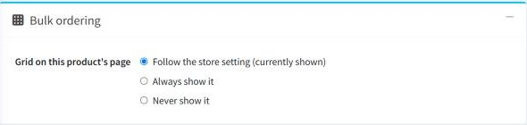

Products the grid cannot express — groups of products, gift cards, rentals, or those needing a detail to type — keep
the normal page whatever this card says.

---

## 6. The customer's journey, screen by screen

### 6.1 The link

A customer who may use bulk ordering sees **Bulk ordering** at the top of every page, beside *My account*.

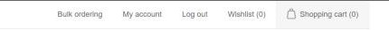

When the store sets **Send users to bulk ordering after login**, the customer lands on the bulk page straight after
signing in, and when an administrator starts impersonating them — unless the store sends people to the subsidy
catalogue first (§3.1). Picking a person in *Order for* never opens the bulk page. Someone who signed in on the way to a particular
page (a product, the cart) still goes there.

### 6.2 The page and its controls

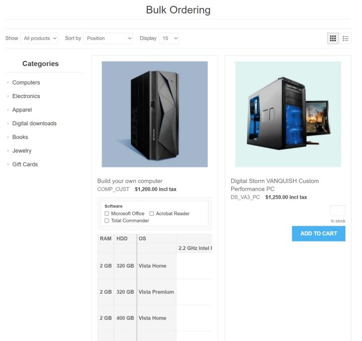

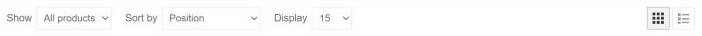

| Control | What it does |
|---|---|
| **Show** | **All products** · **Recently ordered** (offered once the customer has placed an order) · **Best sellers** (most sold in the store first) |
| **From order** | Appears with *Recently ordered*: *Any recent order* lists what the customer ordered **in the last three months**; choosing one of their last 50 orders lists exactly that order's products |
| **Sort by** | Position, name, SKU, price (both ways), newest first |
| **Display** | 15, 30, 50 or 100 products per page (set by the store) |
| **Tiles / List** | Two cards side by side, or one wide card per row with the picture on the left, level with the middle of the card |
| **Categories** | Narrows the page to a category and everything under it; only categories holding something the customer can order are listed |

Cancelled orders count for nothing: they are not "recently ordered", not offered in *From order*, and do not make a
product a best seller. The address bar keeps the choices, so a refresh or a bookmark shows the same page.

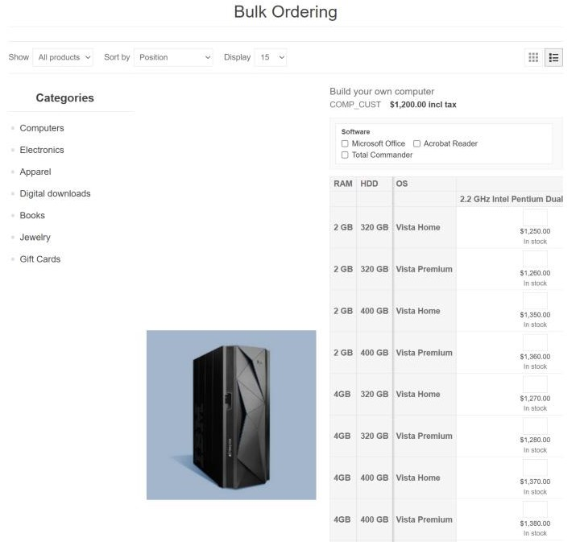

At the bottom of the page are **Add everything on this page** and the page numbers.

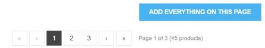

### 6.3 The cards

**A product with two attributes** — the classic grid, sizes across, colours down:

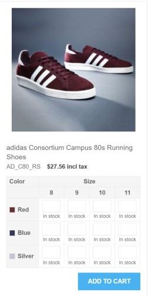

**One attribute** — one row:

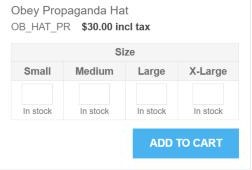

**No attributes** — one box:

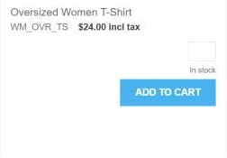

**Pictures as attributes** — when the store shows attribute images, a print or fabric attribute shows its picture
beside its name:

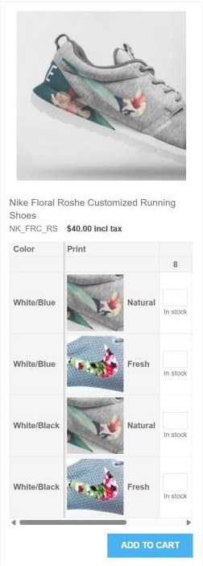

**Out of stock** — no box and no *Add to cart*, only the availability ("Available in 2-4 days"):

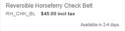

A note such as "The minimum quantity allowed for purchase is 2." appears on the card when the product has one.

### 6.4 Options above the grid

*Build your own computer* has five attributes. **Software** is a tick list, so it sits above the grid; **Processor**
is across, **RAM**, **HDD** and **OS** down. Ticking *Microsoft Office* redrew the card and added $50 to every box
($1,250.00 became $1,300.00).

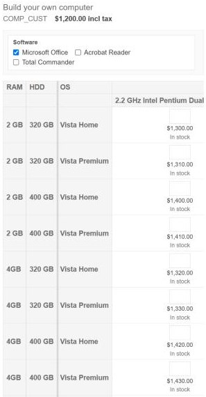

Options chosen above a grid stay while the product is on the screen — through a sort, a page-size or a category
change — and are reset when the customer moves to another page of products ("Options you chose on the previous page
are not kept when you change page.").

### 6.5 Adding one card

Type quantities and press the card's **Add to cart**. A quantity above the stock of its combination is flagged at
once:

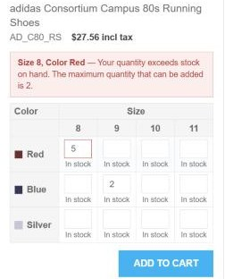

The customer pressed *Add to cart* anyway, with 5 × Red 8, 2 × Blue 9 and 1 × Silver 10. Blue 9 and Silver 10 went
in ("3 in cart"); Red 8 stayed in its box with its reason:

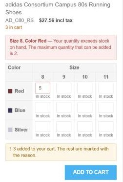

Changing Red 8 to 2 and pressing *Add to cart* again added it:

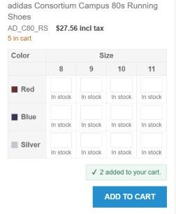

Typed quantities that have not been added stay in their boxes while the customer filters, sorts or pages, as long as
their product is still on the screen. When a product leaves the screen, the page says how many typed quantities were
dropped. Leaving the page with quantities still typed makes the browser ask "Leave site?".

### 6.6 Adding everything on the page

**Add everything on this page** sends every typed line of every card at once. On the Apparel page the customer typed
3 × Oversized T-Shirt, 2 × Medium and 2 × Large caps and 4 × sunglasses:

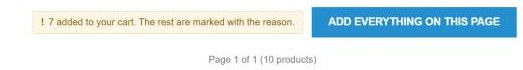

The T-shirts and the sunglasses went in. The cap was refused, with nopCommerce's own reason — the cap is set up to
**require** another product:

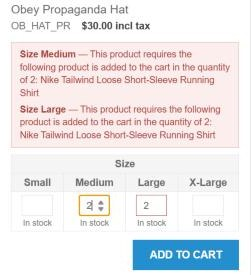

The cart then holds ordinary lines, one per combination:

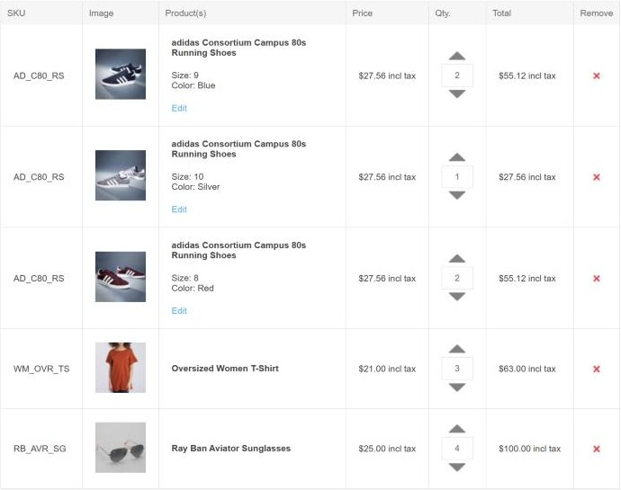

Note the T-shirt: **$24.00** on the card, **$21.00** in the cart. The product has quantity prices (3 or more: $21),
which the cart applies and the card does not show (§10).

### 6.7 Products ordered from their own page

Some products need something a grid of quantity boxes cannot ask for. Their card says why and links to the product
page, which has the right form:

| Product | The card says |
|---|---|
| Gift card | "Gift cards need a recipient and a message, so they are ordered from the product page." |
| Rental | "Rentals need start and end dates…" |
| Name your price (donation) | "This product needs you to name your price…" |
| Subscription (recurring) | "Subscriptions are ordered on their own, from the product page." |
| Group of products | "This is a group of products; each one is ordered from its own page." |
| Buy button switched off | "This product cannot be purchased online." |
| A required detail to type (a text, a date, a file) | "“Enter your text:” needs details we cannot take on this screen…" |

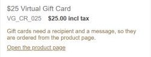

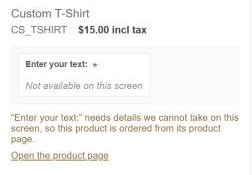

When the detail to type is needed only for some combinations (for example a print text only for the "printed"
variant), only those boxes say **Product page only**; the rest of the grid can be ordered.

### 6.8 The grid on a product's own page

With **Show the bulk grid on product pages** on (or *Always show it* on the product), the product page shows the grid
in place of the attribute pickers, the quantity box and *Add to cart*. Everything else on the page — pictures,
description, delivery estimate, reviews — stays.

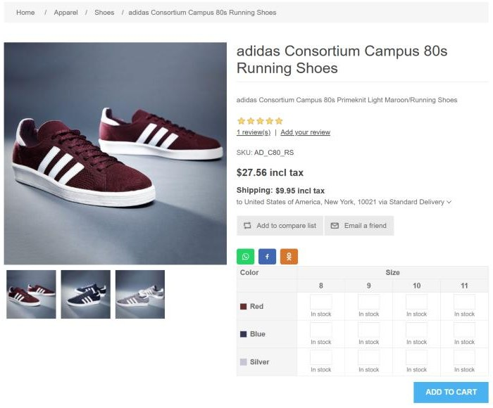

The page keeps nopCommerce's normal controls for products the grid cannot express, for products with only one box,
and when the customer opens the page to **edit a line of their cart**.

### 6.9 On a phone

The card stacks the picture beside the name, and the grid scrolls sideways with the colour column fixed:

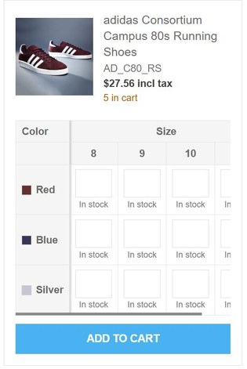

---

## 7. Ordering for other people: packnames and subsidies

In a store with packnames, a manager picks the person in **Order for** before ordering, as everywhere else in the
shop. The bulk page follows that choice.

**What the person may see.** Liam Walker's subsidies show only allocated products, so with Liam selected the bulk page
listed his 10 products and only the categories that hold them (*Computers*, *Apparel*):

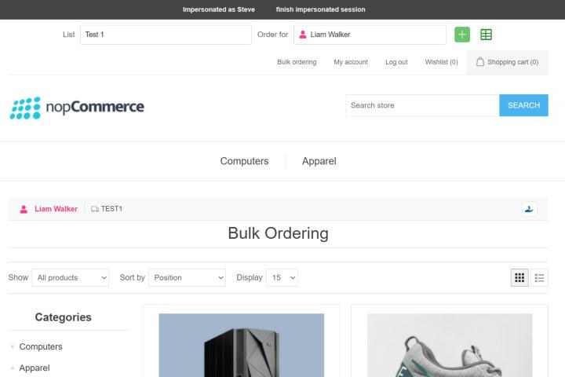

A person whose ordering period is closed sees an empty page, as in the rest of the shop.

**Where the lines go.** Every line added goes to the selected person's part of the cart; "n in cart" on each card
counts that person's lines. To order for someone else, pick them in *Order for* and carry on.

**Subsidy limits.** Liam's *Safety Kit* subsidy gives two pairs of safety glasses, with the quantity limit on, and he
has used both. The bulk page refused a third pair with the subsidy's own message, and added his two running shirts:

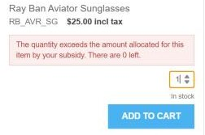

**Paying.** The bulk page does not show what the subsidy will pay. That is worked out at checkout, exactly as for
lines added anywhere else: Liam's two shirts and their delivery were paid in full by his subsidy.

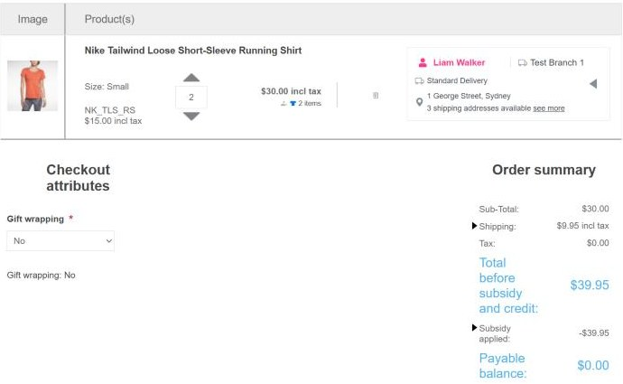

**Recently ordered.** *Recently ordered* and *From order* list the orders of the **signed-in customer** — for a
manager, the orders they placed for everyone. With order 4014 chosen, the page listed the four products of that
order, but only those Liam may order:

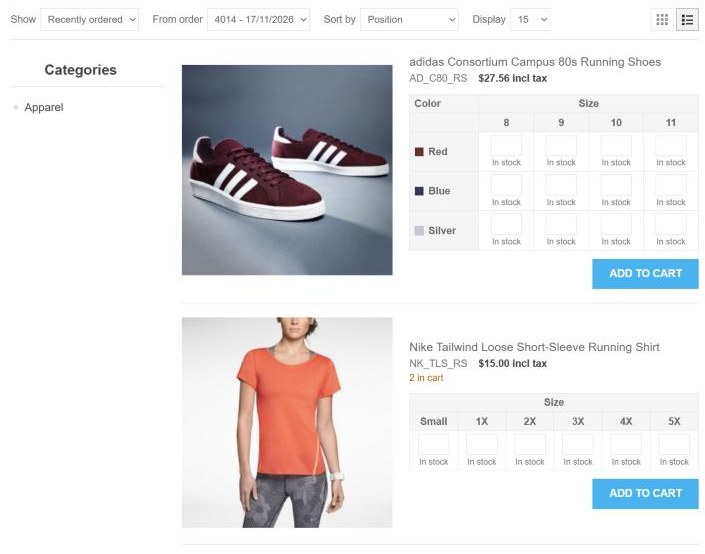

---

## 8. Worked scenarios from the test store

The test data: the nopCommerce sample catalogue. *adidas Consortium Campus 80s* has Size (8–11) and Color (Red, Blue,
Silver) with stock per combination — Red 8 has 2. *Oversized Women T-Shirt* costs $24.00, $21.00 from 3. *Obey
Propaganda Hat* requires two *Nike Tailwind* running shirts in the cart. *Build your own computer* has Processor,
RAM, HDD, OS and a Software tick list. The store's grid attributes are Size, then Color.

| # | Situation | What happened |
|---|---|---|
| A | **One card, one line short of stock** | John Smith typed 5 × Red 8, 2 × Blue 9, 1 × Silver 10. Red 8 was flagged while typing ("maximum … is 2"). *Add to cart*: "3 added to your cart. The rest are marked with the reason." — Red 8 kept its 5. Changed to 2 and added: "2 added", **5 in cart** |
| B | **Everything on the page** | On *Apparel*: 3 T-shirts, 2 Medium + 2 Large caps, 4 sunglasses. "7 added to your cart. The rest are marked with the reason." Both cap sizes refused: "This product requires the following product is added to the cart in the quantity of 2: Nike Tailwind Loose Short-Sleeve Running Shirt" |
| C | **Quantity prices** | The 3 T-shirts showed $24.00 on the card and $21.00 each in the cart ($63.00) |
| D | **An option above the grid** | *Build your own computer*: ticking *Microsoft Office* added $50 to every box (2 GB / 320 GB / Vista Home: $1,250.00 → $1,300.00) |
| E | **Products ordered from their own page** | Gift cards, the rental necklace, the donations, the subscription, the camera group and *Custom T-Shirt* (a text to type) each showed their reason and *Open the product page* |
| F | **A manager ordering for an employee** | Steve Gates, ordering for Liam Walker: 10 products, 2 categories. 2 × *Nike Tailwind* Small added to Liam; 1 × sunglasses refused, "The quantity exceeds the amount allocated for this item by your subsidy. There are 0 left." At checkout: $30.00 + $9.95 delivery, subsidy applied $39.95, **payable $0.00** |
| G | **Re-ordering a past order** | *Recently ordered*, *From order* 4014: the four products of that order (shoes, running shirt, T-shirt, jeans) |
| H | **The grid on the product page** | *adidas Campus 80s*'s own page showed the Size × Color grid and one *Add to cart*, in place of the pickers |

---

## 9. Configuration

### 9.1 Where

- **Per store:** *CW Admin › MultiStores › Manage Store › Store Settings*, section **Bulk Ordering**. Tick the box on
  the left of a row to give the store its own value; unticked rows use the default.
- **Defaults for all stores:** *CW Admin › Default Settings*.
- **Who may use it:** *Configuration › Access control list › Public Store › Access bulk ordering*.
- **One product's page:** the product's **Bulk ordering** card (§5.4).

### 9.2 The settings

| Setting | What it does | Test store |
|---|---|---|
| **Enable Bulk Ordering** | Switches the bulk page, its link and the product-page grid on for the store. Customers also need the permission | On |
| **Grid attributes, in order** (Axis 1–5) | The preference order for laying attributes out: Axis 1 becomes the columns, the others the rows (§5.3) | Size, Color |
| **Default view mode** | Tiles (*Grid*) or *List*, when the customer has not chosen | List |
| **Maximum cells per product** | Above this, a grid's last attribute moves above it | 400 |
| **Products per page** | The page size the customer starts with | 15 |
| **Page size options** | The choices in *Display* | 15, 30, 50, 100 |
| **Show product images** / **Product image size (px)** | The picture on each card | On / 300 |
| **Show attribute images** / **Attribute image size (px)** | Pictures beside attribute values that have one (prints, fabrics) | On / 100 |
| **Attribute image squares size (px)** | Size of colour and image squares; 0 uses the store's own size | 0 |
| **Hide quantity arrows** | Hides the small up/down arrows in the boxes (computers only; phones do not show them) | Off |
| **Show a price per grid cell** | A price under each box, when the combinations do not all cost the same. Off: the card shows a price range instead | On |
| **Show availability** | "In stock", "Out of stock"… under each box. A box that cannot be ordered always says why | On |
| **Send users to bulk ordering after login** | Land on the bulk page after signing in and after being impersonated. The subsidy catalogue's own setting is asked first (§3.1) | Off |
| **Show the bulk grid on product pages** | The grid replaces the pickers on product pages; each product can override it (§5.4) | On |

Prices, stock, availability wording, quantity rules and required products are set on the products themselves, in
nopCommerce, as for any other page of the shop.

---

## 10. Things to know, and open points

**How it works today**

1. **Commit what passes.** On *Add to cart* and *Add everything on this page*, every line that passes is added and
   every line that fails is shown with its reason. It is never all-or-nothing.
2. **The same checks as the product page.** Stock, minimum and maximum quantities, required products and subsidy
   quantity limits are checked line by line, in nopCommerce's own words.
3. **One option per card.** Anything above the grid is chosen once and applies to every line of that card. To order
   two different fits of one shirt in one go, the fit must be one of the store's grid attributes.
4. **Options are kept only while the product is on the screen.** Paging away resets them; typed quantities that leave
   the screen are dropped, and the page says so.
5. **Quantity prices are not shown on the card.** The cart applies them: 3 T-shirts at $24.00 on the card cost
   $21.00 each in the cart.
6. **"The maximum quantity that can be added is N"** counts the stock, not what is already in the cart. With 2 in the
   cart and 3 in stock, typing 2 more is refused with "maximum … is 3". This is nopCommerce's wording everywhere in
   the shop.
7. **Required products are not added automatically** unless the product is set to add them. The line is refused and
   names the product to add first.
8. **Details to type** (a print name, a date, a file) cannot be entered on the bulk page. Those products — or those
   combinations — are ordered from their product page.
9. **Recently ordered** means the last three months of the **signed-in customer's** orders. *From order* lists their
   last 50 orders, whatever their age. For a manager both include the orders placed for everyone, filtered to what
   the selected person may order.
10. **The subsidy is not shown on the bulk page.** It pays at checkout as for any other line; only its quantity limit
    is checked when a line is added.
11. **The page does not open the cart** after adding, even when the store's *Display cart after adding product* is on.
12. **A language added after installation** shows the bulk page's texts as codes until the plugin's texts are
    installed for it.

**Open points**

13. **No "n in cart" on the product page.** The bulk page's cards show how many of a product are in the cart; the
    product-page grid does not.
14. **Old prices, pre-order wording and per-person print names** are not shown or captured on the bulk page.

---

## 11. Quick reference

**Administrator**

- Switch it on: *Store Settings › Bulk Ordering › Enable Bulk Ordering*, and give the role *Access bulk ordering*.
- Choose the grid: *Grid attributes, in order* — sizes first, colours second, works for most uniforms.
- Product pages: the store's *Show the bulk grid on product pages*, or each product's *Bulk ordering* card.

**Customer and manager**

- **Bulk ordering** at the top of the page. Filter, pick a category, type quantities, press **Add to cart** — or
  **Add everything on this page**.
- A quantity that stays in its box was not added: the card says why.
- Ordering for someone? Pick them in **Order for** first: the page shows what they may order, and the lines are theirs.
- Pay at checkout as usual; the subsidy is applied there.
