# Returns, Exchanges and Store Credit — Functional Guide

**System:** CW store on nopCommerce **5.00**, with the CW Core plugin
**For:** managers, store administrators, Sales Support and clients. You do not need any technical knowledge to read it.

> **About the examples.** Every screen in this guide is a real screenshot from the CW test store, taken while the
> scenarios in §9 were run from start to finish: real orders, real returns, real approvals. The people
> (*Steve Gates*, *James Pan*) and the products are test data. Amounts are in US dollars because that is how the test
> store is set up; live stores use their own currency.
>
> §4 explains what nopCommerce does by itself, what CW adds on top, and where the two differ. Things that work
> differently from what you might expect are collected in §11.

---

## Contents

1. [The short version](#1-the-short-version)
2. [Key ideas in plain language](#2-key-ideas-in-plain-language)
3. [The whole process at a glance (activity diagram)](#3-the-whole-process-at-a-glance)
4. [nopCommerce and CW: who does what](#4-nopcommerce-and-cw-who-does-what)
5. [The customer's journey, screen by screen](#5-the-customers-journey-screen-by-screen)
6. [The Sales Support journey, screen by screen](#6-the-sales-support-journey-screen-by-screen)
7. [E-mails the customer and the store receive](#7-e-mails)
8. [What happens to the money](#8-what-happens-to-the-money)
9. [Worked scenarios from the test store](#9-worked-scenarios-from-the-test-store)
10. [Configuration](#10-configuration)
11. [Things to know, and open points](#11-things-to-know-and-open-points)
12. [Quick reference](#12-quick-reference)

---

## 1. The short version

The store sells uniforms and workwear to businesses. Three things work together:

- **Subsidy** — what a company gives each employee to spend on uniform. It can be **units** ("two shirts a
  year") or **money** ("$300 a year"), and it can be limited to certain groups of products.
- **Store credit (credit notes)** — money the store owes a customer. Usually created when something is returned;
  it can also be issued by hand by an administrator.
- **Returns and exchanges** — sending something back, either for **store credit** or to **swap it** for something else.

The central rule, decided by the business:

> **When something is returned, the customer gets back exactly what they spent on it, in the same form.**
> A unit comes back as a unit, subsidy money goes back to the same subsidy pot, and only the money the customer
> paid themselves comes back as store credit. Delivery that was paid by subsidy is not given back.

Every returned item is **decided on its own** by Sales Support — one garment can be accepted while another in the
same parcel is rejected. When an item is approved, the system does the rest automatically: gives the subsidy back,
raises any store credit, and either **places the replacement order straight away** (when nothing is owed) or puts
the replacement in the customer's **cart** for them to pay the balance or the fees.

---

## 2. Key ideas in plain language

### 2.1 Subsidy

A subsidy is what a company allows each of its staff (each *packname*) to spend:

- **A period** — for example a calendar year, optionally repeating every year.
- **Units** — "3 polo shirts". Counted in garments; the price does not matter.
- **Money** — "$250". Counted in dollars.
- **Product groups** — units and money can be limited to a group of products ("2 items from Footwear & Hats",
  "$100 towards Outerwear").
- **Global money** — money not tied to any group. It can pay for anything, and it is the only part of a subsidy
  that can pay for delivery (when the store allows subsidy to pay delivery).
- **Top-ups** — extra units or money added during the period by an administrator or by a manager. Top-ups always
  add to what is there.

Subsidy is always used in this fixed order — units before money, group allocations before the global pot:

1. Product-group units, then their top-ups
2. Product-group money, then its top-ups
3. Global money, then its top-ups

### 2.2 Store credit (credit notes)

A credit note is an amount of store credit belonging to one customer. It shows what it was issued for, its amount
and what is left. Store credit is used **oldest note first**.

Credit notes are created:

- **automatically**, when a return is approved and money the customer paid has to come back, and
- **by hand**, by an administrator with the right permission, against one of the customer's orders.

An administrator can delete a credit note issued by mistake, as long as **none of it has been spent**. Once a note
has paid for an order it cannot be deleted: it is part of the record of how that order was paid.

### 2.3 Returns and exchanges

A **return request** is raised for each item the customer sends back. For each item the customer asks for one of:

- **Credit** — send it back and receive store credit.
- **Exchange** — send it back and receive something else:
  - **Same style** — the same product in another size or colour (*the most common case by far*);
  - **Different style** — a different product;
  - **Exact** — the identical item again (usually a fault or transit damage).

The **reason** the customer gives ("Wrong product ordered", "Problem with the product"…) decides which
**actions** they may ask for ("Replacement", "Store credit"…), and the reason and action together decide whether
credit and/or exchange are allowed and whether fees apply (§10).

### 2.4 Fees

Two standard fees, set per store (or once for all stores):

- **Repackaging fee** — handling and repackaging the returned garment. In the test store: **$3.00 per garment**.
- **Redelivery fee** — shipping the replacement out. In the test store: **$5.00 per 4 garments**.

Sales Support can also add a **one-off fee** with a description ("Name embroidery removal $2.00").

**Fees are always paid by the customer.** Neither subsidy nor store credit is ever used to pay a fee:

- On an **exchange**, the fees are part of what the customer pays at checkout.
- On a return **for credit**, the fees are taken off the credit note before it is issued. When the item was paid
  by subsidy there is no credit note, so no fee is collected; when the fees are larger than the note, the note
  goes down to zero and the rest is not collected. The approval screen warns staff, who set the fee quantities
  to zero if the fees should not stand.

Each returned item carries its own fee. When several items come back in one parcel, Sales Support set the
*Re-Shipped Quantity* to zero on all lines but one so the parcel is charged one redelivery fee. This manual step is
deliberate: the same box is how staff waive or adjust a fee after speaking to the customer.

---

## 3. The whole process at a glance

The diagrams below show the complete activity flow — what the customer does, what nopCommerce does by itself,
what the CW additions do, and what Sales Support does, in four phases.

**Colour key:**
🟦 blue = the customer · ⬜ grey = standard nopCommerce · 🟩 green = CW additions (automatic) ·
🟧 orange = Sales Support · 🟨 yellow = a decision · 🟥 red = the flow stops / nothing is given back ·
🟪 purple = finished.

### Phase 1a — can the item be returned online, and which form opens?

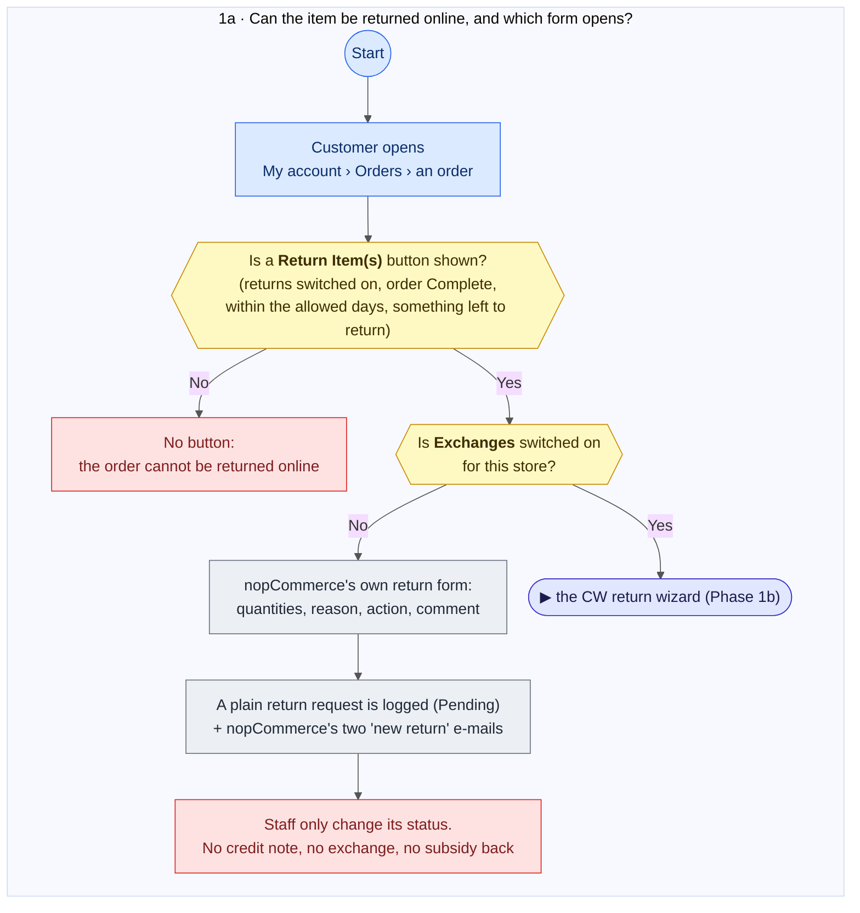

### Phase 1b — the CW return wizard

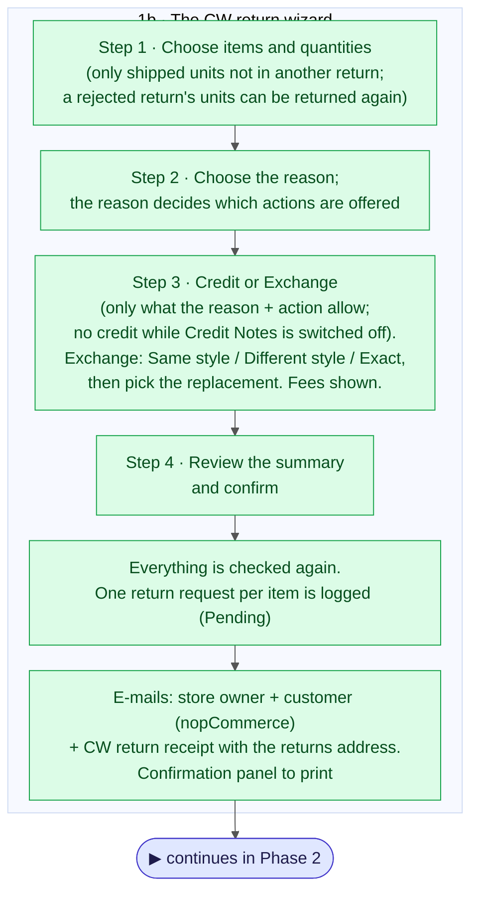

### Phase 2 — Sales Support decides each item

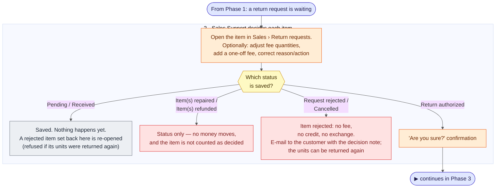

### Phase 3 — what the approval does (automatic)

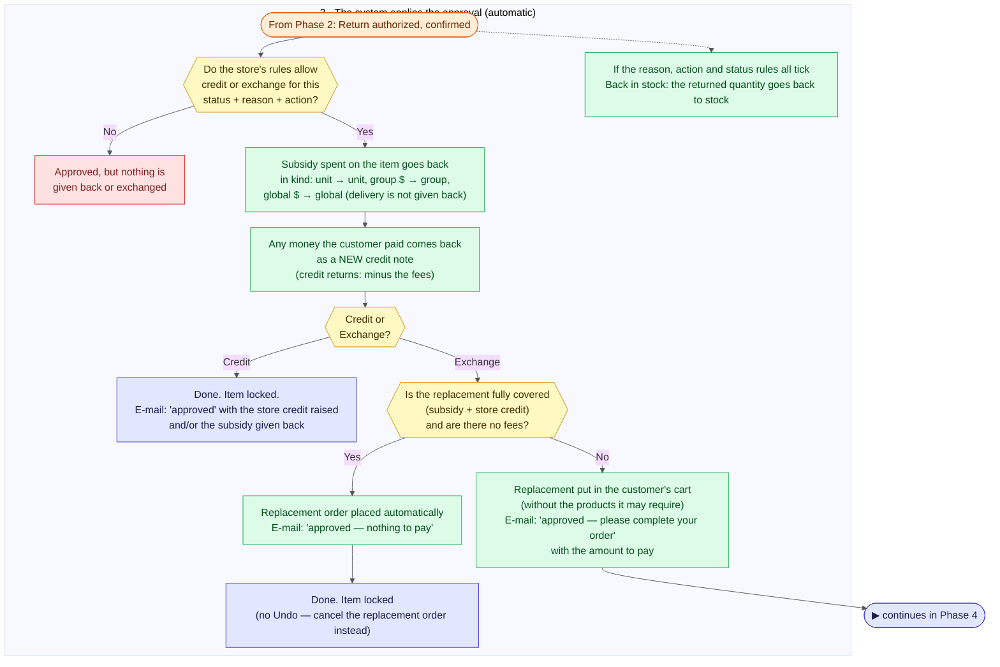

### Phase 4 — the customer completes a pending exchange

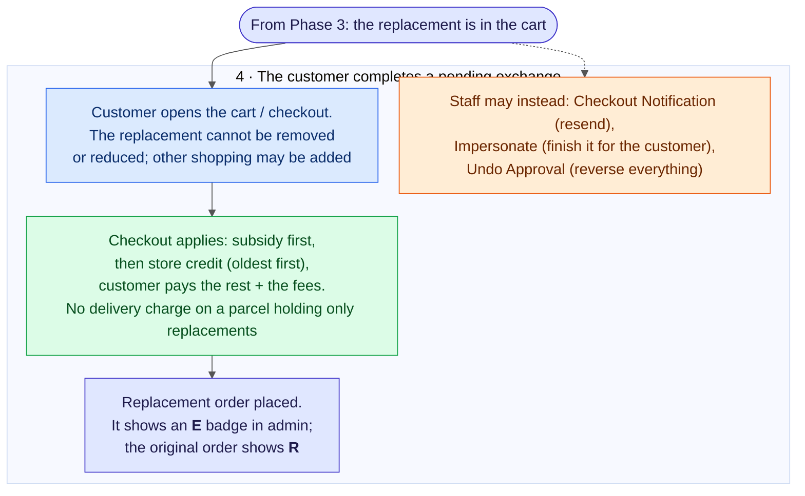

### How the money is settled at checkout (every order, including replacements)

```mermaid
%%{init: {"theme":"base","themeVariables":{"fontFamily":"Segoe UI, Arial","fontSize":"15px"},"flowchart":{"curve":"basis"}}}%%
flowchart LR
  classDef sub fill:#dcfce7,stroke:#16a34a,color:#064e1d
  classDef cn fill:#dbeafe,stroke:#2563eb,color:#0b2e6b
  classDef pay fill:#ffedd5,stroke:#ea580c,color:#6b2600
  classDef fee fill:#fee2e2,stroke:#dc2626,color:#7f1d1d
  A["Goods + delivery<br/>at full price"] --> S1["① Product-group units<br/>(base, then top-ups)"]:::sub
  S1 --> S2["② Product-group money<br/>(base, then top-ups)"]:::sub
  S2 --> S3["③ Global subsidy money<br/>(base, then top-ups)<br/>— the only one that can pay delivery"]:::sub
  S3 --> C["④ Store credit<br/>(credit notes, oldest first)"]:::cn
  C --> P["⑤ Customer pays<br/>what is left"]:::pay
  P --> F["⑥ Exchange fees added on top —<br/>always paid by the customer,<br/>never by subsidy or store credit"]:::fee
```

---

## 4. nopCommerce and CW: who does what

nopCommerce has its own, simple return system: a customer asks to return items, a request is logged with a
status, and the store changes that status by hand. **nopCommerce on its own never gives money or goods back** — a
"Return authorized" or "Item(s) refunded" status in plain nopCommerce is only a label. Everything financial —
store credit, subsidy coming back, exchanges, fees, replacement orders — is CW.

CW builds on top of nopCommerce rather than replacing it: every CW return is still a nopCommerce return request
(same number, same list, same statuses, same reasons and actions, same e-mails), with CW's information attached.

### 4.1 Where they agree (CW uses nopCommerce as it is)

| Feature | nopCommerce | CW |
|---|---|---|
| **Switching returns on** — *Configuration › Settings › Order settings › Enable Returns System* | Shows the **Return Item(s)** button on eligible orders | Same switch; CW does not add its own |
| **Which orders can be returned** — "only for completed orders" and "number of days available" | Hides the button for orders that are not Complete, or older than the set number of days (test store: completed only, 365 days) | Same rules |
| **Return request numbers** — number mask | `{ID}` by default | Same numbers everywhere (customer pages, e-mails, admin) |
| **Statuses** — Pending, Received, Return authorized, Item(s) repaired, Item(s) refunded, Request rejected, Cancelled | Labels set by staff | Same list; CW gives three of them a meaning (§6.4) |
| **Reasons and actions** — *Order settings › Return request reasons / actions* | The lists the customer chooses from | Same lists; CW adds per-store rules on top (§10.3) |
| **The returns list in admin** — *Sales › Return requests* | Search by date, number, status | Unchanged |
| **"New return request" e-mails** to the store owner and the customer | Sent on every new request | Sent too, plus CW's own return receipt (§7) |
| **"Notify customer about status change"** button | Sends nopCommerce's generic status e-mail | Unchanged. CW e-mails the customer by itself when an item is rejected or approved for credit, so pressing the button as well sends a second e-mail (§7) |
| **Quantity returned to stock** on the admin return page | Puts that many units back into stock | Unchanged, and CW fills it in automatically when the store's rules say the goods go *back in stock* (§10.3) |
| **Customer file upload** (setting *Allow customers to upload files*) | Offered on the return form | Also offered in the CW wizard (switched off in the test store) |

### 4.2 Where CW adds to nopCommerce

| | nopCommerce alone | With CW (Exchanges switched on) |
|---|---|---|
| **The customer's return form** | One page: quantities, reason, action, comment | A four-step wizard: items → reason → credit or exchange (with the replacement picked) → summary and confirm (§5) |
| **What can be returned** | Units ordered and not already requested — shipped or not. A **rejected** request keeps its units | Only units that have **shipped** and are not already requested. The units of a **rejected** or cancelled request can be returned again (this also applies to nopCommerce's own form) |
| **Reasons and actions** | Any reason with any action | Only the reasons the store has switched on; the reason decides which actions are offered |
| **Credit or exchange** | Not a concept | Chosen per item, within what the reason and action allow. Credit is offered only while store credit is switched on |
| **Fees** | None | Repackaging, redelivery and one-off fees, shown to the customer before they confirm |
| **Approval** | A label | Gives subsidy back, raises store credit, places or prepares the replacement, sends the right e-mail (§6.5) |
| **Per-item decision with a note** | Not tracked | Each item accepted or rejected with a *Decision note*, which the customer sees on their returns page and in the rejection e-mail; staff see all items that came back together |
| **Delivery on a replacement** | — | A parcel that holds only replacements has **no delivery charge**: the redelivery fee is the delivery charge |
| **Store credit** | Does not exist | Credit notes, a *My Store Credit* page, used automatically at checkout, manual notes, liability reports |
| **Order markers** | None | **E** (order holds an exchange replacement) and **R** (an item of the order was returned and authorised — or later marked repaired or refunded) badges in the order lists |
| **Receipt to print** | None | Printable return note and confirmation panel |

### 4.3 nopCommerce's withdrawal features, and how CW treats them

nopCommerce has several return features meant for the EU "right of withdrawal". This is how each one behaves with
CW:

| nopCommerce feature | What it does in nopCommerce | With CW |
|---|---|---|
| **Allow guests to create return requests** (withdrawal form) | A guest enters an order number and e-mail address and receives a link (valid for *Withdrawal link. Days valid*, 7 in the test store) to nopCommerce's return form | Works, but it is **nopCommerce's plain form**: no exchange, no credit, no fees, and approving it gives nothing back. CW only makes sure the guest cannot return more units than have shipped. **Switched off** in the test store |
| **Locales for EU Withdrawal** | Renames the button and messages to "withdrawal" wording | The wizard's page title follows it too |
| **Return reasons enabled / Return actions enabled** | Lets a store hide the reason or action box | **Ignored by the CW wizard** — it always asks for both, because they decide fees and options. They still apply to nopCommerce's plain form |
| **Allow return requests for downloadable products** | Off by default | Same |

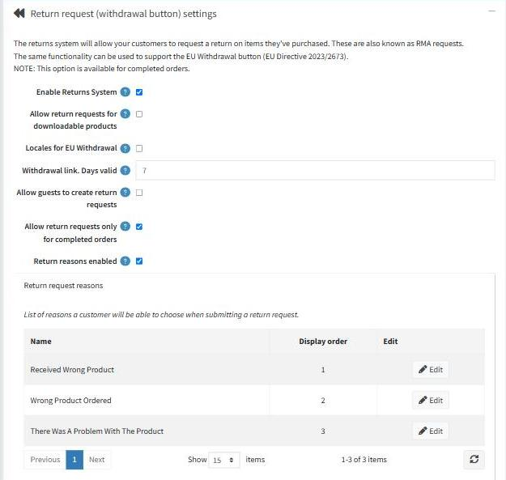

*nopCommerce's own return settings. CW uses "Enable Returns System", "only for completed orders", the number of
days and the reasons/actions lists. "Allow guests…" (the withdrawal form) is off.*

### 4.4 Where they differ

| | nopCommerce | CW behaviour |
|---|---|---|
| Customer with an account, Exchanges **on** | nopCommerce's form | Always the CW wizard; nopCommerce's form is not reachable for them |
| Customer with an account, Exchanges **off** | nopCommerce's form | nopCommerce's form (plain return, no money back), still limited to shipped units — see §5.10 |
| *Item(s) refunded* / *Item(s) repaired* | Labels | Still only labels: **no** refund, credit or subsidy is given back. Use *Return authorized* (§6.4) |
| *Return authorized* | Label | Triggers the whole approval (§6.5) and locks the item |
| *Request rejected* / *Cancelled* | Labels; the units stay counted as "returned" | Mark the item as rejected: no fee, no credit, no exchange. The customer is e-mailed with the decision note, and the units can be returned again |
| Refunds | nopCommerce's order refund (payment gateway) is a separate action on the order | CW does not refund to card; money comes back as store credit |

---

## 5. The customer's journey, screen by screen

The screens below are from the test store, signed in as **Steve Gates**, an employee with a uniform subsidy
(units for the *Footwear & Hats* group plus global money). His order **#2013** contained 2 running shirts, a hat
and a pair of shoes, all paid by his subsidy.

### 5.1 Starting a return

On *My account › Orders*, the order page shows **Return Item(s)** when the order can be returned (returns are
switched on, the order is *Complete*, it is within the allowed number of days, and something is left to return).

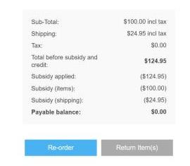

*The bottom of order #2013: the order was fully paid by subsidy (Payable balance $0.00). The* Return Item(s)
*button starts the wizard.*

### 5.2 Steps 1 and 2 — which items, and why

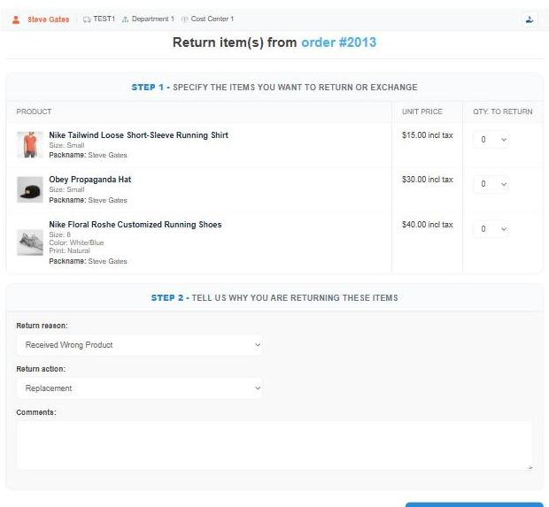

- **Step 1** lists every item of the order with a picture in the colour bought and the **packname** it was for. The
  quantity box only goes up to what can still be returned: units that have **shipped** and are not already in
  another return request. An item that has been fully requested disappears from the list.
- **Step 2** asks for the **reason**. Only the reasons the store has switched on are listed, and choosing a reason
  refreshes the **action** list with the actions linked to it (a reason with no linked actions offers every active
  action). A comment is optional. If the store has no reason
  switched on, the page says *"Returns can't be requested online at the moment. Please contact us about returning
  items from this order."* instead of showing the form.

### 5.3 Step 3 — credit or exchange

The buttons offered depend on the reason and action chosen. With the action **Replacement** the customer sees
**Request exchange**; with **Store Credit** they see **Request credit note**; when both are allowed, both buttons
appear. While the store has **store credit switched off**, *Request credit note* is not offered; if that leaves
nothing for the chosen reason and action, the page says so and asks the customer to choose another combination.

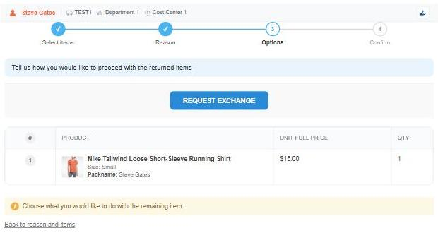

For an exchange, each returned item needs an **exchange type** and a **replacement product**:

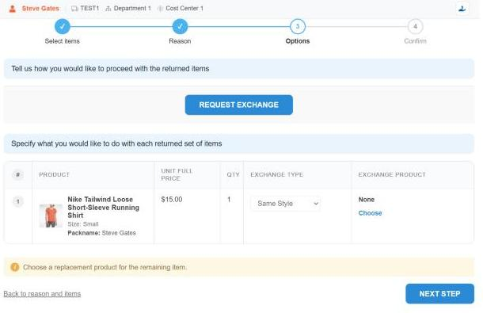

**Same style** opens the same product with its options already set to what was bought, so the customer only
changes what they mean to (here the size):

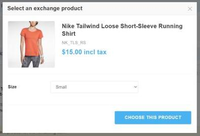

**Different style** opens a searchable, paged list of the products the customer is allowed to order. If their
subsidy only allows certain products, only those are offered.

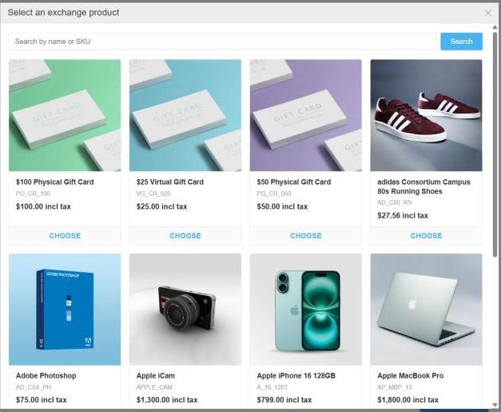

A replacement must have **every option chosen** before it can be picked:

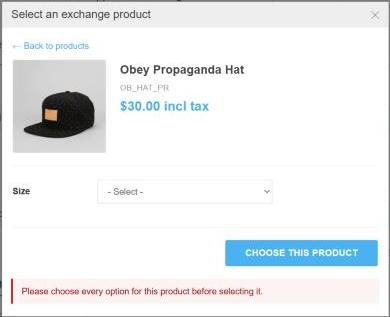

Products that need details the wizard cannot take (text to print, a date, a file, a rental period, gift-card
recipient details) are still listed; choosing one tells the customer which details cannot be taken online and to
pick something else or contact Sales Support.

**Fees are shown before the customer commits.** When the reason and action carry fees, step 3 lists them:

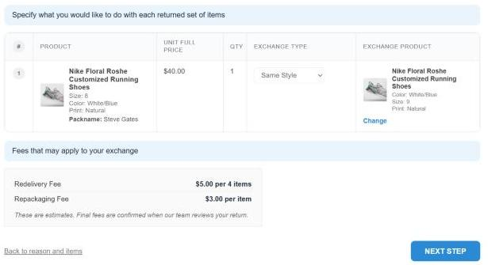

For a **credit** return the items to be credited are listed (the fee estimate appears on the summary in step 4):

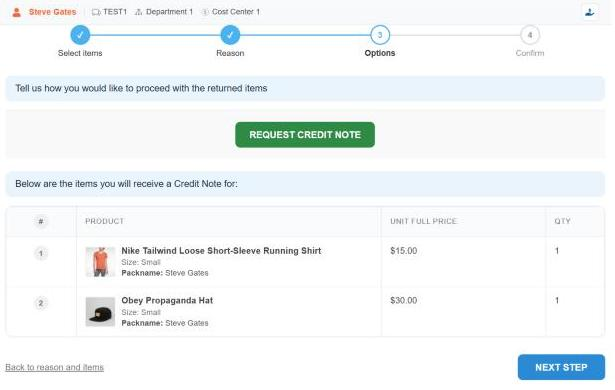

### 5.4 Step 4 — review and confirm

The summary repeats the order, reason, action, comment and items, and estimates what the customer may have to
pay or receive. Three examples from the test run:

**An exchange with no fees** — Small shirt for a 2X shirt, nothing to pay:

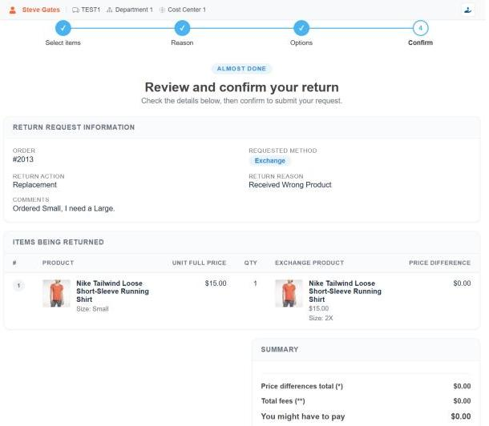

**An exchange with fees** — size 9 shoes for size 10, $8.00 of fees:

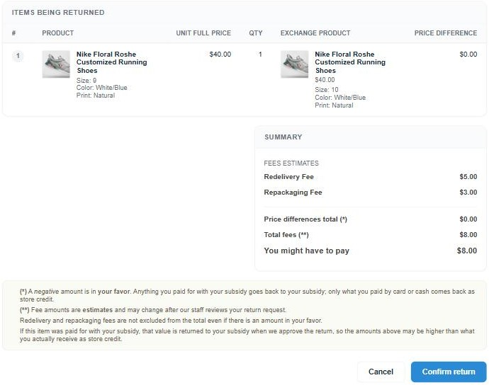

**An exchange for something dearer** — James Pan swaps a $15 shirt for a $30 hat, so $15 more may be due:

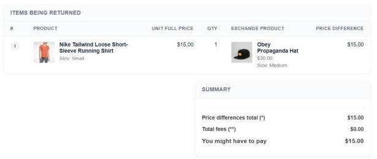

**A return for credit with fees** — a $40 pair of shoes, $8 of fees, at most $32 of store credit:

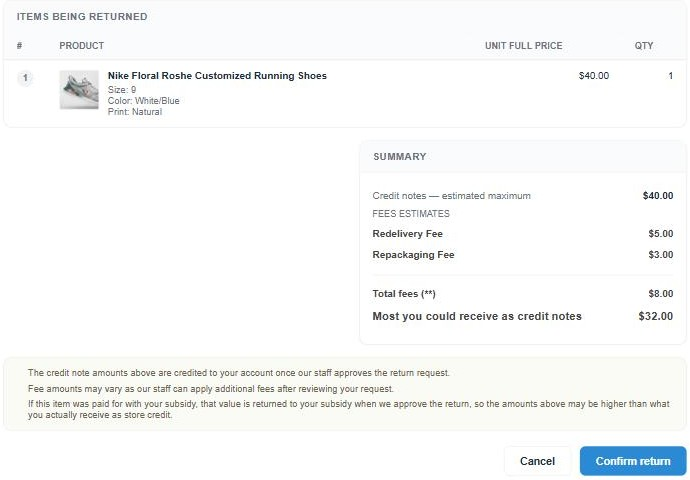

The notes under every summary explain the rules in the customer's words: a negative amount is in their favour;
anything paid by subsidy goes back to the subsidy and only what they paid by card or cash comes back as
store credit; fees are estimates until staff review the return.

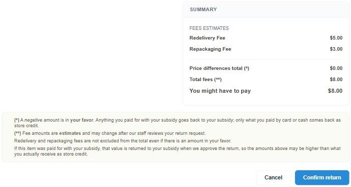

When the customer presses **Confirm return**, the system checks everything again (quantities, reason and action,
credit or exchange, that the replacement fits its type, has all its options and is one they may order). If
something no longer passes, they stay on the same step with their choices kept and a message explaining what to
fix.

### 5.5 The confirmation and return note

After confirming, a **Return requests created** panel opens over the customer's returns list, one block per item,
with the instructions for sending the parcel back. **Print all** opens the printable return note.

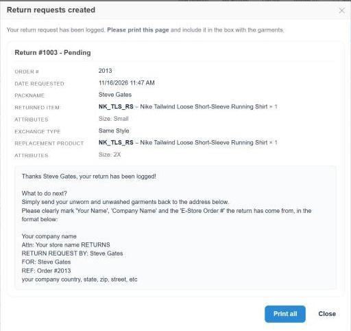

If the store setting *Allow closing without printing the return note* is **off** (as in the test store), the
customer is reminded *"Please print the return request and include it in the box with the garments"* until they
have pressed **Print all**.

### 5.6 My account › Return requests

Each return is listed with its status. While a return is **Pending**, the customer can change the options of the
chosen replacement (for example the size) with **Edit exchange item**, without starting over. The product itself
cannot be changed this way, and the button is not offered for an **Exact** exchange.

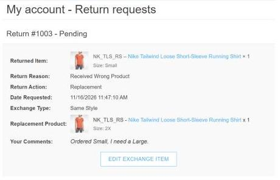

After Sales Support decide, the status changes and the note staff wrote with their decision appears as **Note from
the store**. Below: the hat was **authorised**, the shirt returned with it was **rejected**, and each shows its note:

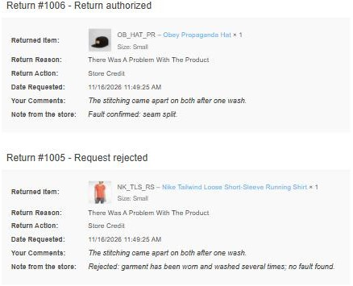

A rejected or cancelled item also sends the customer an e-mail with the same note (§7).

### 5.7 Completing an exchange that needs payment

When an approved exchange still has something to pay (fees, or a dearer replacement), the replacement is placed in
the customer's cart and they receive an e-mail (§7). The checkout shows the replacement and what is due:

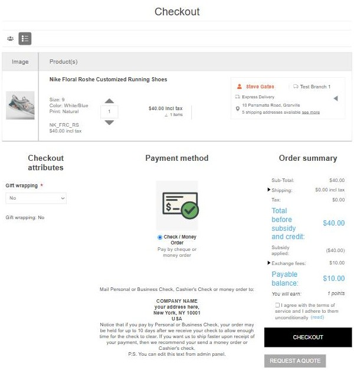

*Steve's size 9 shoes. The shoes are paid by his subsidy (the size 8 pair's unit came back at approval) and the parcel
holds only the replacement, so there is no delivery charge; the payable balance is the **$10.00 of fees** ($5
redelivery + $3 repackaging + $2 one-off fee).*

Good to know:

- The replacement line **cannot be removed and its quantity cannot be reduced** (it can be increased — buying more
  is ordinary shopping).
- The customer can add other items and pay for them in the same checkout. Note that the value of the returned
  garment went back to the subsidy (or onto a credit note) at approval, so it is available to anything in that
  checkout, not only to the replacement.
- There is no time limit. The returned garment is always valued at what the customer actually paid for it (a bulk
  or tier price included). An **Exact** replacement is charged at that same price; a **same-style** or
  **different-style** replacement is charged at its current price.
- The customer cannot cancel an approved exchange; they contact the store.

The placed replacement order shows the breakdown, fees included:

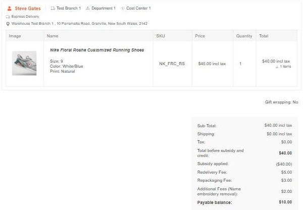

**Delivery on a replacement.** A parcel that holds **only replacements** has no delivery charge — the redelivery fee
(when the store's rules apply one) is what the customer pays to have it sent. If the customer adds other shopping
for the same delivery address, that parcel is charged delivery as usual. James Pan's replacement hat:

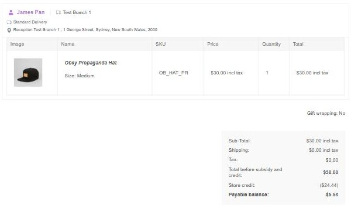

*Order #3013: the $30 hat replaced a $15 shirt. Shipping $0.00; his store credit ($15 from the returned shirt plus
$9.44 left from before) paid $24.44, and he paid $5.56.*

### 5.8 My account › Subsidies

The employee's subsidy page shows what is left and, under **History**, every order, top-up and return behind the
figures. Returns appear as **"Return on order #… — given back"**:

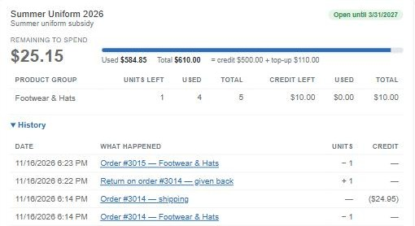

*Reading from the bottom: order #3014 used 1 unit and $24.95 of delivery; the approved exchange gave the unit back
(+1); the replacement order #3015 used 1 unit and, sent on its own, no delivery.*

### 5.9 My account › My Store Credit

Customers who hold, or have ever held, store credit see **My Store Credit** in their account: the available balance,
each credit note (what it was issued for, its amount and what is left of it) and every order their credit was used
on, with links to those orders. Store credit is applied automatically at checkout — the customer does not have to
choose it — and it appears as a *Store credit* line in the order summary.

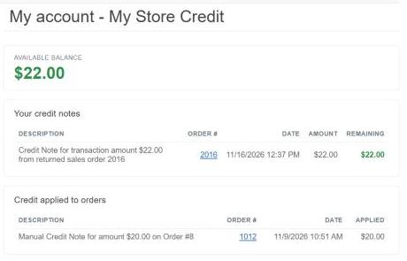

*James Pan after his hat was returned for credit: one note of $22.00 ($30 less $8 of fees). The lower table lists
where earlier credit was spent.*

### 5.10 When Exchanges is switched off: nopCommerce's own form

When a store has **Enable Exchanges** off, the **Return Item(s)** button opens nopCommerce's one-page form instead
of the wizard: quantities (still only shipped units), reason, action and a comment. The request is logged as
*Pending* and the two nopCommerce e-mails are sent, but there is no credit/exchange choice, no fee, no receipt, and
approving it in admin gives nothing back. The same form is what a guest reaches through nopCommerce's withdrawal
link (§4.3).

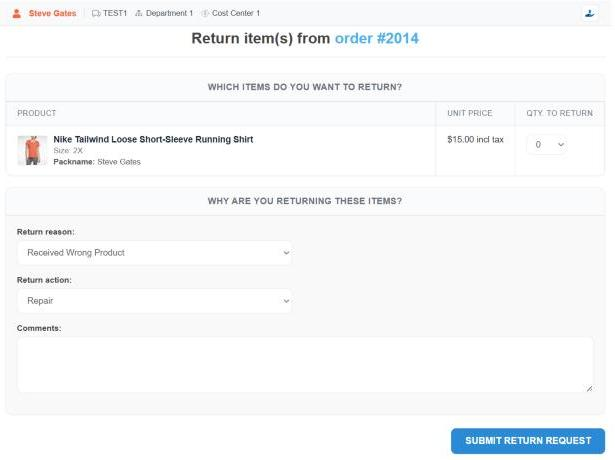

*The same store with Exchanges switched off. Every action is listed, including* Repair*, which the CW rules
switch off: nopCommerce's form does not read CW's rules.*

---

## 6. The Sales Support journey, screen by screen

### 6.1 The returns list

*Sales › Return requests* is nopCommerce's own list: one line per returned item, with its status. Items submitted
together appear as consecutive numbers.

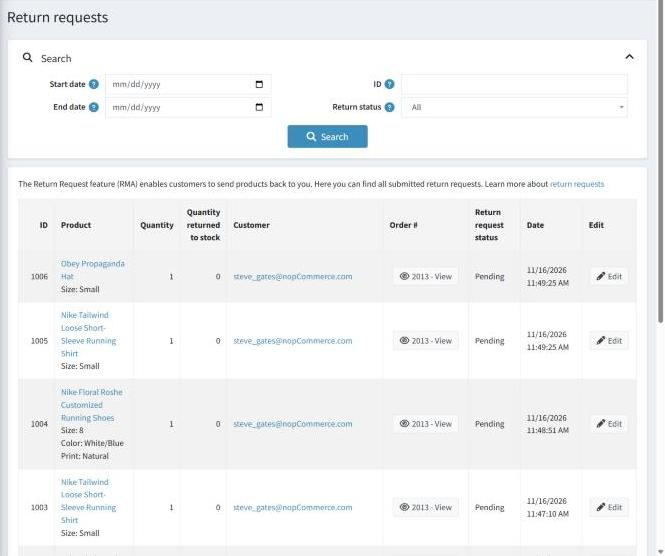

### 6.2 The return page

Opening a line shows nopCommerce's return page with CW's information added:

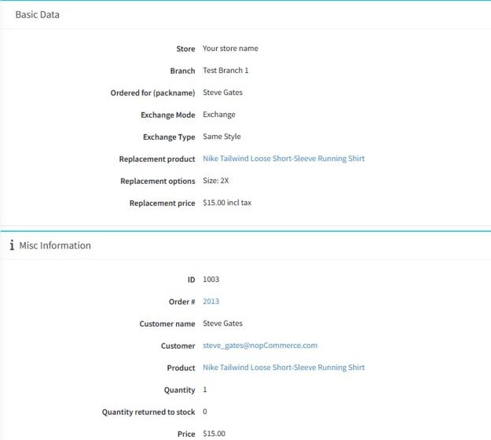

- **Basic data** — store, branch, the **packname** the item was ordered for, whether the customer asked for an
  exchange or a credit note and, for an exchange, the exchange type and the **replacement** chosen (product, options
  and price).
- **Misc information** — the order, customer, product, quantity, price, **status**, **reason** and **requested
  action** (both can be corrected; the action list follows the reason), the **Decision note**, the customer's
  comments and the staff notes.
- **Returned together** — when several items came back in one submission, a table lists them all with their
  decision so far, and links to open each one (see §6.5).
- **Fees and charges** — the money side, described next.

### 6.3 Fees and charges

When the reason and action carry fees, the panel shows the fee quantities and amounts, which staff can change
before approving:

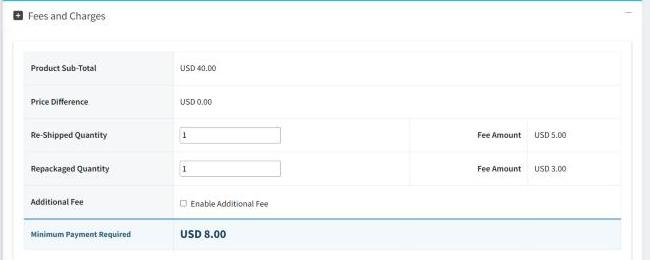

- **Re-Shipped Quantity** drives the redelivery fee, **Repackaged Quantity** the repackaging fee. Both default to
  the returned quantity and can be lowered (to 0 to waive a fee).
- **Enable Additional Fee** adds a one-off fee with a description:

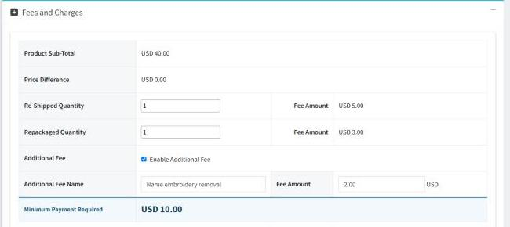

- **Minimum Payment Required** is what the customer will have to pay for an exchange; for a credit return the panel
  shows the most the customer could receive as store credit instead.
- Once an item is **rejected** or **cancelled**, the panel says so: nothing is credited or charged for it.

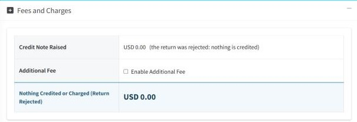

When the reason and action carry no fees, the panel shows only the amounts:

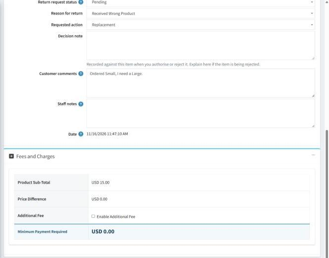

### 6.4 Deciding an item — what each status means

| Status saved | What happens |
|---|---|
| **Pending**, **Received** | Saved. Nothing else happens. Use *Received* to note that the parcel arrived. Setting a **rejected** item back to one of these **re-opens** it: its decision note is cleared and it can be decided again |
| **Return authorized** | The item is **accepted**. A confirmation box appears; then the approval runs (§6.5) and the item is **locked** (only staff notes can change afterwards). If the store's rules say so, the returned quantity goes **back in stock** (§10.3) |
| **Request rejected** or **Cancelled** | The item is **rejected**: no fee, no store credit, no exchange. The customer is **e-mailed** with the decision note, and the units can be returned again. Moving between *Rejected* and *Cancelled* sends nothing more |
| **Item(s) repaired**, **Item(s) refunded** | Only the label changes. **Nothing is given back, nothing is charged**, and the item does not count as decided (§11) |

A rejected item cannot be re-opened once the customer has returned the same units in a **new** return — otherwise
both returns could be approved for the same garment. The page then says which to decide instead:

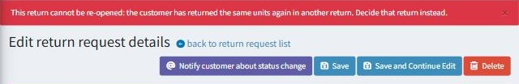

Changing the status to *Return authorized* asks for confirmation first:

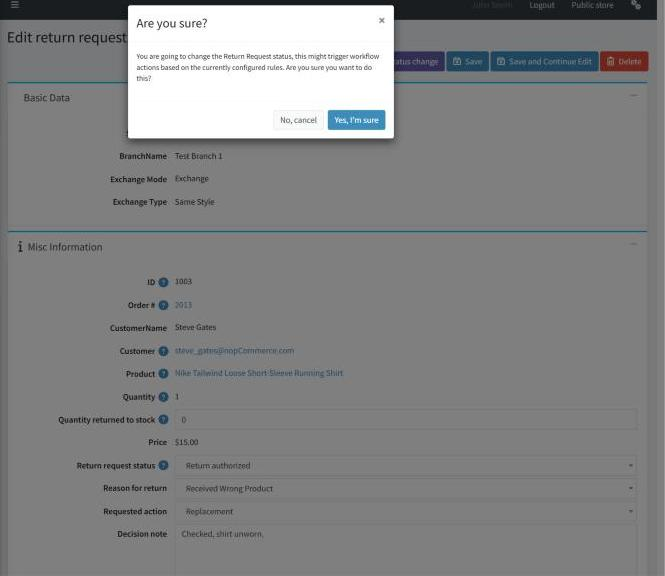

### 6.5 What an approval does — the four outcomes seen in the test run

**A. Exchange, nothing to pay → the replacement order is placed automatically.**
Return #1003 (shirt Small → 2X, no fees, paid by a unit). The unit came back, paid for the replacement, and order
**#2014** was created straight away. The customer is e-mailed "approved — nothing to pay".

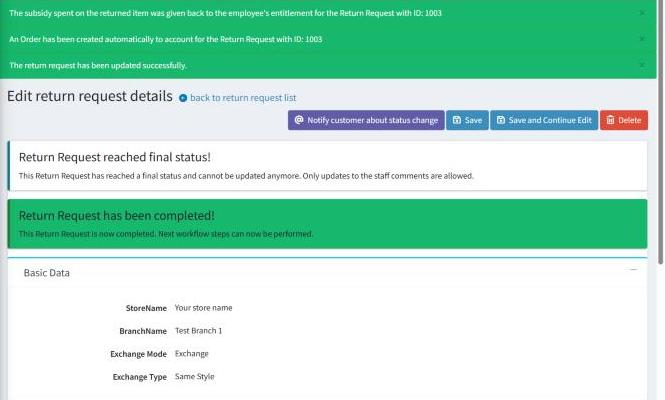

**B. Exchange with something to pay → the replacement goes to the customer's cart.**
Return #1004 (shoes size 8 → 9, $10 of fees). The unit came back, the replacement went into Steve's cart, and he
was e-mailed "approved — please complete your order" with the $10.00 to pay. The page offers **Checkout
Notification**, **Impersonate** and **Undo Approval** (§6.6).

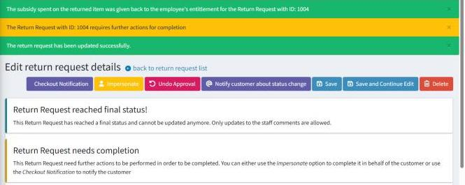

**C. Return for credit of an item paid by subsidy → the subsidy comes back, no credit note.**
Return #1006 (hat, paid by a unit). The unit went back to Steve's subsidy; because he paid no money for it, no
credit note was raised. The *Returned together* table shows the shirt sent back in the same parcel, still to decide:

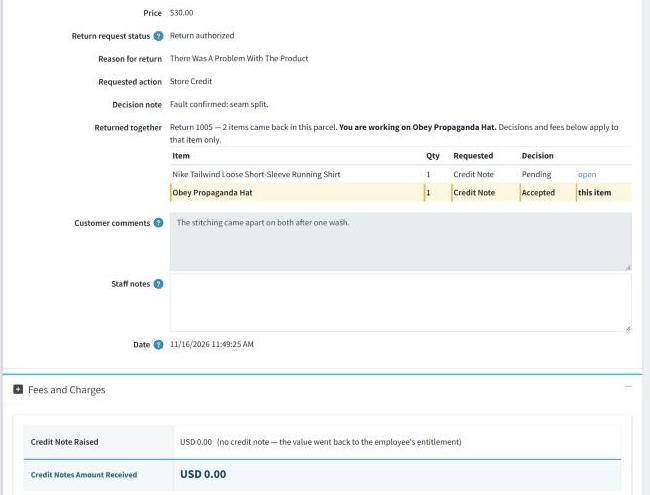

**D. Rejection.** Return #1005 (the shirt from the same parcel) was rejected with a decision note. Nothing is
charged or given back; the customer is e-mailed the note and sees it on their returns page:

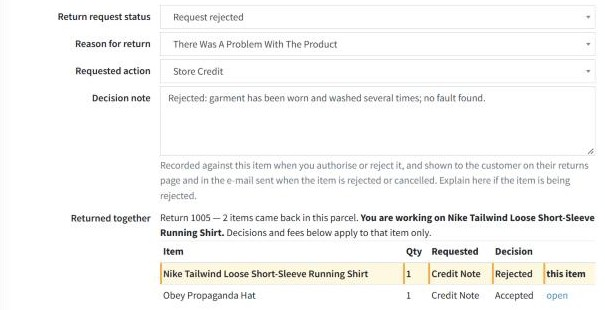

**E. Return for credit of an item the customer paid for → a credit note, less the fees.**
Return #1008 (James Pan's $30 hat, paid with his own money, reason with fees): a credit note of **$22.00** was
raised ($30 − $5 redelivery − $3 repackaging).

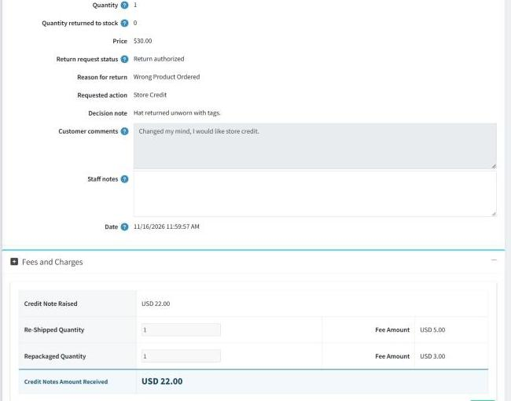

**F. Exchange paid entirely by store credit → placed automatically.**
Return #1009 (James's $15 shirt for $27.56 shoes, no fees): the shirt's $15 came back as a credit note, and that
note together with his $22 note covered the shoes, so order **#2017** was placed straight away and paid by store
credit. The replacement order records which return it came from (*Related to Return Request ID 1009*):

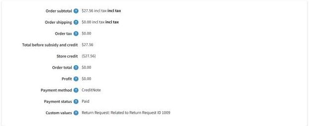

**G. A replacement that is normally sold only with other products.** Return #1007 asked for the Obey hat, which the
catalogue sells only together with the shirt (*required products*). A replacement is not a sale, so it goes to the
customer on its own: on approval the hat alone went into James's cart (he had $15 more to pay), and the shirt was
**not** added. With the reason, action and status rules all ticking *Back in stock*, the returned shirt also went
back to stock (*Quantity returned to stock: 1*):

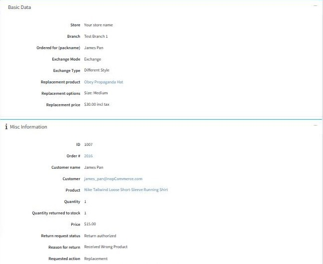

If the exchange step fails during an approval, everything the approval did is undone and an error is shown.
Approving the same item twice has no effect the second time.

An exchange with nothing to pay also goes to the customer's cart (instead of being placed automatically) when the
replacement does not pass the store's normal cart checks — for example a required option is missing.

### 6.6 After an approval that is waiting for the customer

| Button | What it does |
|---|---|
| **Checkout Notification** | Sends the "please complete your order" e-mail again, with the amount the cart asks for now (the earlier unsent e-mail is withdrawn) |
| **Impersonate** | Signs the administrator in as the customer and opens their cart, to finish the checkout for them. Works only for returns of the store the administrator is signed into |
| **Undo Approval** | Reverses everything the approval did — subsidy given back, credit note raised, replacement in the cart, the unsent e-mail — and puts the item back to *Pending* |

**Undo Approval** asks for confirmation:

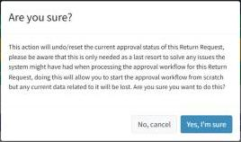

In the test run, return #1004 was approved, undone and approved again: the subsidy history shows the unit given
back once, and the first "please complete" e-mail disappeared from the queue.

**An exchange that was placed automatically (outcome A) has no Undo.** To reverse it, cancel the replacement
order: the subsidy and any store credit it used come back automatically.

### 6.7 Spotting returns and exchanges in the order lists

*Sales › Orders* and the *Orders* tab of a customer mark each order:

- **E** — the order contains a replacement sent for an exchange (in the test run: orders #2014 and #2015);
- **R** — an item of the order was returned and authorised (later marked *repaired* or *refunded* counts too).
  Pending, received, rejected and cancelled returns do not count. An order can carry both.

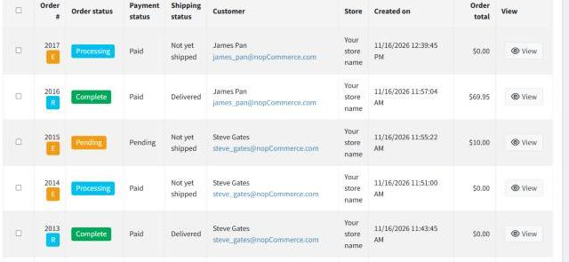

On the original order's own page, a *Return requests* block lists its returns and the store credit applied, and a
replacement order shows which return it came from under *Custom values*.

### 6.8 Store credit in admin

- **On the customer's page** (*Customers › (customer) › Credit Notes*): the available balance, the customer's credit
  notes (order, reason, amount, remaining, date) and where each was spent.
- **Add a manual credit note**: choose one of the customer's orders, give a description and an amount. This needs
  the *Allow manual credit notes* permission as well as access to credit notes, and Credit Notes must be switched
  on for the store.
- **Delete**: removes a note issued by mistake. It is offered only on a note that has not been spent at all; a note
  that has paid for an order cannot be deleted.

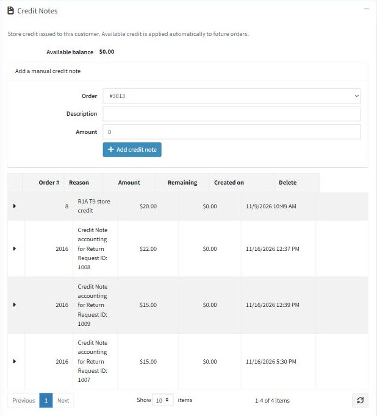

*James's card after the test run: every note has been spent, so none offers Delete. A $5 note added by hand during
the test showed Delete and was deleted.*
- **Credit Notes Report** (*CW Admin › Exchanges & Returns › Credit Notes Report*): per store, how many notes were
  issued and fully used, the total issued and the **outstanding liability** (what the business still owes
  customers); and per store, which customers hold a balance.

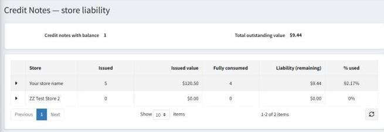

---

## 7. E-mails

| When | E-mail | To | Sent by |
|---|---|---|---|
| A return is submitted (one per item) | *New return request* | Store owner | nopCommerce |
| A return is submitted (one per item) | *New return request* — the details of the request | Customer | nopCommerce |
| A return is submitted (one per item) | **Your Return Request has been received** — what to do next and the returns address, with a *For:* line naming the employee | Customer | CW |
| An exchange is approved and nothing is owed | **Your return #… is approved** — the replacement order number | Customer | CW |
| An exchange is approved and something is owed | **Your return #… is approved – please complete your order** — the amount to pay and what it includes | Customer | CW |
| Staff press *Checkout Notification* | The same "please complete" e-mail, with the current amount | Customer | CW |
| A return is approved **without a replacement** (a credit return, or an exchange the rules settle as credit) | **Your return #… is approved** — the store credit raised and/or that the subsidy was given back. Not sent when nothing came back (the fees took the whole note and no subsidy was paid) | Customer | CW |
| An item is **rejected or cancelled** | **Update on your return #…** — the status and the staff's decision note | Customer | CW |
| Staff press *Notify customer about status change* | *Return request status was changed* | Customer | nopCommerce |

The approval and rejection e-mails from the test run:

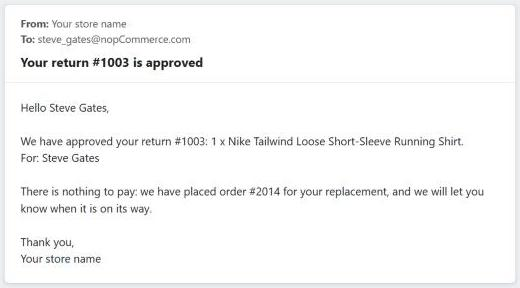

All CW templates can be edited under *Content management › Message templates* (`Return.Receipt`,
`ReturnAuthorisedExcepted.CustomerNotification`, `ReturnAuthorisedPayment.CustomerNotification`,
`ReturnAuthorisedCredit.CustomerNotification`, `ReturnRejected.CustomerNotification`). The *Undo Approval* button
withdraws the approval e-mail while it is still unsent; it is offered only while an exchange waits for the customer
(§6.6), so a credit approval's e-mail cannot be withdrawn that way.

---

## 8. What happens to the money

### 8.1 At checkout (any order, including replacements)

See the settlement diagram in §3. In words: subsidy first (units, then group money, then global money, each base
before its top-ups), then store credit (oldest note first), then the customer pays what is left. Fees are added on
top and paid by the customer.

The checkout, the order page, the confirmation e-mail and the invoice all show it in that order: *Total before
subsidy and credit*, *Subsidy applied* (split into items and shipping), *Store credit*, the customer's own discounts
and fees, and the *Payable balance*.

### 8.2 On a return — "you get back what you spent"

| What paid for the returned item | What comes back when the item is approved |
|---|---|
| A subsidy **unit** | **One unit**, to the same product group. The price does not matter |
| **Product-group money** | That money, to the same product group |
| **Global subsidy money** | That money, to the global pot |
| **Store credit** or the **customer's own money** | A **new** credit note for that amount (on a credit return, minus the fees). Nothing is put back on the old note |
| **Delivery** paid by subsidy | Not given back — the parcel was shipped |

- On an **exchange**, the value comes back first and the replacement then uses it, so a unit goes back and a unit
  comes out. If the replacement costs **more**, the difference is settled the usual way (any subsidy left, then
  store credit, then the customer pays). If it costs **less**: a unit-paid original leaves nothing over; a
  money-paid original leaves the difference where it came from (on the credit note, or in the subsidy pot).
- "More" and "less" are measured against **what the customer actually paid** for the returned garment, not today's
  price.
- An item from an **earlier subsidy period** gives its entitlement back to that earlier period; a lapsed unit comes
  back lapsed.
- Whether the order was invoiced makes no difference.
- **Cancelling an order** gives back everything it used — subsidy and store credit — automatically.
- Fees are fixed once **every item of the same submission** has been decided (accepted or rejected). Until then
  they follow the current fee settings; after that, changing the fee settings does not change them.

---

## 9. Worked scenarios from the test store

Settings during the run: repackaging **$3.00 per garment**, redelivery **$5.00 per 4 garments**. Reasons:
*Received Wrong Product* and *There Was A Problem With The Product* carry **no** fees; *Wrong Product Ordered*
carries both fees.

| # | Customer, item, how it was paid | Request | Decision | Result |
|---|---|---|---|---|
| 1 | Steve, shirt $15, **subsidy unit** | Exchange, same style (Small → 2X), *Received Wrong Product* (no fees) | Return authorized | Unit back and spent on the replacement. **Order #2014 placed automatically, $0.00.** E-mail "approved — nothing to pay" |
| 2 | Steve, shoes $40, **subsidy unit** | Exchange, same style (size 8 → 9), *Wrong Product Ordered* (fees) | Staff added a $2 one-off fee; Return authorized | Unit back. Replacement in the cart; **$10.00 to pay** ($5 + $3 + $2). Steve checked out: order **#3015**; the subsidy paid the shoes, there was **no delivery charge** (the parcel held only the replacement), and he paid $10.00 |
| 3 | Steve, hat $30, **subsidy unit** | Credit, *There Was A Problem* (no fees) | Return authorized | Unit back to his subsidy. **No credit note** — he paid no money for the hat |
| 4 | Steve, shirt $15 (same parcel as 3) | Credit | Request rejected | Nothing given back, nothing charged. Steve was e-mailed the decision note, and the shirt could be returned again (see 9) |
| 5 | James (no subsidy), hat $30, **own money** | Credit, *Wrong Product Ordered* (fees) | Return authorized | **Credit note $22.00** ($30 − $8 fees) |
| 6 | James, a shirt $15, own money | Exchange, different style → adidas shoes $27.56, no fees | Return authorized | Credit note $15 for the shirt; that and his $22 note paid the shoes. **Order #2017 placed automatically, $0.00 to pay**; $9.44 of store credit left |
| 7 | James, the other shirt $15, own money | Exchange → Obey hat $30 (*Received Wrong Product*, *Replacement*; all three *Back in stock* ticks on) | Rejected → Pending → Return authorized | Credit note $15 for the shirt; **the hat alone** went into his cart (the shirt it normally requires was not added); **the shirt went back to stock**. At checkout: **no delivery charge**, store credit $24.44, he paid $5.56 — order **#3013**. With a laptop added to the same parcel, delivery ($9.95) was charged |
| 8 | Steve, Fahrenheit 451 book (return #1002) | — | Request rejected with a two-line note, then Cancelled, then back to Pending | **E-mail "Update on your return #1002"** with the note. Moving on to *Cancelled* sent nothing more; setting it back to *Pending* re-opened it and cleared the note |
| 9 | Steve, the shirt rejected in 4 | Credit, *There Was A Problem* (return #2003) | Return authorized | The rejected shirt could be **returned again**. Unit back to his subsidy; **e-mail "Your return #2003 is approved"** saying his subsidy was given back. Re-opening the old rejected return #1005 was then refused |
| 10 | James, store credit switched **off** for the store | — | — | The wizard offered no credit option (exchange only); his existing store credit was still used at checkout |
| 11 | James, Exchanges switched **off** for the store | Checkout of the hat from 7 | — | Completed normally: an exchange already approved is finished whatever the switch says |

---

## 10. Configuration

### 10.1 Feature switches (per store)

In *CW Admin › MultiStores › (store) › Store Settings › Credit Notes & Exchanges*, and for all stores in *CW Admin ›
Default Settings*:

- **Enable Exchanges** — the CW wizard, its rules and fees. Off: customers use nopCommerce's plain return form (§5.10).
- **Enable Credit Notes** — store credit. Off: no new manual credit notes, and the wizard no longer offers a return
  for credit.
- **Allow closing without printing the return note** — §5.5.

Switching a feature off stops **new** activity; it never blocks **finishing** something already started. An
existing credit note stays visible and **is still used automatically at checkout**, a return already submitted for
credit can still be approved (and raises its credit note), and an approved exchange can still be completed — its
replacement keeps every exemption it had (no quantity rules, no required products, no delivery charge).

### 10.2 nopCommerce's settings

*Configuration › Settings › Order settings › Return request (withdrawal button) settings* (§4.3), and the lists of
**return request reasons** and **actions** below it. Renaming a reason or action is fine; deleting one is refused
while any return uses it.

### 10.3 Reason, action and status rules (per store)

*CW Admin › MultiStores › (store) › Exchanges and Returns*. Three tables decide what a combination allows:

**Return reason rules** — for each reason: allow store credit, allow exchange, repackaging fee, redelivery fee,
back in stock, active, display order, and the **linked actions** (which actions are offered for that reason).

**Return action rules** — the same flags for each action:

**Return status rules** — for each status: perform store credit, perform exchange, back in stock, authorised.

How they combine:

- **Credit** is offered to the customer when the reason **and** the action allow store credit; **exchange** when
  both allow exchange.
- A **fee** applies when the reason **and** the action both have it ticked.
- At approval, nothing happens unless the **Return authorized** status rule has *Authorised* ticked. Its
  *Perform store credit* tick (together with the reason and action allowing store credit) lets a credit return
  raise a credit note; its *Perform exchange* tick (together with the reason and action allowing exchange) lets
  an exchange be performed. If an exchange is not allowed at approval but credit is, the request is settled as
  credit. On an exchange the customer's own money always comes back, whatever the store-credit tick says, so
  nobody pays twice for a garment.
- The goods go **back in stock** on approval when the reason, the action **and** the *Return authorized* status rule
  all tick *Back in stock*: the whole returned quantity is added to stock, once, with nopCommerce's usual stock note.
  Otherwise staff enter *Quantity returned to stock* by hand as before. Undoing an approval does not take stock out
  again.
- A reason with **no linked actions** offers every active action.
- **Anything not configured counts as "not allowed".** A newly added reason does nothing until it has a rule.

### 10.4 Fee rules

*CW Admin › Exchanges & Returns › Fee Settings* holds the rules for all stores; a store's *Fee Settings* tab can
override them (editing an inherited rule creates the store's own copy).

Each rule is a **fixed price** or an amount **per so many units** (rounded up):

---

## 11. Things to know, and open points

These are behaviours of the current version that surprise people, and points that are waiting for a business
decision.

**How it works today**

1. **Only *Return authorized* gives anything back.** *Item(s) refunded* and *Item(s) repaired* are labels only:
   no store credit, no subsidy back, no exchange, and the item is not counted as decided. To refund as store
   credit, authorise a credit return.
2. **Stock comes back only when the rules say so.** With *Back in stock* ticked on the reason, the action and the
   *Return authorized* status rule, approval puts the whole returned quantity back in stock; otherwise staff use
   *Quantity returned to stock*. Undoing an approval does not take the stock out again.
3. **Only the *Return authorized* status matters in the status rules.** The ticks on the other statuses (in the
   test store, *Received* is fully ticked) have no effect.
4. **Two e-mails if staff also press *Notify customer about status change*.** CW already e-mails the customer when an
   item is rejected or approved; nopCommerce's button sends its own generic message as well.
5. **A rejected item stays editable**; only an authorised item is locked. Setting it back to *Pending* or *Received*
   re-opens it (the decision note is cleared), unless the customer has since returned the same units again.
6. **An automatically placed exchange cannot be undone** with *Undo Approval*; cancel the replacement order instead.
   *Undo Approval* is offered only while an exchange waits for the customer, so a credit approval cannot be undone
   either.
7. **Impersonate** works only for returns of the store the administrator is signed into.
8. **Exchanges switched off** means plain nopCommerce returns for new requests: staff can change statuses, but nothing
   financial happens. The same applies to returns raised through nopCommerce's guest withdrawal form.
9. **Store credit switched off** hides the credit option for new returns; credit returns already submitted are still
   approved as credit, and existing store credit is still spent at checkout.
10. **Nothing is sent to the accounting system (Jim2)** — return outcomes and credit notes are not synchronised.
11. **A replacement ships without the products it normally requires** (a catalogue *required products* setting), and a
    parcel holding only replacements has **no delivery charge** — the redelivery fee is its delivery charge. A store
    with no redelivery fee rule sends replacements free.

**Waiting for a decision**

12. **Billing address on an exchange checkout** — whether the customer should choose it.

## 12. Quick reference

**Customer**

- Return from *My account › Orders › (order) › Return Item(s)*. Only shipped items, only what is not already returned.
- Choose reason → action → credit or exchange → replacement → confirm. Print the return note and put it in the parcel.
- Check progress in *My account › Return requests*; change a pending exchange with *Edit exchange item*.
- If an exchange needs payment, it is waiting in the cart. Store credit is in *My Store Credit*; subsidy in *Subsidies*.

**Sales Support**

- Work from *Sales › Return requests* or from the order's page. Decide each item on its own.
- Before approving: check the fee quantities (zero the redelivery on all but one item of a parcel), add a one-off fee
  if needed, write a decision note.
- *Return authorized* = accept (automatic from there). *Request rejected* = reject — the customer is e-mailed your
  decision note, so write it for them. Don't use *Item(s) refunded* to refund.
- Pending exchange: *Checkout Notification* to remind, *Impersonate* to finish it, *Undo Approval* to reverse.
- Look for **E** and **R** in the order lists.

**Administrator**

- Switches: *Store Settings › Credit Notes & Exchanges*. Rules: store *Exchanges and Returns* tab. Fees: *Fee
  Settings*. nopCommerce return settings: *Order settings*.
- A new reason or action needs an active rule before customers see it; link actions to a reason to narrow what it offers.
- Tick *Back in stock* on the reason, the action and the *Return authorized* status for goods that go straight back on
  the shelf.
