# PackNames — Functional Guide

**System:** CW store on nopCommerce **5.00**, with the CW Core plugin
**For:** managers, store administrators, Sales Support and clients. You do not need any technical knowledge to read it.

> **About the examples.** Every screen in this guide is a real screenshot from the CW test store, taken while the
> scenarios in §10 were run: real packnames, a real order for three people, a real shipment. The people (*Steve
> Gates*, *James Pan*, *Brenda Lindgren*, *Liam Walker*), the branches and the products are test data. **All amounts
> are in Australian dollars (AUD)**, shown with the "$" sign as Australian stores show them.
>
> §4 explains what nopCommerce does by itself, what CW adds on top, and where the two differ. Things that work
> differently from what you might expect are collected in §12.

---

## Contents

1. [The short version](#1-the-short-version)
2. [Key ideas in plain language](#2-key-ideas-in-plain-language)
3. [The whole picture at a glance (diagrams)](#3-the-whole-picture-at-a-glance)
4. [nopCommerce and CW: who does what](#4-nopcommerce-and-cw-who-does-what)
5. [The administrator's journey, screen by screen](#5-the-administrators-journey-screen-by-screen)
6. [The manager's journey, screen by screen](#6-the-managers-journey-screen-by-screen)
7. [The employee's journey](#7-the-employees-journey)
8. [After the order: delivery, shipments and documents](#8-after-the-order-delivery-shipments-and-documents)
9. [E-mails](#9-e-mails)
10. [Worked scenarios from the test store](#10-worked-scenarios-from-the-test-store)
11. [Configuration](#11-configuration)
12. [Things to know, and open points](#12-things-to-know-and-open-points)
13. [Quick reference](#13-quick-reference)

---

## 1. The short version

The store sells uniforms and workwear to businesses. Most orders are not placed by the person who will wear the
garments: a **manager** orders for the people in their team, and each garment has to reach the right person, at the
right place, charged to the right subsidy.

A **packname** is that person: one employee (or one group, such as "Warehouse Team") that uniforms are ordered for.
Every packname belongs to a **branch** of the client company, sits in a **packname list**, and can have a
**department**, a **cost centre**, a **gender**, a **print name** and its own **subsidy**.

- An **administrator** sets up the client's structure in *CW Admin › MultiStores › Manage Store*: branches,
  packname lists, packnames, departments, cost centres and the store's settings.
- A **manager** signs in, picks a packname from the **"Order for"** selector at the top of every page, shops for
  them, picks the next person, and so on. At checkout each packname gets their own delivery address and delivery
  method, and everything is placed as **one order**.
- An **employee** who has their own account signs in and orders for themselves only.
- Staff in admin see the order **grouped by packname**, ship it **destination by destination**, and every report,
  invoice and e-mail keeps the packname, branch, department and cost centre the order was placed for.

The central rule:

> **Who a garment is for decides everything about it**: which products can be seen, which subsidy pays for it,
> where it is delivered and which branch, department and cost centre it is charged to. **Who places the order**
> decides only the price and whose account the order sits in.

---

## 2. Key ideas in plain language

### 2.1 Store

A **store** is one client's shop (for example *Your store name* in the test store). Everything below belongs to one
store, and each store has its own settings (§11). A store can have packnames switched off, in which case it behaves
like a standard nopCommerce shop.

### 2.2 Branch

A **branch** is a site or division of the client company: "Head Office", "Sydney Warehouse", "Melbourne". Branches
form a **tree**: a branch can have sub-branches ("Test Branch 1 › Test Branch 1.3 › Test Branch 1.3.1"). A branch
has:

- a **code** and a **name** (the code is shown as a small badge everywhere);
- its **addresses** — delivery points such as *Reception* and *Warehouse*, one of them the **default**;
- optionally its own list of **delivery methods**, replacing the store's list for the packnames of that branch;
- an **Active** switch. A branch that is not active takes no *new* packnames, lists or customers; everything already on
  it keeps working.

### 2.3 PackName list

A **packname list** is a group of packnames inside a branch — often one per branch ("Test 1"), sometimes several
("Office staff", "Drivers"). A list decides **which managers can order for its people** (§2.6):

- **All Managers** — every manager of the store can see it;
- **Parent Managers** — managers of the branches *above* this one can see it (offered on lists of sub-branches);
- **Owners** — named managers who can see it wherever they are.

One list per branch is the branch's **default list**: the list new packnames go to when nobody chooses another one
(automatic creation and imports). A list switched to **not active** disappears from ordering at once, but its
packnames can still be maintained in admin and by their managers.

### 2.4 PackName

A **packname** is one person (or one group) that uniforms are ordered for. Its details:

| Detail | What it is for |
|---|---|
| **Name** | Shown everywhere; must be unique inside its list |
| **Branch / list** | Where the packname belongs, and so who may order for it |
| **Department**, **Cost Centre** | Who the order is charged to; a department can also decide which products are visible (§2.7) |
| **Employee number**, **Print name**, **PO entry**, **Comments**, **Gender** | Optional fields, each switched on per store (§11). The print name can pre-fill a product's personalisation |
| **Colour** | A colour that marks the packname in the selector, at checkout and on the order, so a manager can tell people apart at a glance |
| **Group** | Marks a packname that is a team rather than one person (for example "Warehouse Team"). A group never has its own account |
| **Customer** (account) | Optional. With an account the person can sign in and order for themselves. Without one, only a manager can order for them |
| **Manager** | The person can order for other packnames (§2.5). Only an administrator can make someone a manager, and a manager must have an account |
| **Active** | An inactive packname disappears from the selector, and anything in the cart for them is put aside until they are active again |
| **Addresses** | The packname's own delivery addresses (for home delivery, §6.6) |
| **Subsidies** | What the company gives this person to spend (see the *Returns, Exchanges and Store Credit* guide, §2.1) |

### 2.5 Managers and employees

There are three kinds of packname, and what someone sees depends on which one they are:

| Kind | Can sign in? | Orders for | What they see at the top of the page |
|---|---|---|---|
| **Manager** | Yes | Everyone in the lists and departments they reach (§2.6), including themselves | The **List** and **Order for** selector, plus the **+** (add packname) and Excel buttons when the store allows them |
| **Employee with an account** | Yes | Themselves only | Their own name in the information strip; no selector |
| **Packname without an account** (or a group) | No | — (a manager orders for them) | — |

### 2.6 Which packnames a manager can order for

A manager reaches the packnames in:

1. **every list of their own branch** — the branch of the list the manager's own packname is in;
2. every list marked **All Managers**, on any branch of the store;
3. every list marked **Parent Managers** on a branch *below* their own branch;
4. every list that names them as an **owner**;
5. the packnames of every **department** they manage — whatever list those packnames are in.

In the test store Steve Gates is a manager whose own packname is in list *Test 1* of *Test Branch 1*. His selector
offers four entries, reached by four different routes (§6.1).

Separately, the store setting **Limit to Manager's Assigned Branches** decides where a manager may *add* new
packnames: off — any active branch of the store; on — only branches holding a list the manager can order from, and
the new person goes into that list. With the setting off, a manager can add someone to a branch whose lists they
cannot reach; that person is created but the manager cannot order for them.

### 2.7 Departments and cost centres

- A **department** ("Nursing", "Maintenance") cuts across branches. Each department can have **department managers**,
  who can order for every packname in that department. Each department also has a hidden **customer role** of its
  own, so products, categories and manufacturers can be shown only to certain departments (the *Departments* panel on
  their access-control settings).
- A **cost centre** is where the cost of an order line is charged. A cost centre can belong to the whole store or to
  one branch (and so to the packnames of that branch and the branches below it).

Both have an **Active** switch with the same meaning as a branch's: an inactive one is no longer offered for new
packnames, but packnames that already have it keep it.

### 2.8 What a packname sees, and what the manager pays

While a manager is ordering for a packname, the shop shows **that packname's catalogue**:

- the products, categories and manufacturers that the packname's own account (or the store's default roles, for a
  packname without an account) and its department can see;
- when every subsidy of the packname is set to *View Only Allocated Products*, **only the products in its subsidy**.
  In the test store, the new starter Liam Walker sees only two menu entries (§10, scenario B). For such a person,
  while their subsidy's ordering period is closed the shop shows **nothing at all** — an empty shop for that person
  means their period is closed.

**Prices and permissions follow the manager** — the person signed in. Discounts and tier prices that apply to the
manager's account apply to everything they order, for whoever it is.

### 2.9 The packname cart and the packname checkout

A manager has **one cart** holding the lines of every packname they have shopped for; each line remembers who it is
for. The cart opens straight onto the **packname checkout**, a single page where:

- each packname gets its own **delivery address** and **delivery method**;
- **subsidy** pays for each packname's own lines, from that packname's subsidy;
- the order is placed once, for everybody.

Packnames that go to the **same address with the same method** share one parcel and **pay one delivery charge**
between them (§6.6).

---

## 3. The whole picture at a glance

**Colour key:**
🟦 blue = the customer (manager or employee) · ⬜ grey = standard nopCommerce · 🟩 green = CW additions (automatic) ·
🟧 orange = administrator or Sales Support · 🟨 yellow = a decision · 🟥 red = refused / stops · 🟪 purple = finished.

### 3.1 How a client is organised

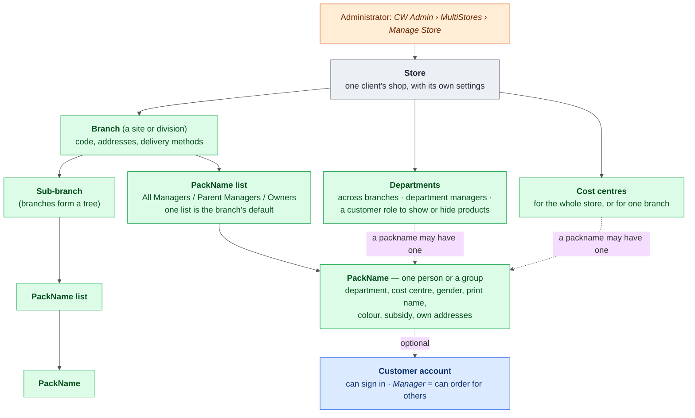

### 3.2 Which packnames a manager can order for

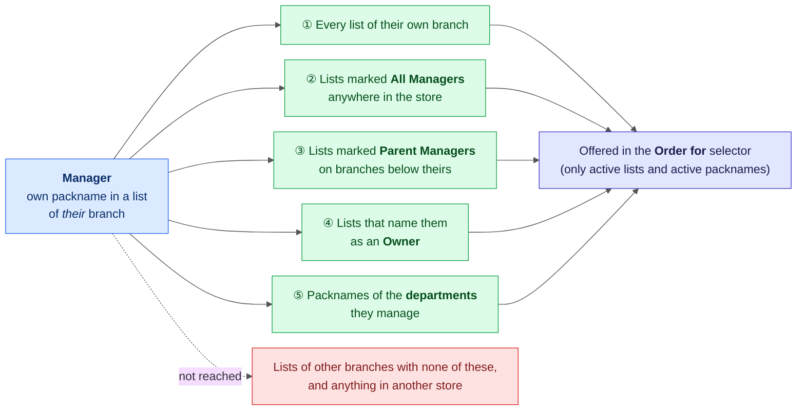

### 3.3 How packnames get into the system

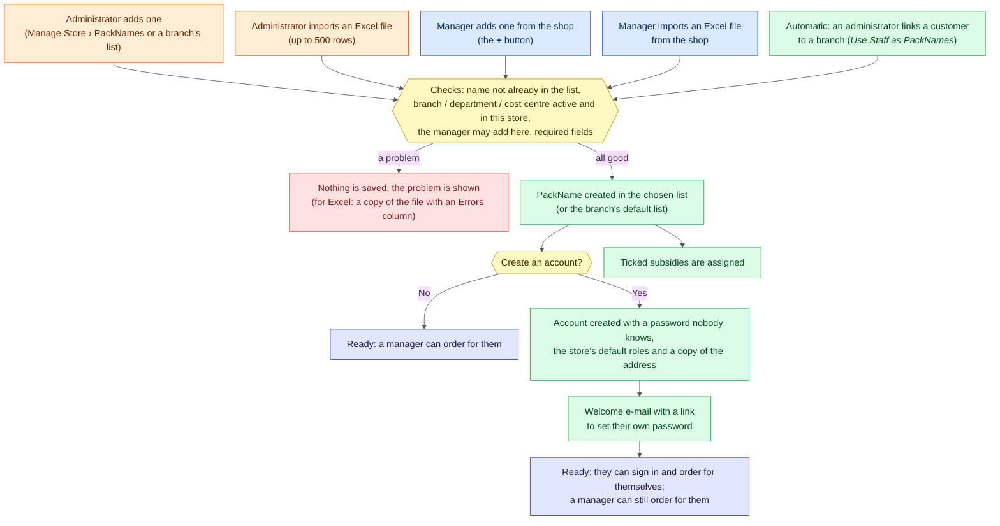

### 3.4 A manager orders for the team

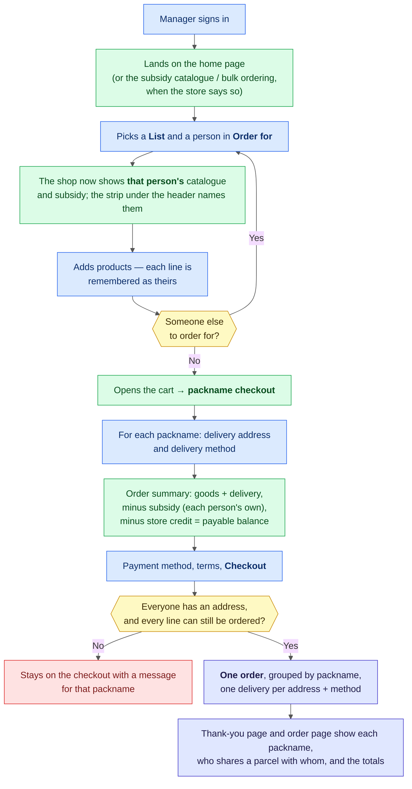

### 3.5 From order to delivery

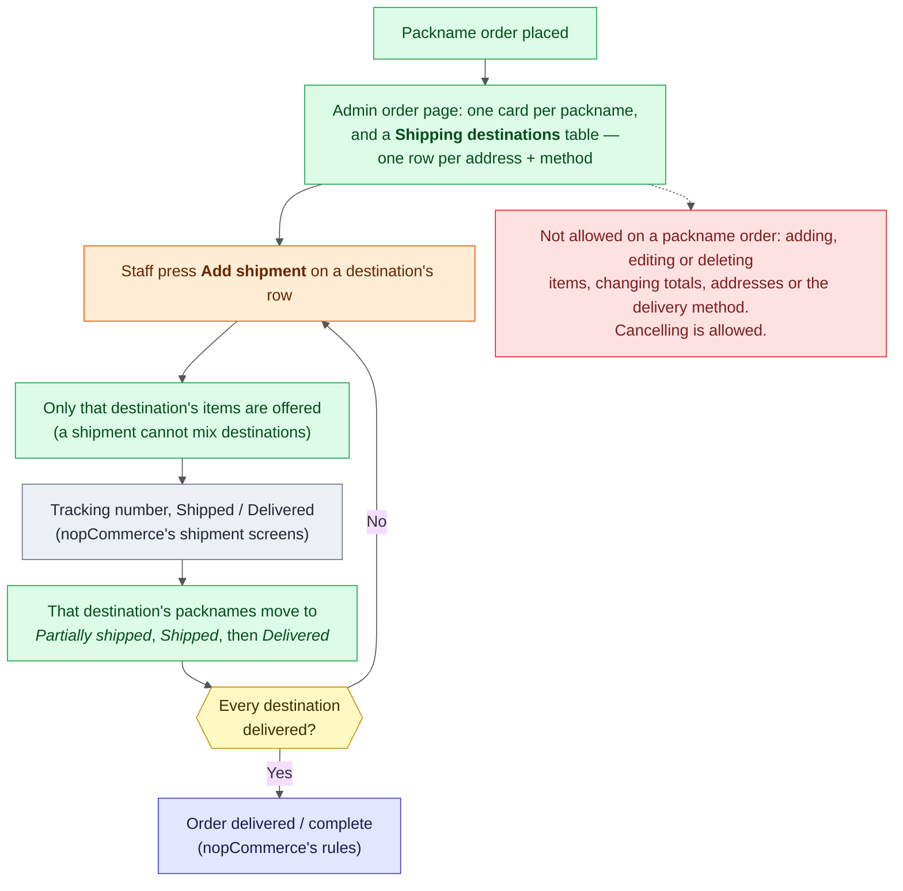

### 3.6 What decides the catalogue, the subsidy and the price

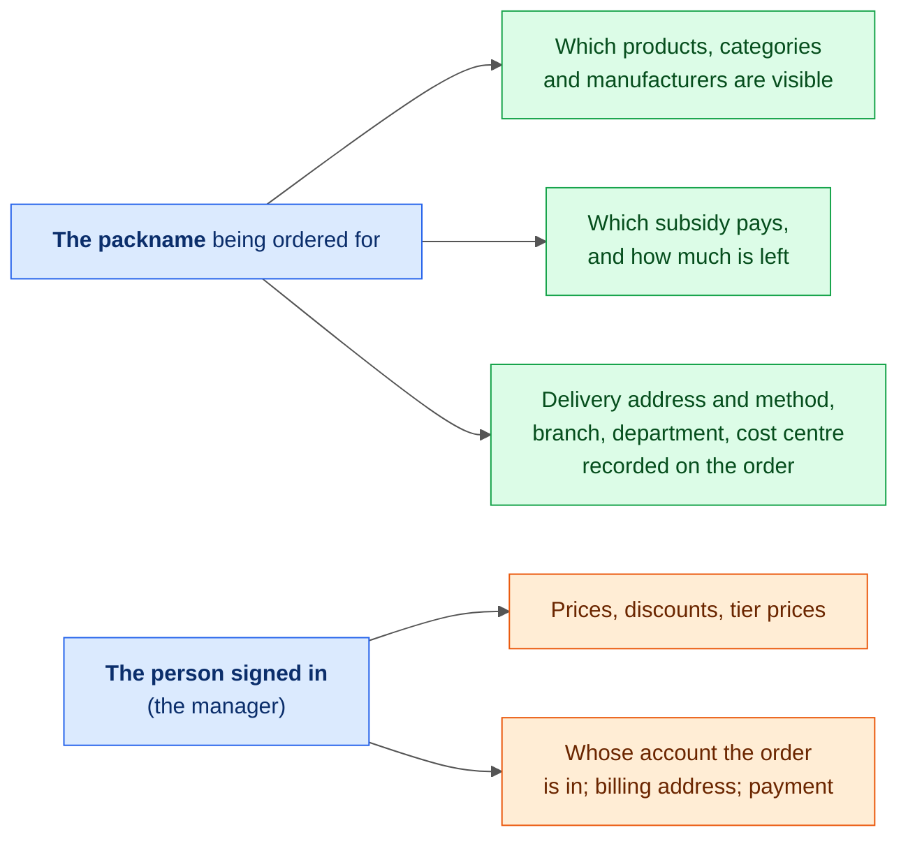

---

## 4. nopCommerce and CW: who does what

nopCommerce knows only one kind of shopper: a customer who buys for themselves, with one cart, one delivery address
and one delivery method per order. **Everything about packnames — branches, lists, managers, ordering for other
people, per-person delivery and per-person subsidy — is CW.**

CW builds on nopCommerce rather than replacing it: a packname order is still a nopCommerce order (same number, same
order list, same statuses, same payment methods, same shipments), with the packname information attached to every line.

### 4.1 Where they agree (CW uses nopCommerce as it is)

| Feature | nopCommerce | CW |
|---|---|---|
| **Customer accounts, sign-in, passwords** | Standard | Same accounts. A packname's account is an ordinary customer account; the welcome e-mail uses nopCommerce's own "set your password" link |
| **Products, categories, access control** | Visibility by customer role | Same rules, applied to the packname being ordered for (§2.8). Departments add a role of their own |
| **Order numbers, statuses, payment, the order list** | Standard | Unchanged |
| **Shipments** — tracking number, shipped, delivered | Standard screens | Same screens, opened per destination (§8.2) |
| **Delivery rates** | Shipping plugins | Packname orders use the CW Freight methods (flat rates per method) |
| **Order e-mails and invoice** | Standard | Same e-mails; the invoice and the totals show the packname lines and the subsidy |

### 4.2 Where CW adds to nopCommerce

| | nopCommerce alone | With CW (PackNames switched on) |
|---|---|---|
| **Who an order is for** | The customer who places it | Any packname the manager reaches; every line remembers who it is for |
| **Client structure** | Stores and customer roles | Branches (a tree), packname lists, departments, cost centres, managers |
| **Header** | — | The **List / Order for** selector, the **+** and Excel buttons, and a strip naming the selected packname |
| **Cart** | One basket | One basket, split by packname, with a count per person in the selector |
| **Checkout** | One address, one method | The **packname checkout**: an address and method per packname, subsidy per packname, one order |
| **Delivery charge** | Per order | Per **destination** (address + method); packnames sharing a destination share the charge |
| **Admin order page** | One products card, one shipping block | One card per packname; a **Shipping destinations** table with *Add shipment* per row |
| **Customer page in admin** | — | A *Branch* field and a read-only *PackName* card, with a link to the packname in Manage Store |
| **Bulk set-up** | — | Excel import of packnames (admin and manager), bulk activate / deactivate / move / delete, Excel export |

### 4.3 Where they differ

| | nopCommerce | CW |
|---|---|---|
| **The cart page** | Shows the cart | Goes straight to the packname checkout (when the cart holds packname lines) |
| **Coupons and gift cards** | Entered in the cart | Not offered on the packname checkout |
| **Pickup in store** | Offered when set up | Not offered for packname orders; deliver to a branch address instead |
| **Editing a placed order in admin** | Items, totals, addresses and the delivery method can be edited | Blocked for packname orders (they would break the per-packname record). Cancel and re-order instead |
| **"My account › Orders"** | The buyer's orders | The orders **placed by** this person. An employee does not see orders a manager placed for them |

---

## 5. The administrator's journey, screen by screen

Everything is in **CW Admin › MultiStores**: choose the store and press **Manage Store**. The page has one tab per
area; the tabs that belong to a switched-off feature are not shown.

### 5.1 Branches

The **Branches** tab shows the branch tree on the left. Choosing a branch shows, on the right, its **packname
lists**, its **cost centres** and its **addresses**, each with *Edit*, delete and *Add* buttons. A green dot means
active, a grey dot inactive; the number next to each list is how many packnames it holds.

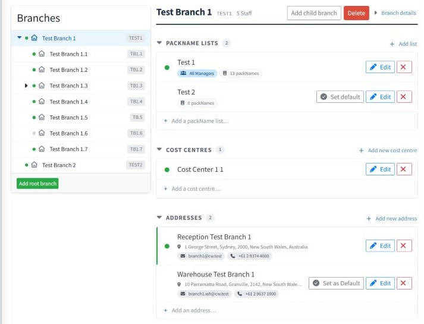

*Branch details* opens the branch's own form: code, name, card code, branch number, payment terms, its own
**delivery methods** (empty = the store's list) and **Active**.

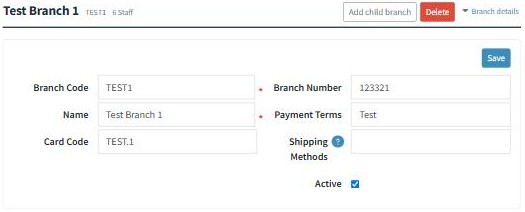

- *Add child branch* creates a sub-branch; *Add root branch* a branch at the top of the tree.
- A branch can only be moved under a branch of the same store, and never under one of its own sub-branches.
- **Delete** is refused while the branch still has sub-branches, packname lists or cost centres — move or delete
  those first.
- When the store setting *Use Branches as PackName Lists* is on, a new branch gets its default list automatically,
  named after the branch's code or name.

The same branches can also be maintained from **CW Admin › Branches**, a plain list with the same rules.

### 5.2 PackName lists

*Edit* on a list opens its form. **All Managers** makes the list visible to every manager of the store; **Active**
switched off hides it from ordering at once. *Set default* (on the branch's list of lists) makes it the default list.

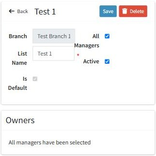

On a list of a **sub-branch** there is also **Parent Managers**, and the **Owners** grid names the managers who can
order for the list wherever they are (*Add new owner*). Below, *Test Branch 1.3* is a list of *Test Branch 1.1* that
only its owner, Steve Gates, can order for:

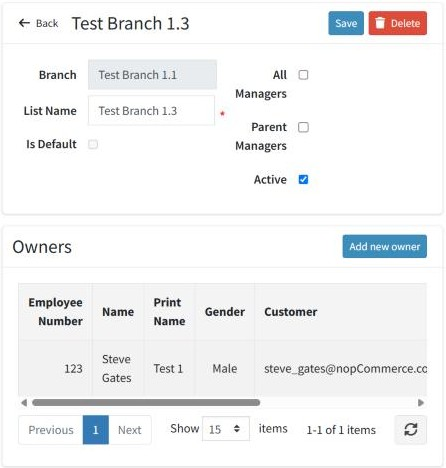

Choosing a list (rather than *Edit*) shows its packnames in a grid with the same bulk actions as §5.4.

### 5.3 A packname

*Edit* on a packname (from a list or from the **PackNames** tab) opens its form. The branch is shown for
information; the **PackName List** picker moves the packname to another list. **Associate a customer** links an
existing account; **Clear** unlinks it. **Manager** makes the person a manager (they must have an account).

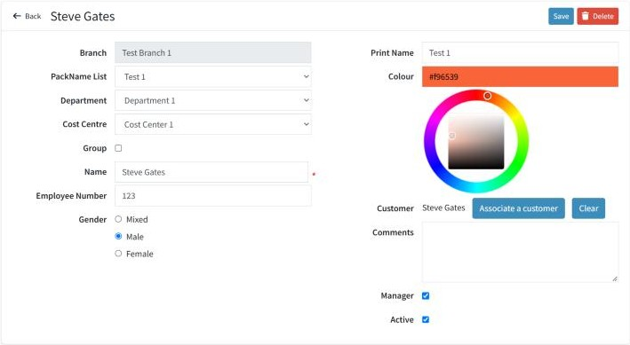

Below the form, the **Addresses** grid lists everything the packname can be delivered to: its **own** addresses
(*Edit / Delete*), its branch's addresses (marked with the branch code, maintained on the branch) and its account's
addresses (*From Customer*). *Add new address* adds one of its own.

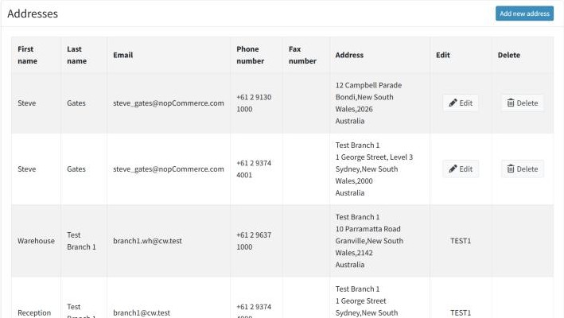

Further down are the packname's **subsidies** — credit, top-ups, what has been used and the history — described in the
*Returns, Exchanges and Store Credit* guide.

### 5.4 The PackNames tab — every packname of the store

The **PackNames** tab lists every packname of the store with a search (name, e-mail, kind, gender, branch,
department, cost centre, managers only). Ticking packnames enables the **bulk actions**:

- **Activate / Deactivate**;
- **Move to list** — to another list of the store (the same checks as a single move: the name must not already be in
  the target list, and the list and its branch must be active);
- **Delete**;
- **Export selected to Excel** (or **Export to Excel** for the whole search).

Up to 500 packnames are handled at a time. **Import from Excel** and **Add a new PackName** are at the top;
**Customers Without PackName** lists the store's customers who have no packname yet.

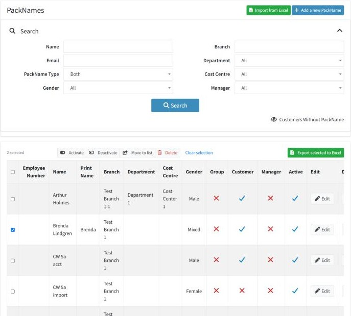

### 5.5 Importing packnames from Excel (administrator)

*Import from Excel* opens a three-step page: **download the template**, **fill it in** (one row per packname, up to
500 rows, values picked from dropdowns), **upload and import**.

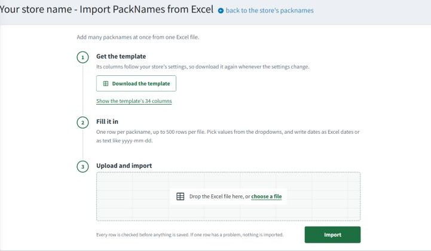

- The template's columns follow the store's settings. In the test store it has 34: branch, name, group, department,
  cost centre, employee number, gender, print name, colour, comments, two groups of subsidy columns (name, credit,
  start, end), the account columns (add customer, e-mail, first and last name) and the address columns. **Download it
  again whenever the settings change.**
- Each packname goes to the **default list** of the branch named on its row when that list is active, otherwise to
  another active list of the branch; a list is created only when the branch has no active list.
- **Every row is checked before anything is saved. If one row has a problem, nothing is imported**, and the page offers
  a copy of the file with an **Errors** column naming each row's problems. Fix the file and upload it again.
- Rarely, a row passes the check but is refused while saving (for example, someone added the same name in the
  meantime). The import then stops at that row: everything before it is kept, and the page says which row it stopped
  at.
- Rows that create an account send that person the welcome e-mail (§9).

### 5.6 Departments

The **Departments** tab lists the store's departments. *Edit* opens the department: its name, **Active**, and its
**Managers** — packnames who can order for everybody in the department (*Add managers*).

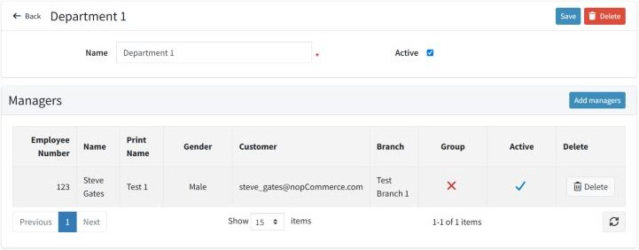

To show a product, category or manufacturer only to certain departments, use the **Departments** panel in its
access-control settings (it offers the departments of the stores the item is mapped to).

### 5.7 Cost centres

The **Cost Centres** tab lists the store's cost centres; tick **From Branches** to include those that belong to a
single branch. A branch's own cost centres are also maintained on the branch (§5.1).

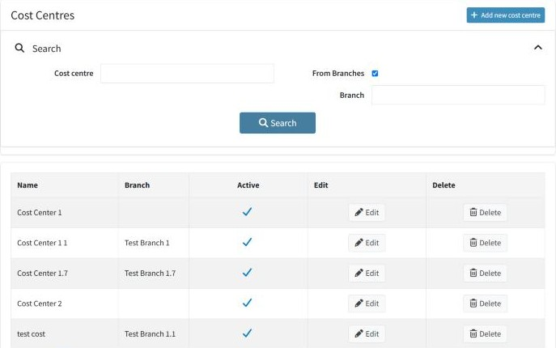

### 5.8 Customers and packnames

On a customer's page in *Customers › Customers*, CW adds a **Branch** field:

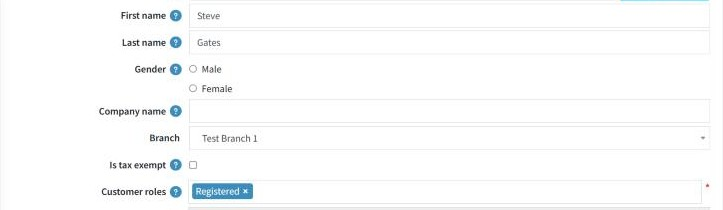

- With *Use Staff as PackNames* on, linking a customer to a branch creates their packname in the branch's default
  list (named "First Last"). If that list already has someone with that name, nothing is created and the page says so.
- Changing the branch of a customer who has a packname moves the packname to the new branch's default list. The save
  is refused, with a message, when that list already has someone with the same name, when the branch belongs to
  another store, or when the branch is removed altogether.

Further down, the **PackName** card shows the customer's packname read-only, with **Open in Manage Store** to edit it:

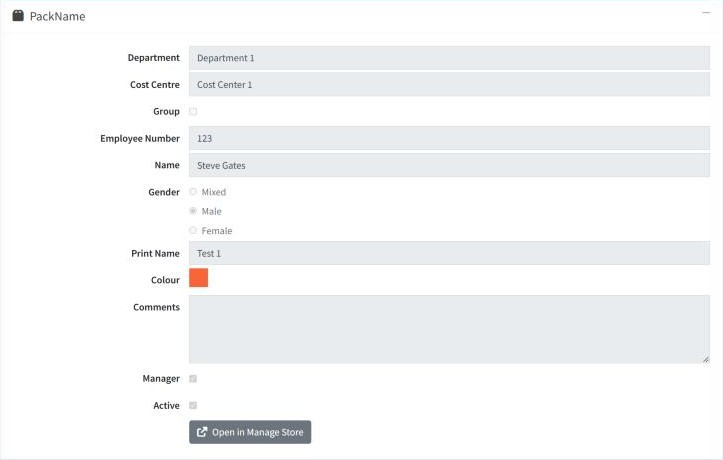

Deleting a customer keeps their packname (and its order history) as a packname without an account, and no longer a
manager.

### 5.9 Store settings

The **Store Settings** tab holds every packname setting for this store (§11). The tick box on the left of each row
means **override for this store**; an unticked row uses the value in *CW Admin › Default settings*. Two buttons create
what is missing in one go: **Generate PackNames for all Customers** (for customers already linked to a branch who
have no packname; branches with no active list get one too) and **Generate PackName Lists for Branches**. Both also
save the three settings beside them, and work **in the background**, so the results appear a little later; a customer
skipped because the name is already taken is listed only in the system log.

---

## 6. The manager's journey, screen by screen

### 6.1 The selector

A manager sees the selector above the header on every page: **List** chooses which list (or department) to pick
from, **Order for** chooses the person. The green **+** adds a packname and the grid icon opens the Excel import
(each only when the store allows it).

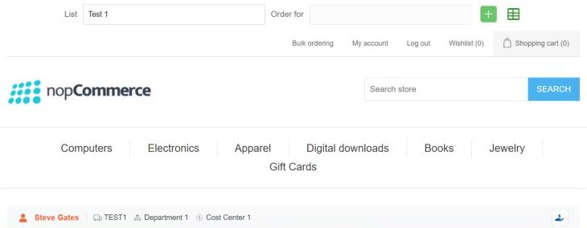

The **List** dropdown offers one entry per list the manager can order from, plus one per department they manage, in
alphabetical order; lists with nobody in them are not shown (§2.6). In the test store Steve sees:
*Test 1* (his own list), *Test Branch 1.1 L* (an *All Managers* list of a sub-branch), *Test Branch 1.3* (a list he
owns) and *Department 1 (Dept)* (the department he manages).

**Order for** lists the people, with a search box. A filled person icon means the packname has an account, an
outline icon means it has none, and a group has an icon of its own; the employee number is shown next to the name; the
pencil opens the packname's form.

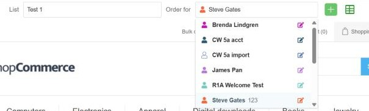

Once something is in the cart for a person, the selector shows how many items are waiting for them:

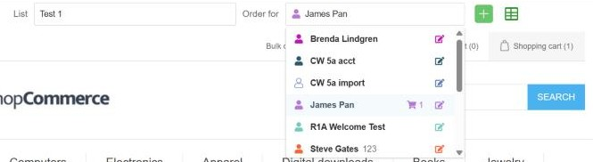

### 6.2 The information strip

Under the header, a strip names the selected packname with their colour, branch code, department and cost centre.
When the packname has a subsidy running, a button on the right opens a summary of what is left. The strip also warns
when ordering is closed for this person, or when they have no delivery address.

### 6.3 Shopping for someone

With a person selected, the shop is **theirs**: the menu, the categories and the search show what that packname may
see (§2.8), and "Add to cart" puts the product in **their** part of the cart. Switch person and carry on; nothing in the
cart changes when the selection changes.

### 6.4 Adding a packname

The **+** button opens *Add PackName*. The branch, department and cost centre pickers offer only active entries of
the manager's store. *Use Branch* means "none": the packname then has no department or cost centre, and their orders
carry none. The fields shown follow the store's settings. **Subsidies** appear when the store lets managers choose
them.

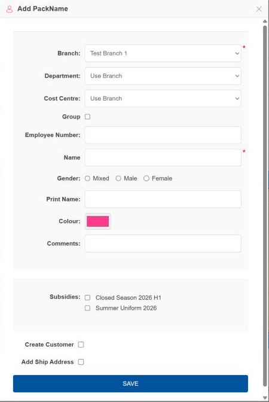

**Create Customer** (when the store allows it) creates an account at the same time and sends the welcome e-mail;
**Add Ship Address** (when the store allows home delivery) gives the packname a delivery address of their own:

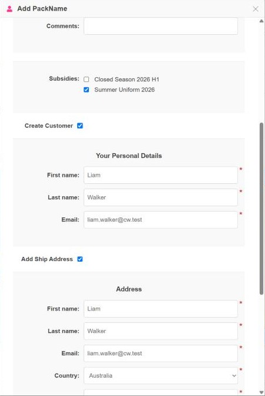

The new packname is selected straight away, so the manager can start ordering for them. Below, Liam Walker has just been
added with a subsidy that shows only its own products, so the menu has shrunk to the two categories that hold them:

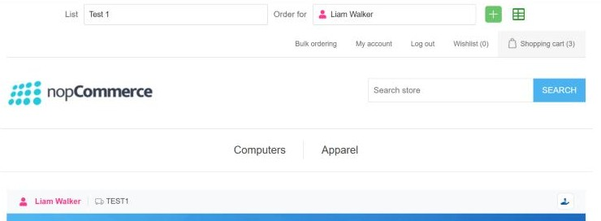

A **group** packname never
gets an account. Only an administrator can make someone a manager.

### 6.5 Editing and deleting

The pencil in **Order for** opens the same form for an existing packname (without the account part). Changing the
branch moves the person — and their account — to that branch. **Delete** removes the packname and their subsidy
assignments; their orders keep everything they were placed with, and their account (if any) stays, without a
packname. A manager cannot delete their own packname, and cannot deactivate anyone: deactivating is done in admin.
All of this needs the store setting *Allow Managers to Add PackNames*; with *Limit to Manager's Assigned Branches* on,
the pencil appears only for people in lists the manager can add to.

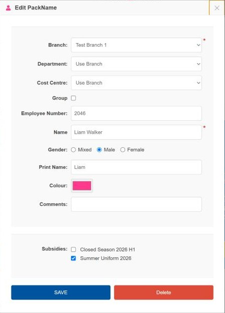

### 6.6 The packname checkout

Opening the cart takes the manager to the **packname checkout**. The two icons at the top switch between two views:

- **View by packName** (people icon, the default): each person with their lines, and the person's box on the right.
  The arrow on the box opens their **delivery methods** (with the price of each) and **addresses**:

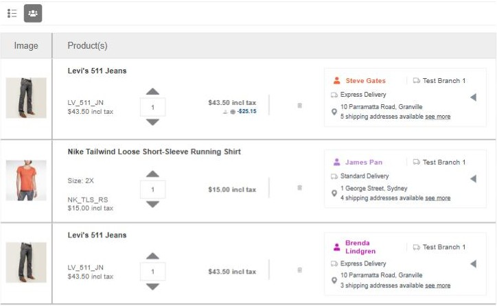

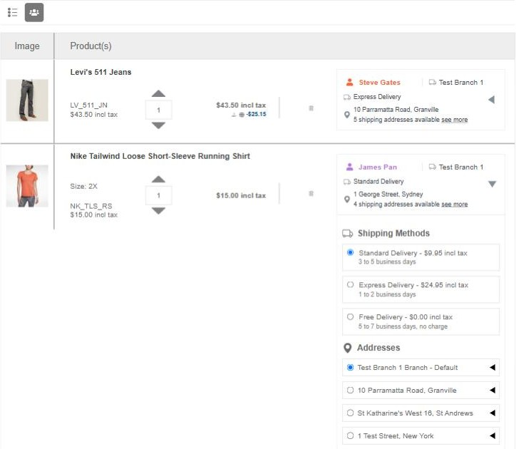

- **View by product** (list icon): one row per product, with everyone who is getting it underneath — handy for
  checking sizes:

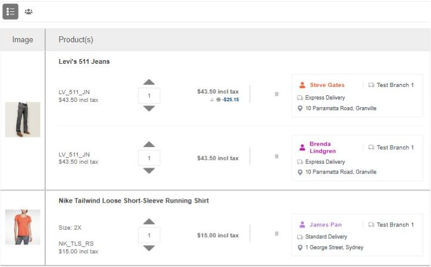

**Which delivery methods are offered:** the branch's own list when it has one, otherwise the store's list; the first
one is the default. **Which addresses are offered:** the branch's default address first, then the branch's other
addresses; with *Allow Home Delivery* on, also the packname's own addresses and their account's addresses. With
*Allow Customers To Add Address* also on, a new address can be added at the checkout.

The **order summary** adds up the goods and every destination's delivery charge, takes off the subsidy (each
packname's own lines, from their own subsidy) and any store credit, and shows the **payable balance**:

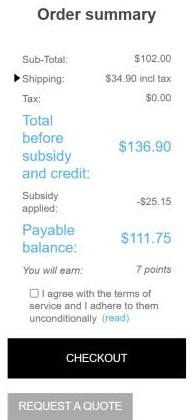

In the example, Steve's and Brenda's jeans go to the branch warehouse by *Express Delivery* ($24.95, **once** for
both), and James's shirt to the branch reception by *Standard Delivery* ($9.95): $34.90 delivery. Steve's subsidy pays
$25.15 of his own jeans.

The order is refused, with a message at the top of the page, if a packname has no address or no delivery method, if
a line asks for more than their subsidy allows, or if a line can no longer be ordered (for example, their ordering
period has closed). Only the packname's own branch addresses are offered, not those of a parent branch: with home
delivery off, the people of a branch with no addresses cannot be ordered for.

### 6.7 The thank-you page and the order page

After *Checkout*, the thank-you page lists each packname with their branch, department, cost centre, delivery method,
address and items, and says who shares a parcel ("Shared with: Brenda Lindgren"):

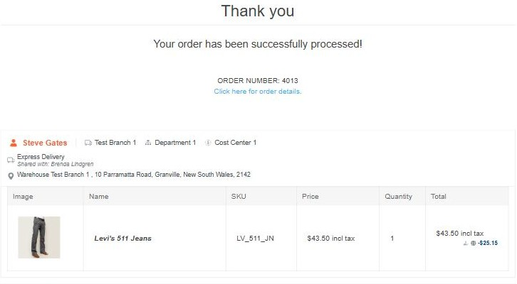

The order stays in the manager's **My account › Orders**, grouped the same way, with the totals at the bottom:

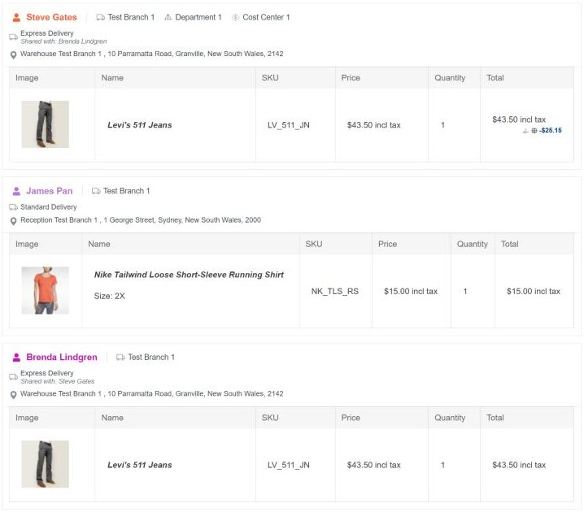

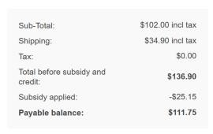

*Re-order* puts every line back in the cart **for the packname it was ordered for**; people the manager no longer
reaches are skipped.

### 6.8 Importing packnames from the shop

The grid icon next to **+** opens the same three-step import as the administrator's (§5.5). The manager's template
follows the store's settings: the account columns only when managers may create accounts, the subsidy columns only
when they may choose subsidies, and the branches only those they may add to.

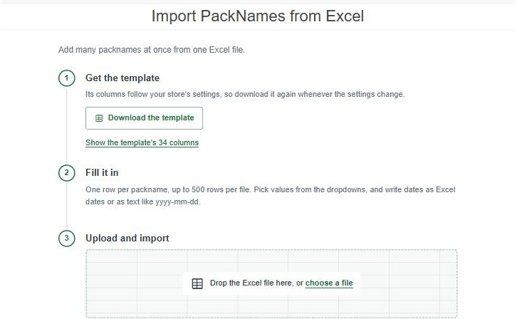

---

## 7. The employee's journey

An employee with an account signs in like any customer. There is **no selector**: they always order for themselves,
and the strip names them:

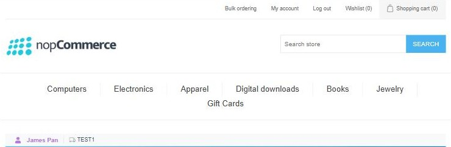

They see their own catalogue and subsidy, use the same packname checkout (with only themselves on it) and find
**their own** orders in *My account › Orders*. Orders a manager placed for them are in the manager's account, not
theirs.

New employees created with an account receive the welcome e-mail (§9) and set their own password from its link.

---

## 8. After the order: delivery, shipments and documents

### 8.1 The admin order page

A packname order looks different in *Sales › Orders*. Instead of one products card there is **one card per
packname**: branch, department, cost centre, delivery method (with a **Shared** badge when the parcel is shared),
shipping status, delivery charge, address and items, and the subsidy used for that person:

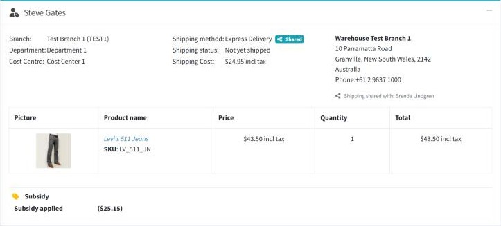

The *Info* card shows the *Total before subsidy and credit*, the subsidy and the order total.

### 8.2 Shipping destinations and shipments

The **Shipping destinations** table lists one row per destination (address + method) with the packnames going there,
its shipping status and an **Add shipment** button:

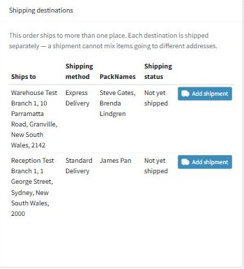

*Add shipment* opens nopCommerce's shipment form showing **only that destination's items**, each with a **For** line
naming the packname, department and cost centre it is for — so two identical products going to different people can be
told apart. A shipment can never mix items going to different places. Below, the reception row of order #4013 offers
only James Pan's shirt:

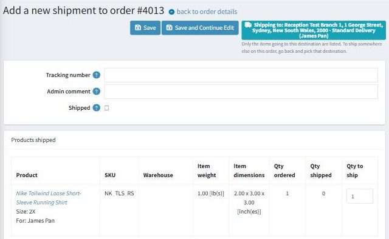

Once saved as shipped, that destination's packnames move to *Shipped* while the other destination stays *Not yet
shipped*; the order becomes *Partially shipped* and the manager receives nopCommerce's "shipment sent" e-mail ("Your
order … has been partially shipped").

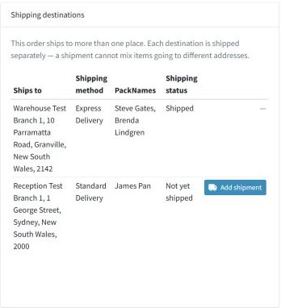

The **Shipments** grid below has a **Ships to** column:

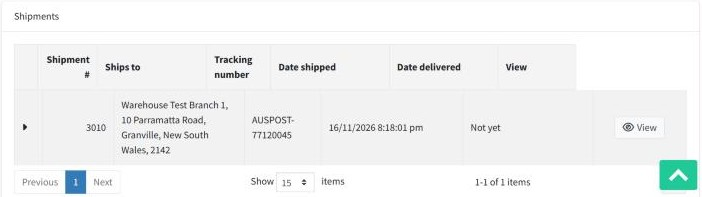

When a destination is delivered (*Set as delivered* on the shipment), its packnames move to *Delivered*. The order
is delivered when every destination is.

### 8.3 What cannot be changed on a placed packname order

To keep each person's lines, subsidy and delivery correct, these nopCommerce admin actions are **refused** on a
packname order: adding, editing or deleting items, editing the totals, editing the order's addresses (delivery or
billing) and changing the delivery method. **Cancelling** the order works as usual (the subsidy and any store credit
used come back); to change an order, cancel it
and place a new one.

### 8.4 Documents and reports

- The **PDF invoice** lists every delivery destination of the order and shows the subsidy and store credit in the
  totals.
- The **packing slip** of a shipment prints the destination's address and each item's details (personalisation
  included).
- Every order line keeps a record of the **packname, branch, department and cost centre as they were when it was
  ordered**, so the order reads the same after someone moves branch or changes name.

---

## 9. E-mails

| When | Who receives it | What it says |
|---|---|---|
| A packname is created **with an account** (manager's form, Excel import) | The new person | Their name, employee number, branch and subsidies, and a link to **set their password** |
| An order is placed, shipped, delivered, completed | The person who placed it (the manager) | nopCommerce's standard order e-mails, with the subsidy in the totals |
| A subsidy is about to expire (when the store has the reminders switched on in *Promotions › Reminders*) | People with an account and a subsidy | How much of their subsidy is left and when it ends |

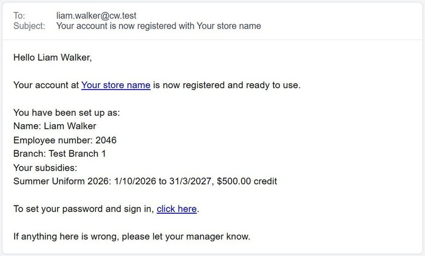

The set-password link is nopCommerce's own password-recovery link, valid for the number of days set in nopCommerce's
customer settings.

---

## 10. Worked scenarios from the test store

The test store's structure: *Test Branch 1* (code TEST1) with sub-branches 1.1 to 1.7; list *Test 1* (All Managers)
on *Test Branch 1*; manager **Steve Gates** (employee 123, *Department 1*, *Cost Center 1*), who manages *Department
1* and owns list *Test Branch 1.3*. Store settings as in §11.

| # | Situation | What happened |
|---|---|---|
| A | **Steve orders for three people** | He picked James Pan and added a running shirt ($15.00), Brenda Lindgren and added jeans ($43.50), then himself and added jeans ($43.50). At the checkout James got *Standard Delivery* to the branch reception, Steve and Brenda *Express Delivery* to the branch warehouse. One order, **#4013**: goods $102.00, delivery $34.90 (**$24.95 once for the shared warehouse parcel + $9.95**), Steve's subsidy −$25.15, **payable $111.75**. The thank-you page showed "Shared with" on Steve's and Brenda's boxes |
| B | **A new starter with an account** | From the **+** button Steve added *Liam Walker* (employee 2046, male, print name "Liam") with an account, a home address in Fitzroy VIC and the *Summer Uniform 2026* subsidy. He was selected straight away. Because his subsidy shows only allocated products, the menu shrank to the two categories holding them. Liam received the welcome e-mail with his subsidy ($500.00, 1/10/2026 to 31/3/2027) and a set-password link |
| C | **An employee signs in** | James Pan (an employee with an account) saw no selector, only his own name in the strip. His *Orders* page did not include #4013, which is in Steve's account |
| D | **Shipping one destination** | In admin, *Add shipment* on the warehouse row offered only Steve's and Brenda's jeans. Saved as shipped with tracking AUSPOST-77120045: the warehouse row became *Shipped*, the reception row stayed *Not yet shipped*, the order became *Partially shipped* and Steve received the "shipment sent" e-mail ("has been partially shipped") |
| E | **Who Steve can order for** | His List dropdown offered *Test 1* (his own branch), *Test Branch 1.1 L* (All Managers, on a sub-branch), *Test Branch 1.3* (he is its owner) and *Department 1 (Dept)* (he manages the department) |

---

## 11. Configuration

### 11.1 Where

- **Per store:** *CW Admin › MultiStores › Manage Store › Store Settings*. Tick the box on the left of a row to give
  this store its own value.
- **For all stores:** *CW Admin › Default settings*.

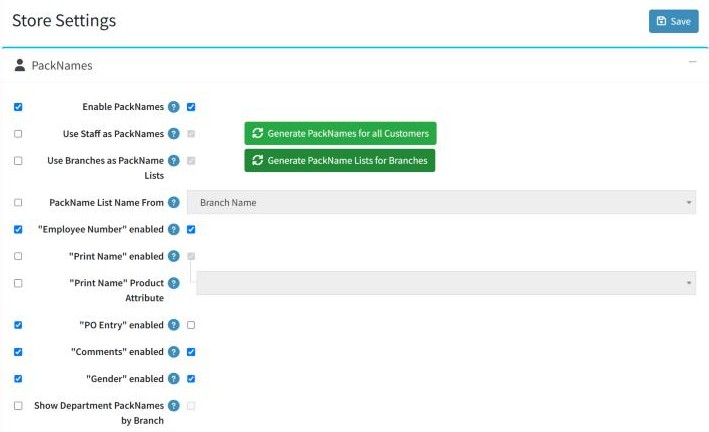

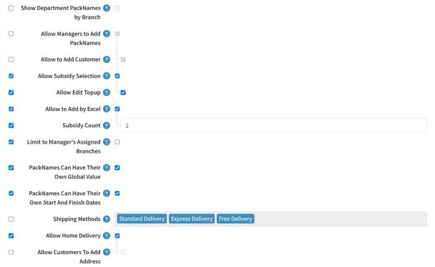

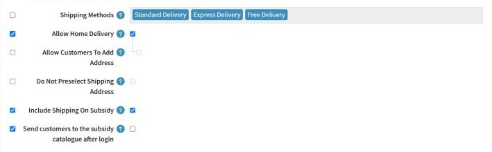

### 11.2 The settings

| Setting | What it does | Test store |
|---|---|---|
| **Enable PackNames** | Switches the whole feature on for the store. Off: the store behaves like standard nopCommerce (no selector, normal cart and checkout) | On |
| **Use Staff as PackNames** | Linking a customer to a branch creates their packname in the branch's default list. The button creates them now, in the background, for customers linked to a branch who have none | On |
| **Use Branches as PackName Lists** | A new branch gets its default list automatically. The button creates them now for branches that have none | On |
| **PackName List Name From** | Names those lists after the branch's code or name | Branch name |
| **"Employee Number" / "Print Name" / "PO Entry" / "Comments" / "Gender" enabled** | Shows that field on packname forms, imports and the checkout | All but PO Entry |
| **"Print Name" Product Attribute** | The product attribute (for example an embroidery text) that the print name fills in | — |
| **Show Department PackNames by Branch** | Department managers see each branch's list holding only the department's people, instead of one list per department | Off |
| **Allow Managers to Add PackNames** | Managers may add, edit and delete packnames from the shop. Also needed for the manager's import and for top-up editing | On |
| **Allow to Add Customer** | Managers may create an account with a new packname, and the manager's template gets the account columns | On |
| **Allow Subsidy Selection** | Managers may tick subsidies for a packname, and the manager's template gets subsidy columns | On |
| **Allow Edit Topup** | Managers may change subsidy top-ups (also needs *Allow Managers to Add PackNames*) | On |
| **Allow to Add by Excel** | Shows the Excel import button to managers | On |
| **Subsidy Count** | How many groups of subsidy columns the Excel template has (1–10) | 2 |
| **Limit to Manager's Assigned Branches** | Managers may add or import packnames only into branches holding a list they can order from (and the new person goes into that list) | Off |
| **PackNames Can Have Their Own Global Value / Start And Finish Dates** | A packname's subsidy can differ from the subsidy's own credit or dates | On |
| **Shipping Methods** | The delivery methods packnames may use, the first being the default. Empty = every CW Freight method. A branch's own list replaces it | Standard, Express, Free Delivery |
| **Allow Home Delivery** | Packnames' own addresses (and their accounts' addresses) are offered at the checkout, besides the branch's. Also shows *Add Ship Address* on the add form and the address columns in the Excel template | On |
| **Allow Customers To Add Address** | A new address can be added at the checkout (needs *Allow Home Delivery*) | Off |
| **Do Not Preselect Shipping Address** | Nobody has an address chosen in advance at the checkout. Switching it on also clears the addresses already chosen in every cart of the store | Off |
| **Include Shipping On Subsidy** | Subsidy money can also pay delivery | On |
| **Send customers to the subsidy catalogue after login** | After signing in or choosing a person, land on the subsidy catalogue when that person has a subsidy with product groups | Off |
| **Default Customer Roles** (*Registration*) | Roles given to accounts created for packnames (the manager's form and both Excel imports; not when an administrator links an existing customer), and the catalogue that packnames **without** an account see | — |

Related settings elsewhere: *Enable Subsidy*, *Enable Credit Notes*, *Enable Exchanges* and *Bulk Ordering* in the same
tab; the delivery methods and their rates in the CW Freight plugin.

### 11.3 nopCommerce options to keep off on packname stores

Some nopCommerce 5.00 options do not work with ordering for other people and must stay **off**: sign-in by phone code,
vendors, price lists, the withdrawal form and automatic cancellation of unpaid orders.

---

## 12. Things to know, and open points

**How it works today**

1. **Prices follow the manager.** The catalogue and the subsidy are the packname's, but discounts and tier prices are
   the signed-in person's.
2. **One delivery charge per destination.** Packnames going to the same address with the same method share a parcel
   and pay one charge between them; a different address or method is a separate parcel and a separate charge.
3. **Orders sit in the account of the person who placed them.** An employee does not see, in their own account, the
   orders a manager placed for them.
4. **Deactivating is safe; deleting is final.** An inactive list disappears from ordering at once but stays in admin;
   an inactive packname disappears from the selector and their cart lines are put aside until they are active again.
   An inactive branch, department or cost centre is just not offered for new packnames. Deleting a packname removes it,
   their cart lines and their subsidy assignments; their past orders keep everything.
5. **A branch cannot be deleted** while it has sub-branches, lists or cost centres.
6. **Names are unique inside a list.** Adding, importing, moving or creating a packname automatically is refused (or
   skipped and reported) when the target list already has someone with that name.
7. **Only an administrator makes managers**, and a manager must have an account.
8. **A placed packname order cannot be edited in admin** — only cancelled (§8.3).
9. **Coupons, gift cards and pickup in store** are not offered on the packname checkout.
10. **Packnames switched off** for a store makes it a standard nopCommerce shop for new orders; packname orders
    already placed keep their packname information.

**Open points**

11. **Cost centre addresses** can be entered in admin but are not offered at the checkout or used anywhere yet.
12. **Payment methods that take payment on their own page** (PayPal): the packname checkout checks the order, hands
    the manager to the payment page and places the order when the payment comes back, but this has not yet been
    tested end to end with PayPal, so PayPal stays switched off on packname stores until it is.
13. **One more item on a placed order** has no answer today other than a new order (§8.3).

---

## 13. Quick reference

**Administrator**

- Everything is in *CW Admin › MultiStores › Manage Store*: **Branches** (tree, lists, cost centres, addresses),
  **Departments**, **Cost Centres**, **PackNames**, **Store Settings**.
- New client: branches → lists (or *Use Branches as PackName Lists*) → packnames (one by one, Excel import, or *Use
  Staff as PackNames*) → managers (tick *Manager*; give lists *All Managers*, *Parent Managers* or owners as needed).
- Bulk work: tick packnames on the PackNames tab → Activate / Deactivate / Move to list / Delete / Export.
- Prefer **deactivating** to deleting.

**Manager**

- Pick **List** and **Order for**, shop, pick the next person. The number next to a name is what is in the cart for them.
- **+** adds a person; the grid icon imports many; the pencil edits one.
- At checkout check each person's **address and method**; people sharing an address and method share one delivery
  charge.
- Your orders are in *My account › Orders*, grouped by person.

**Sales Support**

- On a packname order use **Add shipment** on each row of *Shipping destinations*.
- Don't try to edit a packname order's items or totals — cancel and re-order instead.
