# Subsidies — Functional Guide

**System:** CW store on nopCommerce **5.00**, with the CW Core plugin
**For:** managers, store administrators, Sales Support and clients. You do not need any technical knowledge to read it.

> **About the examples.** Every screen in this guide is a real screenshot from the CW test store, taken while the
> scenarios in §10 were run: real product groups, real subsidies, real top-ups and real orders. The people
> (*Steve Gates*, *Olivia Chen*, *Liam Walker*), the branches and the products are test data. **All amounts are in
> Australian dollars (AUD)**, shown with the "$" sign as Australian stores show them.
>
> Subsidies work together with packnames (who a garment is for) and with returns (what comes back when a garment is
> returned). Those parts have their own guides: *PackNames — Functional Guide* and *Returns, Exchanges and Store
> Credit — Functional Guide*. Things that work differently from what you might expect are collected in §12.

---

## Contents

1. [The short version](#1-the-short-version)
2. [Key ideas in plain language](#2-key-ideas-in-plain-language)
3. [The whole picture at a glance (diagrams)](#3-the-whole-picture-at-a-glance)
4. [nopCommerce and CW: who does what](#4-nopcommerce-and-cw-who-does-what)
5. [The administrator's journey, screen by screen](#5-the-administrators-journey-screen-by-screen)
6. [The manager's journey, screen by screen](#6-the-managers-journey-screen-by-screen)
7. [The employee's journey](#7-the-employees-journey)
8. [What happens to the money](#8-what-happens-to-the-money)
9. [E-mails and reminders](#9-e-mails-and-reminders)
10. [Worked scenarios from the test store](#10-worked-scenarios-from-the-test-store)
11. [Configuration](#11-configuration)
12. [Things to know, and open points](#12-things-to-know-and-open-points)
13. [Quick reference](#13-quick-reference)

---

## 1. The short version

A **subsidy** is what a client company gives each of its people (each **packname**) to spend on uniforms during a
**period** — for example "from 1 October to 31 March, $500 plus two free shirts and one pair of trousers".

- An **administrator** builds the subsidy in *CW Admin › MultiStores › Manage Store*: first the **product groups**
  ("Shirts", "Trousers & Belts", "Footwear & Hats"), then the **subsidy** with its period, its money, the **units or
  money per product group**, and the **packnames** it is given to.
- A **manager** shopping for someone (or an **employee** shopping for themselves) sees what that person has left at
  the top of the **subsidy catalogue**, and every product they can choose grouped by product group.
- At checkout the subsidy pays automatically, in a fixed order (units first, then group money, then the subsidy's
  general money). Whatever is not covered is paid by store credit and then by the customer.
- During the period an administrator or a manager can **top up** a person (add units or money) and an administrator
  can give one person a **different amount or different dates** (a *variation*).
- When the period ends, what is left cannot be used. A subsidy that **repeats every year** is full again on the first
  day of the next period, with nothing to do. Customers can be **reminded by e-mail** before their subsidy ends.

The central rule:

> **The subsidy belongs to the person the garment is for**, not to the person placing the order. A manager ordering
> for Olivia spends Olivia's subsidy on Olivia's garments, and his own subsidy only on his own.

---

## 2. Key ideas in plain language

### 2.1 Product group

A **product group** is a named set of products — "Shirts", "Trousers & Belts", "Safety Gear" — with an **icon** and a
**colour** so people recognise it in the shop. A group belongs to one store and can be used by several subsidies,
each giving it different amounts. A product can be in more than one group.

A group switched to **not active** stops counting at once: it is no longer shown in the shop and it no longer pays for
anything, in any subsidy.

### 2.2 Subsidy

A **subsidy** is the rule itself. It has:

| Part | Meaning | Example |
|---|---|---|
| **Name** and **description** | What people see | *Summer Uniform 2026* |
| **Duration start / end** | The **ordering period** — the days on which the subsidy can be spent | 1/10/2026 to 31/3/2027 |
| **Annual Recurrence** | The period repeats every year on the same dates | *Safety Kit 2026*: 1 July to 30 June, every year |
| **Credit Allocation** | General money for each person, usable on any product the person may buy (and on delivery, when the store allows it) | $500 |
| **Product groups** | For each group: **Quantity** (free units) and/or **Credit** (money only for that group) | Shirts: 2 units · Trousers & Belts: 1 unit + $40 · Footwear & Hats: $60 |
| **View Only Allocated Products** | The person sees only the products of the subsidy's groups (§2.6) | On |
| **Include Managers** | The two restrictions also apply to people who are managers | Off |
| **Order Outside Period** | The person can still order outside the period, at full price. *View Only Allocated Products* still applies | Off |
| **Restrict To Allocated Qty** | The person cannot put more units in the cart than the subsidy gives (§2.7) | On, on *Safety Kit 2026* |
| **Active** | An inactive subsidy gives nothing | On |

### 2.3 Units and money

There are three kinds of entitlement, and they are always used in this order:

1. **Units of a product group** — "2 shirts". Counted in garments: a $15 shirt and a $24 shirt each use one unit.
2. **Money of a product group** — "$60 towards Footwear & Hats". Only products of that group can use it.
3. **General money** of the subsidy (*Credit Allocation*) — "$500". Any product the person may buy can use it —
   except that, on a subsidy set to *View Only Allocated Products*, it pays only for the products of that subsidy's
   groups. It is the only part that can pay for **delivery**.

Each of the three can have **top-ups** (§2.5), which are used after the original amount.

### 2.4 Assignment

A subsidy does nothing until it is **given to packnames**. Each packname that has it gets their own, separate
entitlement: two people with *Summer Uniform 2026* each have $500 and two shirts. To take a subsidy away from someone,
delete them from the subsidy's PackNames list.

The subsidy can be given to packnames in three ways: on the subsidy's **PackNames** list in admin, by a manager on the
shop's **Add / Edit packname** form (when the store allows it), or in an **Excel import** of packnames (by a manager or
an administrator).

### 2.5 Top-ups and variations

- A **top-up** adds to one person's subsidy for the **current period**: extra general money, or extra units and/or
  money for one product group. A top-up always **adds** — entering 50 adds $50 — and needs a reason. It cannot be
  negative; to reduce someone's subsidy, use a variation. A top-up can also be made **before a period starts**: it then
  counts for that period (for a yearly subsidy, a top-up made between two periods counts for the next one), and it is
  shown on the person's subsidy straight away. Top-ups do not carry over from one period to the next. Only after a
  one-off subsidy has ended can no more top-ups be made.
- A **variation** gives one person a **different general amount** and/or **different dates** from everyone else
  ("part-time: $400 instead of $500"). Variations are offered only when the store allows packnames to have their own
  value or their own dates (§11). A variation can also be set when a person is added by Excel import (credit and date
  columns, shown when the store allows them). If the store later switches those settings off, people's variations are
  kept but no longer used: everyone gets the subsidy's own amount or dates.

Every top-up and variation is recorded with who made it, when and why, and shown in the history (§5.6, §7.3).

### 2.6 What a person can see

When **every** subsidy a person currently has is set to *View Only Allocated Products*, the shop shows that person
**only the products of their subsidies' product groups**, and only the categories that hold them. A person with at
least one subsidy without that setting sees the whole catalogue (as their customer roles allow).

When none of the person's subsidies is in its period or allows ordering outside it, the person **cannot order at
all**: the shop shows them nothing and they cannot be selected for ordering.

### 2.7 The quantity limit

*Restrict To Allocated Qty* stops a person's cart from holding more units of a product than their subsidy still gives
— "2 pairs of safety glasses, and not a third". It can only be switched on for a subsidy that gives **units and no
general money**, that shows only allocated products and does not allow ordering outside the period. If the subsidy or
a group holding the product still has **money** left (including money from a top-up or a variation), the limit does
not apply, because the extra units can be paid from that money. The limit comes back once that money is spent.

### 2.8 The ordering period

The period is counted in the **store's own time zone**: a subsidy ending on 31 March ends at midnight at the end of
31 March in the store's time. Before the start date and after the end date the subsidy cannot be spent.

A subsidy with **Annual Recurrence** has a real period every year. When this year's period ends, the subsidy is full
again on the first day of the next one — nothing has to be done. A period may cross New Year (1 July to 30 June), and
29 February is read as 28 February in a year that has no 29th.

A yearly subsidy's dates do not need moving forward each year: it repeats by itself. **Do not move a running yearly
subsidy's dates to a later year.** The dates entered mark its first period, and top-ups made before that first period
count for it. Moved forward a year, the subsidy's first period becomes the new dates, and last year's top-ups count
again in it. To change a yearly subsidy's dates, keep the year of its first period; to start afresh, create a new
subsidy.

---

## 3. The whole picture at a glance

**Colour key:**
🟦 blue = the customer (manager or employee) · ⬜ grey = standard nopCommerce · 🟩 green = CW additions (automatic) ·
🟧 orange = administrator · 🟨 yellow = a decision · 🟥 red = refused / stops · 🟪 purple = finished.

### 3.1 How a subsidy is built

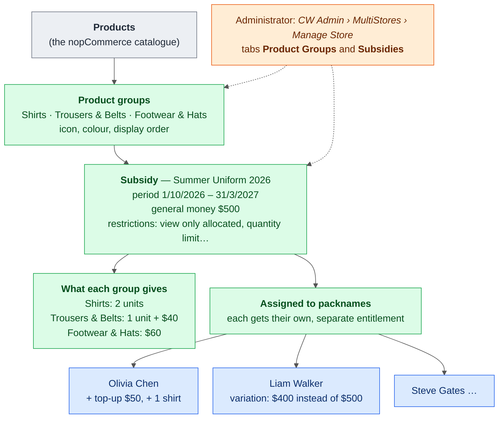

### 3.2 Setting up a subsidy

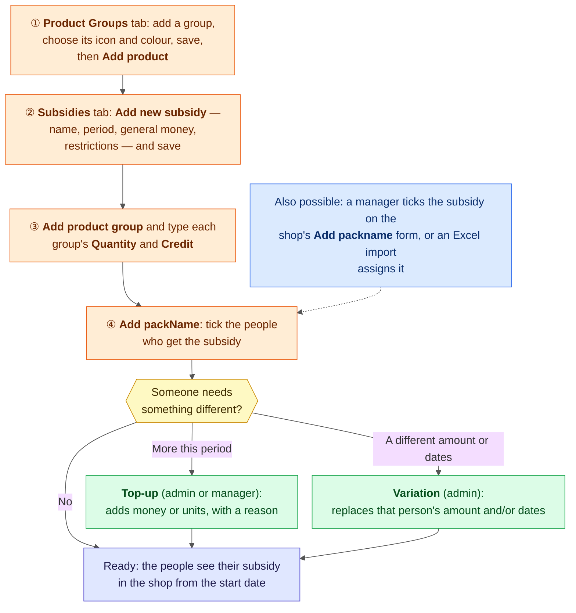

### 3.3 What a person can see and order

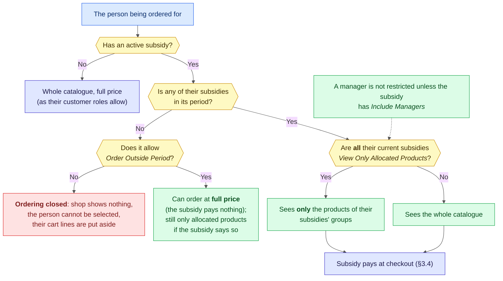

### 3.4 How the subsidy pays at checkout

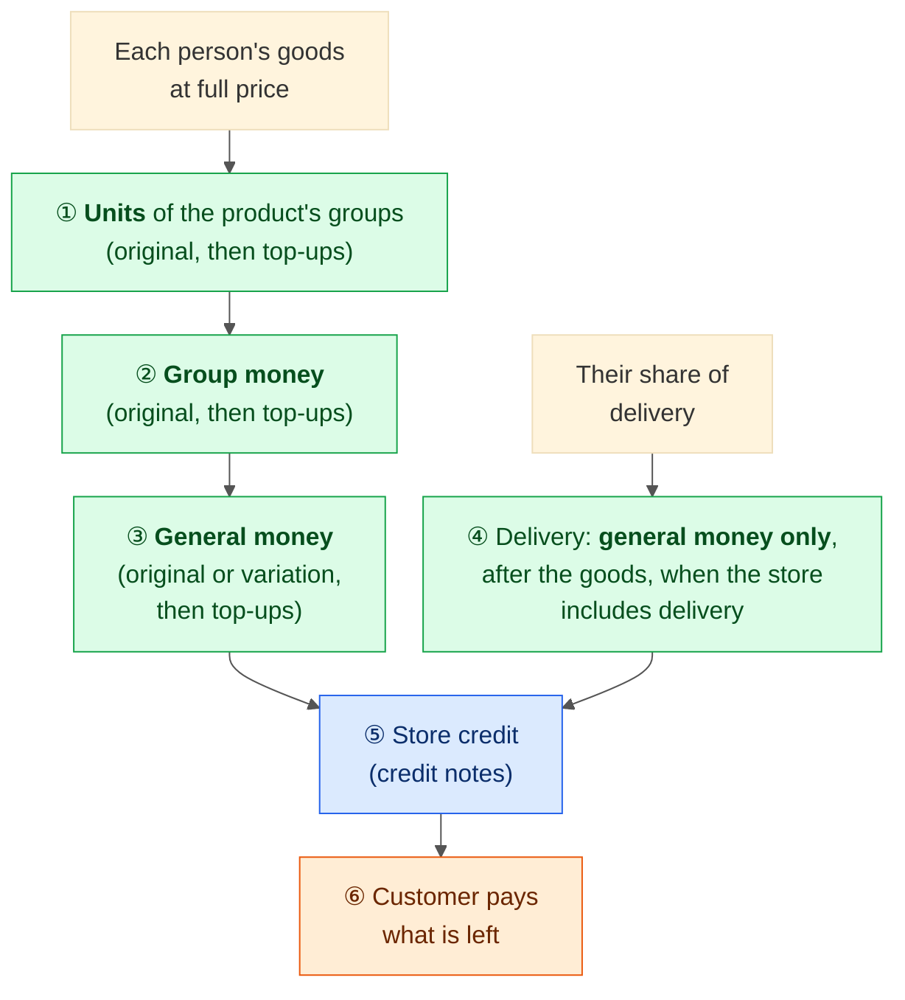

### 3.5 The life of a period

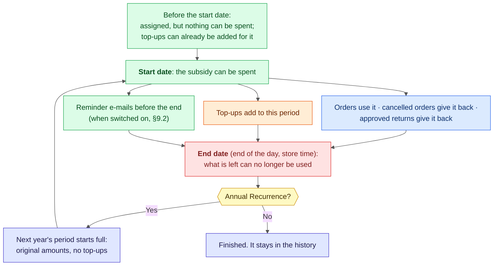

---

## 4. nopCommerce and CW: who does what

nopCommerce has no idea of a subsidy: a customer pays for what they buy, with money, gift cards or reward points.
**Everything about subsidies — product groups, periods, units, per-person entitlements, top-ups, the subsidy
catalogue and the restrictions — is CW.** CW builds on nopCommerce rather than replacing it: an order paid partly or
wholly by subsidy is still a nopCommerce order, with the subsidy shown in its totals.

### 4.1 Where they agree (CW uses nopCommerce as it is)

| Feature | nopCommerce | CW |
|---|---|---|
| **Products, prices, categories** | Standard | Product groups point at ordinary products; prices do not change |
| **Orders, statuses, payment** | Standard | Same orders. The subsidy is recorded on the order; the customer pays the rest by any payment method |
| **Cancelling an order** | Standard | Cancelling gives the subsidy back automatically |
| **Reminder e-mails** | *Promotions › Reminders* (abandoned carts, incomplete registrations) | The subsidy expiry reminder is a fourth card on the same page, working the same way |
| **E-mail templates** | *Content management › Message templates* | The subsidy e-mails are ordinary templates, editable there |

### 4.2 Where CW adds to nopCommerce

| | nopCommerce alone | With CW (Subsidy switched on) |
|---|---|---|
| **Entitlements** | — | Product groups, subsidies, per-person assignments, top-ups and variations |
| **The shop** | Catalogue for everyone | The **subsidy catalogue**, with a bar showing what is left, in the cart and used; a subsidy button in the strip under the header |
| **Catalogue visibility** | By customer role | Optionally only the person's subsidy products (§2.6); nothing at all while their period is closed |
| **Cart** | Any quantity | Optionally limited to the units the subsidy gives (§2.7) |
| **Checkout and order totals** | Discounts, gift cards, reward points | **Subsidy applied** (items and delivery), before store credit and before the customer's own payment |
| **My account** | Orders, addresses… | **Subsidies**: what is left, per group, and the full history by period |
| **Admin** | — | Subsidy screens in *Manage Store*; a subsidy panel on each packname and on the customer page; subsidy rows on the order page |

### 4.3 Where they differ

| | nopCommerce | CW |
|---|---|---|
| **Order total** | What the customer pays | Still what the customer pays — the *Payable balance*. The order also shows the *Total before subsidy and credit* |
| **Discounts** | Taken off the order total | Taken off **only the customer's share**: a discount on an order that the subsidy pays in full is worth nothing |
| **A $0 order** | Unusual | Normal: an order paid wholly by subsidy has no payment step |

---

## 5. The administrator's journey, screen by screen

Everything is in *CW Admin › MultiStores › Manage Store*, on the **Product Groups** and **Subsidies** tabs (shown
only when Subsidy is switched on for the store). The subsidy panel of each person is on the **PackNames** tab and on
the customer's page.

### 5.1 Product groups

The **Product Groups** tab lists the store's groups with their icon, display order and number of products. The arrow
on the left of a row shows its products.

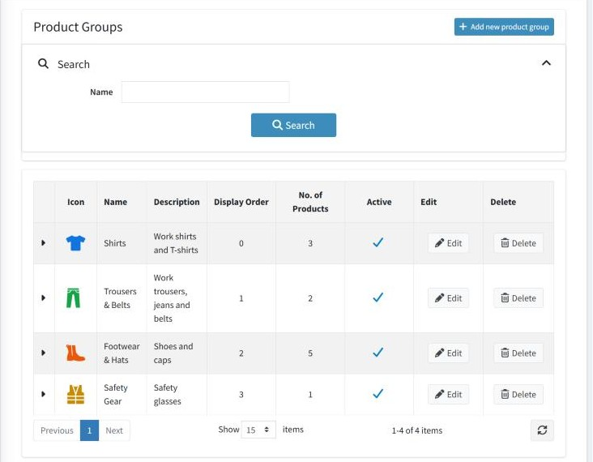

**Add new product group** opens the form: name, description, **icon** (*Choose Icon* opens a picker of uniform and
workwear icons), **colour** (the icon's colour in the shop), display order and *Active*. After the first save, **Add
product** opens a search window where products are ticked and saved into the group.

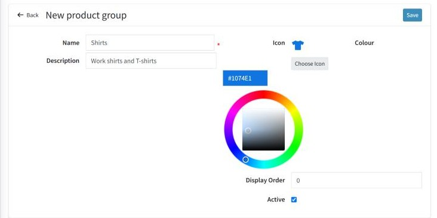

### 5.2 Subsidies

The **Subsidies** tab lists the store's subsidies with their period, *Credit Allocation* (the general money per
person), *Allocated Staff* (people assigned), *$Value* (general money × people) and *% Used*. *% Used* reads "—" for a
subsidy outside its period.

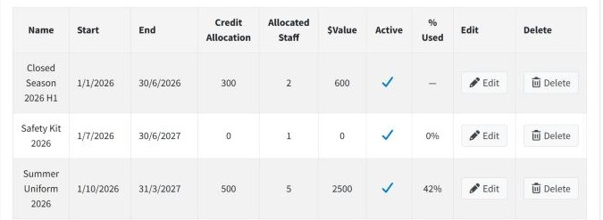

**Add new subsidy** (or *Edit*) opens the subsidy. Some options appear only when they make sense:

- *Include Managers* is shown only with *View Only Allocated Products* ticked.
- *Restrict To Allocated Qty* is shown only while *View Only Allocated Products* is ticked, *Order Outside Period* is
  not, and *Credit Allocation* is 0. Typing a credit amount while it is ticked asks for confirmation: confirming
  turns the limit off, cancelling puts the credit back to 0.

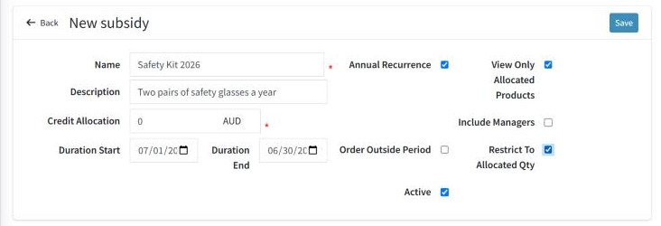

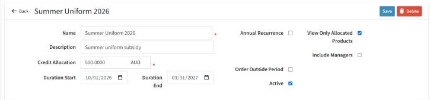

Both dates are required and the end must be after the start. Money is between 0 and 1,000,000.

### 5.3 What each product group gives

Under the subsidy, **Product Groups** lists the groups it uses. **Add product group** ticks groups in; then **Edit**
on a row sets that group's **Quantity** (units) and **Credit** (group money) for this subsidy, and its display order
in the shop.

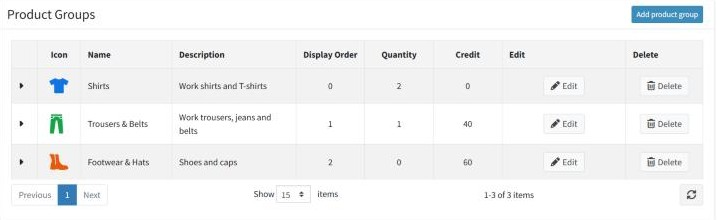

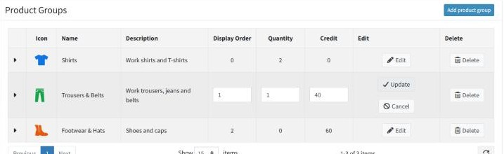

### 5.4 Who gets the subsidy

Under the subsidy, **PackNames** lists the people who have it, with their branch, department, *% Used* and whether
the assignment is active. **Add packName** opens a search window (name, e-mail, gender, type, branch, department, cost
centre, and *Show packNames without subsidy*); tick the people and save.

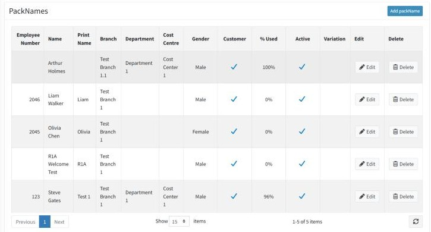

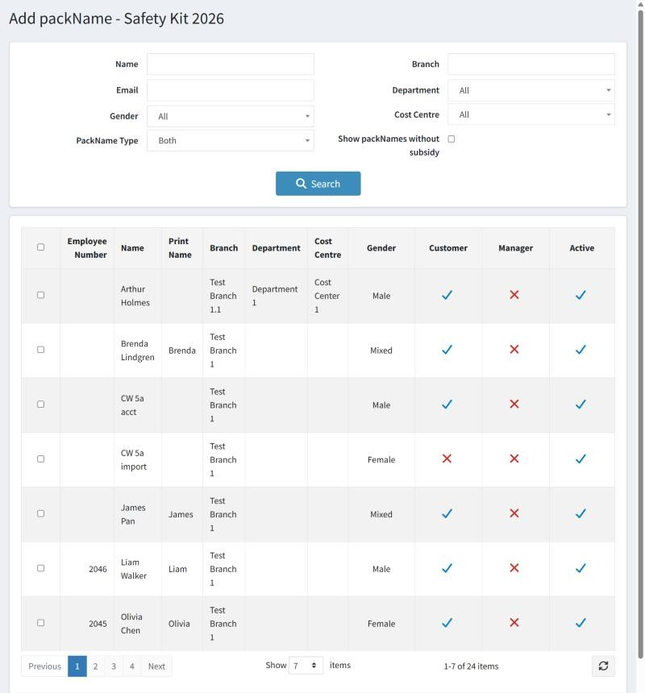

### 5.5 Top-ups and variations

From a person's subsidy panel (§5.6):

- **Topup Credit › Change** adds general money to this person for the current period — or, before the period starts,
  for the coming one. The reason is required. After a one-off subsidy has ended the link reads "closed".

  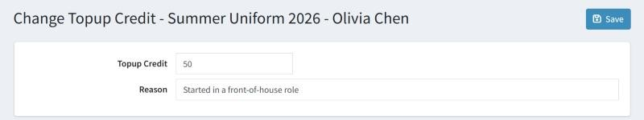

- **Edit** on a product-group row adds units and/or money to that group for this person, on the same terms.
- **Credit Allocation › Change** (or **Start / End › Change**) opens the **variation**: a different amount and/or
  different dates for this person, with a reason. *Credit* is offered when the store allows packnames their own value,
  the dates when it allows their own dates. Enter both dates or neither. The variation can also be opened from the
  subsidy's **PackNames** list (*Edit*).

  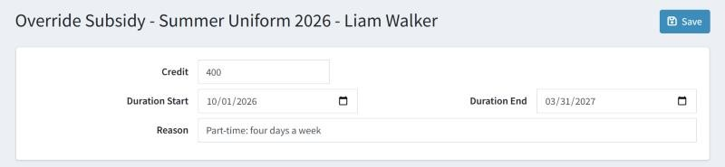

### 5.6 A person's subsidy panel

Open a packname (Manage Store › **PackNames**) or the customer's page. The **Subsidies** card shows one block per
subsidy the person has, whether its period is open or not, so a season can be prepared before it starts:

- **Subsidy Info** — the general money (*Credit Allocation*, *Topup Credit*, *Total Credit*, *Used Credit*,
  *Remaining Credit*), units (*Total Units*, *Used Units*, *Remaining Units*), the period and the subsidy's options. *% Used* is the general money used (or the units
  used when the subsidy gives no money), and reads "—" outside the period.
- **Product Groups** — per group: what the subsidy gives, the top-ups, and what has been used.
- **Subsidy History** — every assignment, allocation, top-up, variation, order and return, with who did it and why.

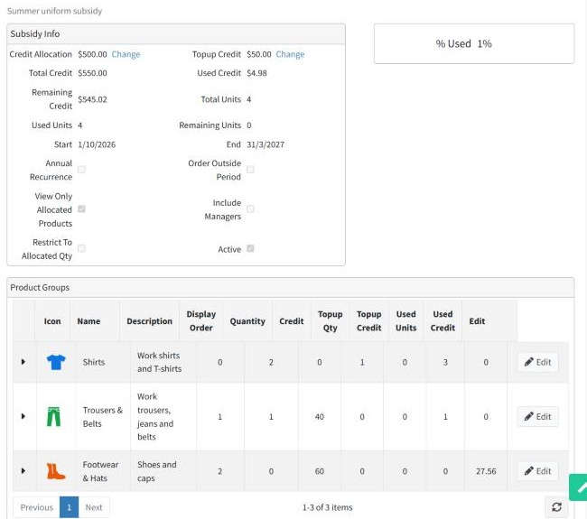

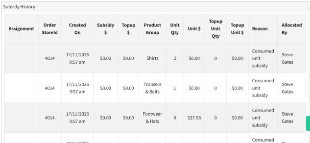

*Olivia's panel after the scenarios of §10: $500 + a $50 top-up, $4.98 used on delivery, 4 units (2 shirts + 1 extra
shirt + 1 pair of trousers) all used, and $27.56 of the $60 footwear money used.*

On the customer's page the card is shown only to administrators who can manage stores.

### 5.7 The order page

On a packname order, the **Info** card shows the *Total before subsidy and credit*, then *Subsidy (items)* and
*Subsidy (shipping)*, then the *Order total* (what the customer pays). The profit report counts what the subsidy paid
as part of the order's income.

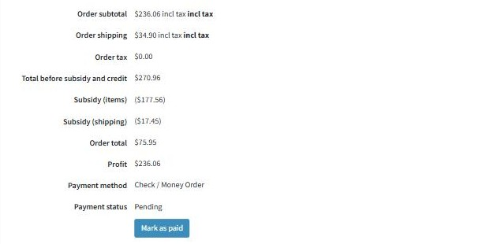

### 5.8 Reminders

*Promotions › Reminders* has a subsidy card below nopCommerce's own reminders (§9.2).

---

## 6. The manager's journey, screen by screen

A manager picks a person in the **Order for** selector (see the *PackNames* guide). From then on the shop shows
**that person's** catalogue and subsidy.

### 6.1 The subsidy catalogue

The subsidy catalogue (the shop can be set to open it straight after signing in or picking a person, §11) shows the
person's subsidy bar and, below it, every product they can choose, grouped by product group.

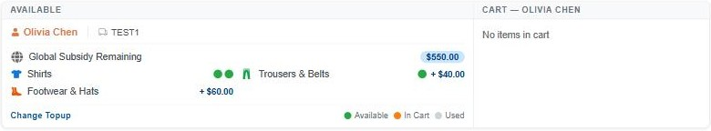

**Available** (left) shows:

- **Global Subsidy Remaining** — the general money left (here $500 + the $50 top-up);
- each **product group**: its free units as **dots** (one per unit; with more than six units, three numbers instead)
  and its group money left ("+ $40.00");
- the colour key: **green** = available, **orange** = in the cart, **grey** = used.

**Cart — *person*** (right) shows what the cart already takes from each group. The bar updates as products are added:

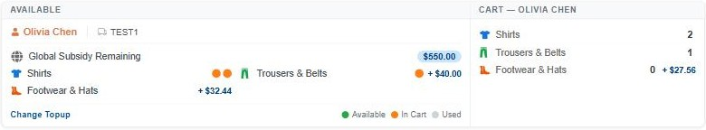

Each product group is a block of products, its header showing the same dots and money. A group whose units and money
are used up, with no general money left, is marked **Completed**.

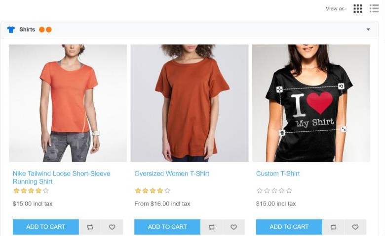

### 6.2 The subsidy button in the strip

On every other page, the strip under the header has a subsidy button (on the right). It opens a small panel with the
same figures and a link to the full subsidy catalogue.

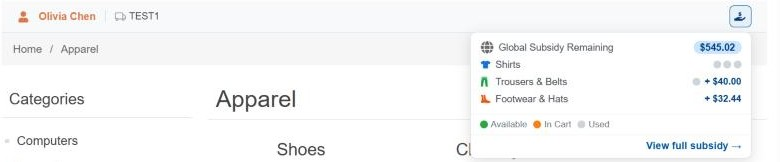

### 6.3 Topping up from the shop

When the store allows it (§11), **Change Topup** on the bar opens **Manage Topup** for the person being ordered for:
each current subsidy with its general money and top-ups, and each product group with its units, money and top-ups.

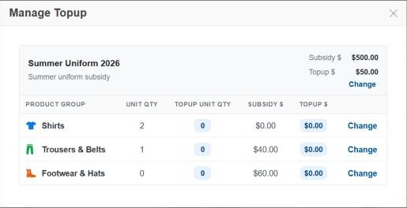

**Change** opens a small form: the amount to **add** (money, or units and/or money for a group) and a required reason.

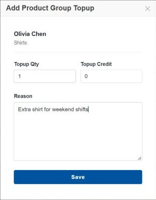

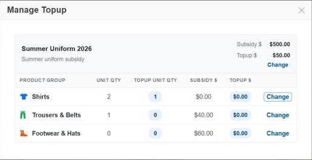

A manager can top up only people they manage. *Manage Topup* lists every subsidy the person has that can still be
topped up — including one whose period has not started yet, so a season can be prepared ahead.

### 6.4 The quantity limit

When a subsidy limits the cart to its units (§2.7), adding more is refused with a message saying how many are left:

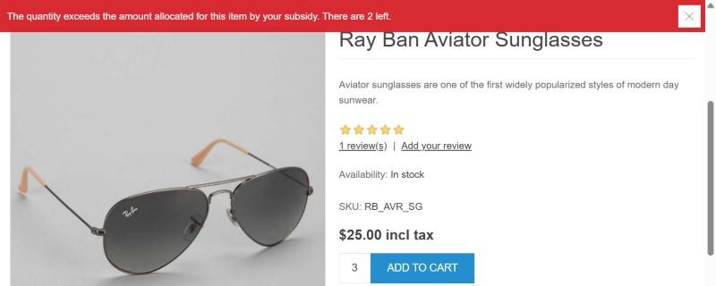

The same check runs again when the order is placed, so two managers ordering for the same person cannot both use the
last units.

### 6.5 The checkout

On the packname checkout every line shows what the subsidy pays for it, under its price: the group's icon and **"N
items"** for units, or the amount for money ("−$27.56"). A globe icon means general money. A packname box shows
*Shipping covered by subsidy* when the subsidy pays its delivery.

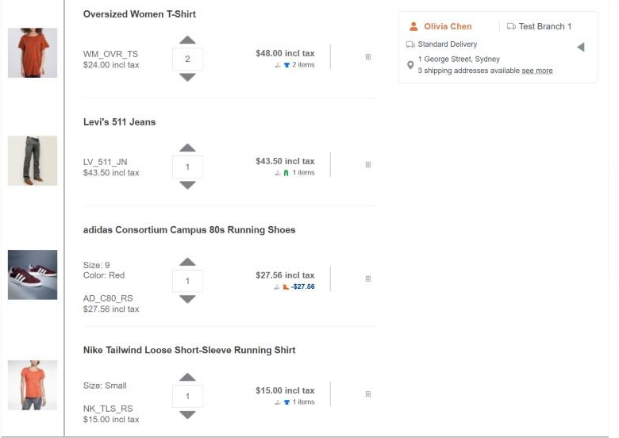

The **Order summary** shows the total at full price, then what the subsidy pays (the arrow opens the split between
items and shipping), then the **Payable balance**:

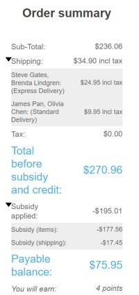

When the subsidy pays everything, the payable balance is $0.00 and there is **no payment step**:

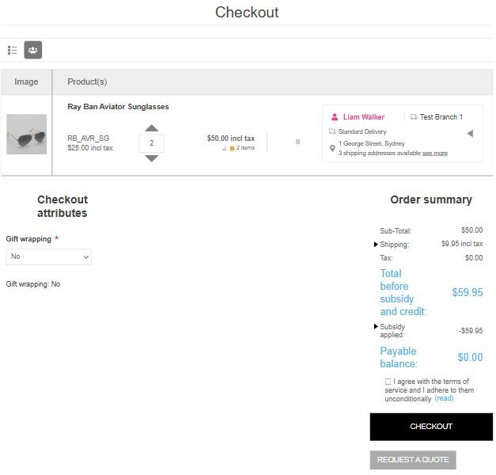

### 6.6 The order page

The customer's order page shows the same rows in the order the money moved, and each line keeps its subsidy note:

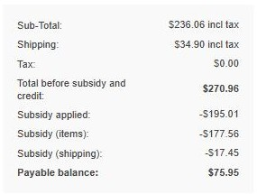

### 6.7 When someone's ordering is closed

A person whose subsidy period is over (and whose subsidy does not allow ordering outside it) is greyed out in the
selector, with the tooltip "Ordering is closed for this packname." Anything already in the cart for them is **put
aside, not deleted**: it comes back if the period opens again or they get a new subsidy.

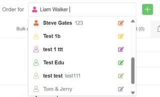

### 6.8 Adding people with a subsidy

When the store allows it, the manager's **Add / Edit packname** form and the Excel import also assign subsidies (see
the *PackNames* guide, §6.4 and §6.8). The new person's welcome e-mail lists their subsidies (§9.1).

---

## 7. The employee's journey

### 7.1 Shopping

An employee with their own account signs in and orders for themselves: there is no selector, only their name in the
strip and the subsidy button. Everything in §6.1, §6.2, §6.4 and §6.5 applies to them in the same way. They cannot
top themselves up.

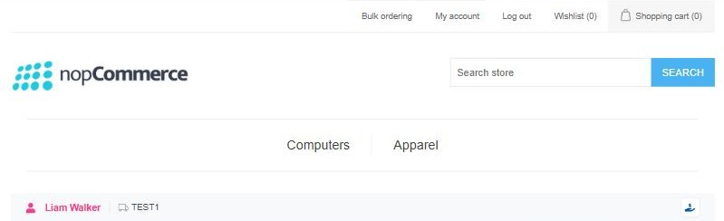

### 7.2 My account › Subsidies

*My account › Subsidies* shows one card per subsidy the person has. A manager sees the page of the person currently
selected, with a note saying so.

- The **status**: *Open until 31/3/2027*, *Open until 30/6/2027 · resets every year*, *Opens …* (not started yet) or
  *Closed since …*.
- The big figure: the **general money remaining to spend** — or, for a subsidy with no money, the **units** remaining —
  with a bar of *Used* against *Total* and how the total is made up (credit + top-up).
- A table per **product group**: units left, used and total; group money left, used and total ("—" where the group gives
  none).

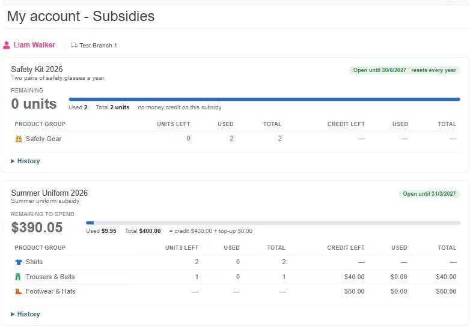

### 7.3 The history

**History** opens the list of everything behind the figures, newest first: orders (per group, and delivery), top-ups
(by whom, and why), allocations, variations ("Credit or dates changed by …") and returns ("Return on order #… — given
back"). Earlier periods of a yearly subsidy are under *Earlier seasons*, each with its own dates and totals.

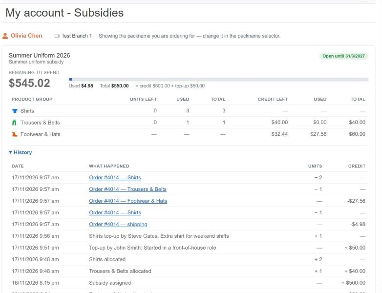

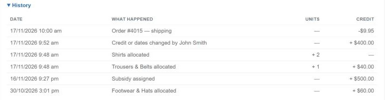

*An order number is a link only when the order is in the reader's own account. Liam's order #4015 was placed by his
manager, so on Liam's page it is plain text.*

---

## 8. What happens to the money

### 8.1 At checkout

For each person in the order, the subsidy pays **line by line**:

1. **Units** of the product's groups (original, then top-ups). A unit pays the **whole line price** of one garment,
   whatever it costs.
2. **Group money** of the product's groups (original, then top-ups).
3. **General money** of the subsidy (the original amount or the person's variation, then top-ups).

When a person has **several subsidies**, the units of all of them are used first; then the money of each subsidy in
turn (its group money, then its general money), then the next subsidy's.

Then **delivery**, when the store includes it (§11): only **general money** pays it, after the goods. When people share
a parcel (same address and method), each pays their share of the one delivery charge.

What the subsidy does not cover is paid by **store credit**, and the rest by the customer. The customer's own
**discounts** are taken off only their share: they never reduce what the subsidy pays.

> **Example (order #4014, §10 scenario A).** Olivia's 2 T-shirts ($48.00) used 2 shirt units; her jeans ($43.50) used
> the 1 trousers unit; her shoes ($27.56) used footwear money; her running shirt ($15.00) used the shirt unit added by
> the top-up; her half of the shared delivery ($4.98) used general money. The order: total before subsidy $270.96,
> subsidy on items $177.56, on shipping $17.45, **payable $75.95**. Olivia's share was $134.06 on items and $4.98 on
> delivery; the other $43.50 on items and $12.47 on delivery came from Steve's own subsidy (his jeans used his own
> trousers unit), and James's and Brenda's lines had no subsidy.

### 8.2 When an order is cancelled

Cancelling an order gives back **everything it used** — units, group money, general money, delivery — at once, into
the period of the original order.

### 8.3 When an item is returned

An approved return gives back **what was spent, in the same form**: a unit comes back as a unit to the same group,
money to the same pot. Delivery paid by subsidy is not given back (the parcel was shipped). An item from an earlier
period gives its entitlement back to that earlier period, so nothing becomes spendable. The details, with examples,
are in the *Returns, Exchanges and Store Credit* guide, §8.2.

### 8.4 Where the subsidy is shown

The checkout, the thank-you page, the customer's order page, the order e-mail, the invoice (PDF) and the admin order
page all show the same rows, in the order the money moved: *Total before subsidy and credit*, *Subsidy applied*
(*items* and *shipping*), *Store credit*, the customer's discounts and fees, and the *Payable balance*.

---

## 9. E-mails and reminders

### 9.1 The welcome e-mail

A person created **with an account** by a manager or an import receives a welcome e-mail that lists each subsidy with
its period, its money (general and group money together) and its free units ("3 items"), and a link to set their
password. In the example below the subsidy had only general money at the time.

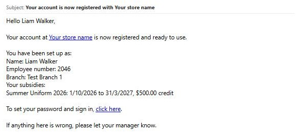

### 9.2 Subsidy expiry reminders

*Promotions › Reminders* has a subsidy card below nopCommerce's own three. When **Subsidy expiry reminders enabled** is
ticked, up to three e-mails are sent **before the end of the period**: by default **30 days**, **7 days** and **1 day**
before. Each follow-up can be switched off or given another time, in hours or days, as long as #1 comes first and #3
last.

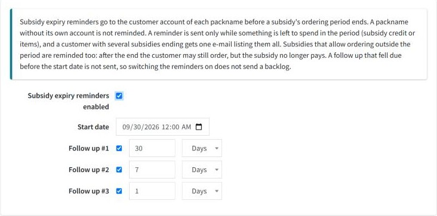

| Rule | What it means |
|---|---|
| **Who** | Only people with **their own account** and e-mail. People without an account, and managers about other people, are not reminded |
| **Only when something is left** | No reminder for a subsidy with nothing left to spend |
| **One e-mail per person** | Several subsidies ending at the same time are listed in one e-mail (subsidy, person, last day, days left, what is left) |
| **No backlog** | A reminder that fell due before the **start date** is not sent, so switching the reminders on never sends old ones |
| **Each follow-up once** | Per subsidy and per period; a yearly subsidy starts again from #1 the next year |
| **Within the hour** | The reminders are checked every hour |
| **Ordering outside the period** | Subsidies that allow it are reminded too: after the end the person can still order, but the subsidy no longer pays |

The three e-mails ("Your subsidy at *store* ends soon", "…ends in *n* day(s)", "Last reminder: …") can be edited in
*Content management › Message templates*. The switch and the start date can be set per store; the three follow-up
times apply to every store. Reminders are off until switched on. If several follow-ups are already due (for example, a
subsidy assigned two days before it ends), only the latest is sent.

### 9.3 Other e-mails

The order e-mails (placed, shipped, …) are nopCommerce's own, with the subsidy rows in their totals.

---

## 10. Worked scenarios from the test store

The test data: product groups **Shirts** (2 T-shirts and a running shirt), **Trousers & Belts** (jeans, belt),
**Footwear & Hats** and **Safety Gear** (safety glasses). **Summer Uniform 2026** (1/10/2026 – 31/3/2027, $500 general
money, view only allocated products; Shirts 2 units, Trousers & Belts 1 unit + $40, Footwear & Hats $60) is assigned
to Steve Gates (manager), Olivia Chen, Liam Walker and others. **Safety Kit 2026** (1 July – 30 June every year, no
money, Safety Gear 2 units, quantity limit on) is assigned to Liam. Delivery is included in the subsidy.

| # | Situation | What happened |
|---|---|---|
| A | **A manager orders for Olivia** | An administrator topped Olivia up by $50 ("Started in a front-of-house role"). Steve picked Olivia: her bar showed $550, 2 shirt dots, 1 trousers dot + $40, + $60 footwear, and her menu shrank to the categories of her subsidy. He added 2 T-shirts, jeans and shoes; the dots turned orange. (His own jeans, already in the cart, used his own trousers unit.) From the bar he added one more shirt unit ("Extra shirt for weekend shifts") and a running shirt. At checkout her lines showed "2 items", "1 items", "−$27.56", "1 items". The same order also held lines for Steve, James Pan and Brenda Lindgren. Order **#4014**: total $270.96, subsidy $177.56 on items and $17.45 on delivery, **payable $75.95** |
| B | **A variation** | Liam works part-time: an administrator gave him a variation of **$400** instead of $500 ("Part-time: four days a week"). His bar showed $400; his history "Credit or dates changed by John Smith" |
| C | **The quantity limit** | For Liam, Steve tried to add **3** pairs of safety glasses: refused, "There are 2 left". Two were accepted |
| D | **An order paid wholly by subsidy** | Liam's 2 glasses ($50.00) used his 2 Safety Gear units, and his delivery ($9.95) came from Summer Uniform's general money. Payable **$0.00**, no payment step. Order **#4015** |
| E | **The employee's view** | Signed in as Liam: no selector; *My account › Subsidies* showed *Safety Kit 2026* "Open until 30/6/2027 · resets every year", **0 units** left, and *Summer Uniform 2026* with **$390.05** to spend. Order #4015 is in Steve's account, so on Liam's page it is plain text |
| F | **Ordering closed** | *Tom & Jerry* has only *Closed Season 2026 H1* (ended 30/6/2026, no ordering outside the period): greyed out in Steve's selector, "Ordering is closed for this packname" |

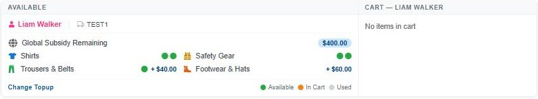

*Liam's bar before scenario C: the general money of Summer Uniform after his variation, and the groups of both his
subsidies — including Safety Gear's two units.*

---

## 11. Configuration

### 11.1 Where

- **Per store:** *CW Admin › MultiStores › Manage Store › Store Settings*. Tick the box on the left of a row to give
  the store its own value; unticked rows use the default.
- **Defaults for all stores:** *CW Admin › Default Settings*.
- **Reminders:** *Promotions › Reminders* (§9.2).

### 11.2 The settings

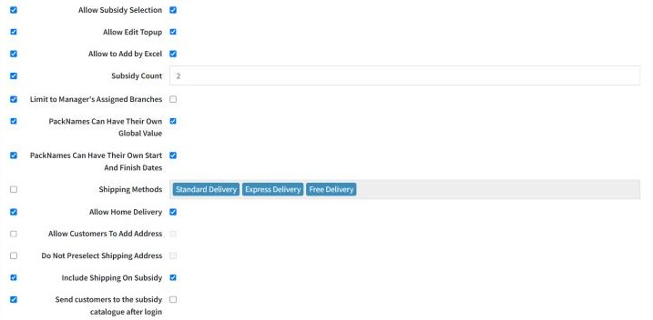

| Setting | What it does | Test store |
|---|---|---|
| **Enable Subsidy** (section *Subsidy*) | Switches the whole subsidy system on for the store. Needs PackNames on too. Off: no subsidy is offered, restricted or paid; orders already placed keep their subsidy | On |
| **Allow Subsidy Selection** | Managers can tick subsidies on the shop's *Add / Edit packname* form. Shown under *Allow Managers to Add PackNames*. The manager's Excel template has subsidy columns when *Allow to Add by Excel* is also on | On |
| **Allow Edit Topup** (under the above) | Managers can top people up from the shop (§6.3). Needs *Allow Subsidy Selection* and *Allow Managers to Add PackNames* too: unticking either one switches it off | On |
| **Subsidy Count** | How many subsidy columns the manager's Excel template has (1 to 10). Shown under *Allow to Add by Excel* | 2 |
| **PackNames Can Have Their Own Global Value** | Variations can change a person's general money | On |
| **PackNames Can Have Their Own Start And Finish Dates** | Variations can change a person's dates | On |
| **Include Shipping On Subsidy** | General money also pays delivery, after the goods | On |
| **Send customers to the subsidy catalogue after login** | After signing in, picking a person or being impersonated, the shop opens the subsidy catalogue when the person has subsidy product groups | Off |

The options of each subsidy (period, restrictions, recurrence…) are on the subsidy itself (§2.2).

---

## 12. Things to know, and open points

**How it works today**

1. **The subsidy is the person's.** A manager's own subsidy pays only for the manager's own garments.
2. **A unit pays a whole garment**, whatever its price. Units are always used before money.
3. **Top-ups belong to one period** and do not carry over. A top-up made before a period starts counts for that
   period. A yearly subsidy starts each period from its original amounts.
4. **Top-ups only add.** To reduce someone's subsidy, use a variation. Removing the subsidy from a person and assigning
   it again clears their top-ups and their variation; what they have already spent in this period stays spent.
5. **What is left at the end of a period is lost.** Reminders (§9.2) help people use it in time.
6. **Only general money pays delivery**, and only when the store includes delivery.
7. **Discounts never reduce the subsidy.** They come off the customer's share only.
8. **A closed period hides everything.** For a person with no open subsidy (and no ordering outside the period) the
   shop is empty and their cart lines are put aside, not deleted.
9. **Several subsidies**: the person sees only allocated products only when *all* their current subsidies say so; a
   quantity limit on a product is decided only by the subsidies that contain that product.
10. **The figures in admin and in My account are the general money.** *Used Credit*, *Remaining Credit* and *% Used*
    on the panel, and the big figure in My account, are the subsidy's general money. Group money is in the product-group
    table.
11. **Deactivating a product group** stops it paying in every subsidy at once. Deleting a subsidy removes it from
    every person; their past orders keep what they used.
12. **Unpaid orders keep their subsidy** until they are cancelled.
13. **Editing a subsidy affects everyone at once.** Changing its money, units or dates during the period changes the
    entitlement of every person who has it; what they already spent stays spent.

**Open points**

14. **Subsidy history in admin**: the order column is labelled "Order StoreId", and money used from a product group
    is described as "Consumed unit subsidy".
15. **"N items"** under a checkout line is in English whatever the shop's language.

---

## 13. Quick reference

**Administrator**

- Everything is in *CW Admin › MultiStores › Manage Store*: **Product Groups** (groups and their products) and
  **Subsidies** (period, money, options, what each group gives, who gets it).
- New subsidy: product groups → subsidy → *Add product group* and set Quantity / Credit → *Add packName*.
- One person needs more this period (or the next, before it starts) → **top-up**; a different amount or dates →
  **variation** (packname panel).
- Quantity limit → a subsidy with **no general money**, *View Only Allocated Products* on, *Order Outside Period* off.
- Reminders → *Promotions › Reminders*.

**Manager**

- Pick the person in **Order for**; the bar shows what they have: **green** available, **orange** in the cart,
  **grey** used.
- **Change Topup** adds money or units for the person you are ordering for, with a reason.
- At checkout each line shows what the subsidy pays; the summary shows the *Payable balance*.

**Employee**

- *My account › Subsidies* shows what is left, per group, and the history.
- Spend it before the end date: what is left cannot be used afterwards.
